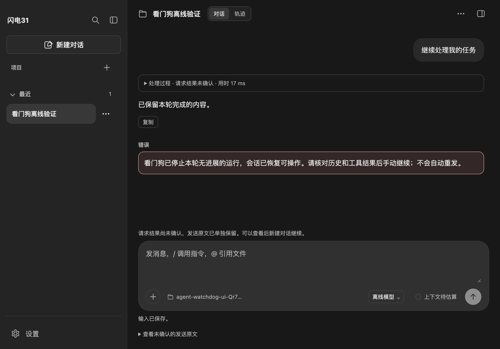

# Agent 看门狗

每次发送进入 Pi 执行阶段后，主进程启动看门狗。连续 **10 分钟没有新输出或工具进展**时，请求停止当前父任务及其子任务。持续有进展的任务不受总运行时长限制。

## 进展与等待

- 文本、可见思考、工具执行事件、SDK 生命周期状态和子智能体事件重置无进展计时；仅队列变化不算进展。
- 等待桌面扩展的确认、选择、输入或编辑弹窗时暂停处置；用户完成交互后重新计算十分钟。
- 正常完成、异常结束和主动停止均清理本轮计时，不影响下一次请求。

## 停止与恢复

1. 超时只发出一次取消请求，提示正在停止；已经完成的内容保留。
2. 等待 Pi 及子任务停止后释放运行锁，页面恢复操作，提示核对历史和工具结果后手动继续。
3. 超时运行的发送快照保留为“待确认”，不自动回填或重发，不自动发送队列中的下一条。可通过输入区的原文查看及二次确认入口处理，或新建对话。
4. 请求异常时同样先中止遗留父子链路，再恢复页面操作；不增加自动模型重试，也不覆盖 Pi 自身重试配置。
5. 请求停止三十秒后仍未退出，提示“停止未确认”并继续保留互斥锁。取消报错也保留锁，不启动另一个可能重复写入的任务；没有后台取消重试。

应用异常退出后，下次启动沿用已有会话恢复规则，核对真实工作目录和历史绑定。有未确认发送快照时额外提示先核对结果；不重建缺失历史，不自动续跑。可恢复内容仅限已经落盘的历史、输入和快照，不能把“进程退出”推断为外部操作未生效。

## 边界

看门狗运行于 Electron 主进程，覆盖开始执行后的 Agent 请求。它不能在主进程自身卡死或退出后继续运行，也不强制杀死不响应取消的外部进程。此时应先检查外部任务状态；如需强制结束应用，只保证已确认落盘的内容，重启后仍须核对结果。

初始化、工作区快照、输入持久化和独立的手动上下文整理不属于本次无进展计时范围。静默运行超过十分钟的工具也会触发停止；看门狗无法仅凭没有输出证明工具已经卡死。

## 验证

- `node --test tests/unit/agent-watchdog.test.js tests/unit/chat-service.test.js tests/unit/chat-draft-lifecycle.test.js tests/unit/chat-workspace-changes.test.js tests/unit/extension-ui-bridge.test.js tests/unit/session-service.test.js tests/unit/subagents.test.js tests/unit/pi-desktop-runtime.test.js tests/unit/pi-output-runtime.test.js`
- `node_modules/.bin/electron tests/ui/agent-watchdog.check.cjs`
- 单元测试推进虚拟时间检查十分钟阈值、进展重置、用户等待、停止超时、取消失败及快照保护；子任务夹具使用真实 SDK 和内存 Provider 验证事件传递，不请求真实模型。
- 离线页面检查使用真实聊天服务和临时状态，注入到期信号，验证已有内容保留、恢复页面交互、快照保留和不重发。截图可通过 `WATCHDOG_SCREENSHOT_PATH` 指定输出位置。
- 未进行真实模型卡住、外部工具拒绝取消及主进程强制结束的人工验收，不能用离线检查代替这些结论。

