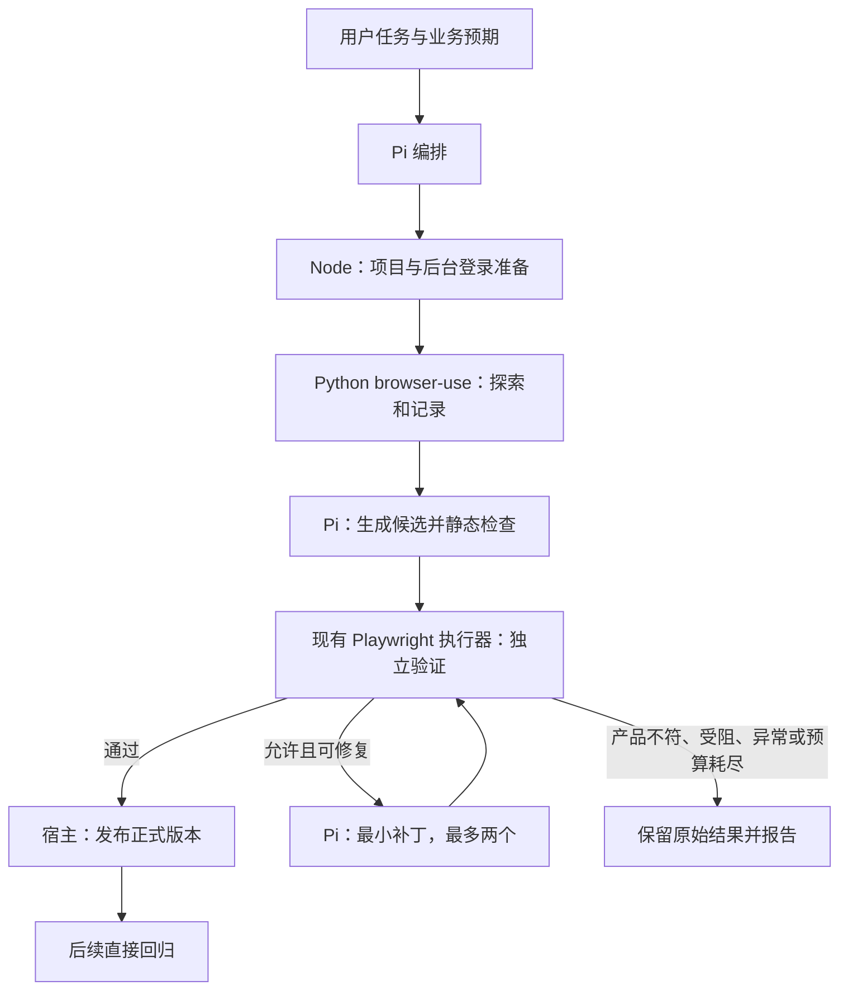

# browser-use 探索与 Playwright 自动化测试实施方案

修订日期：2026-11-09（Asia/Shanghai）。

本文定义目标流程，已接入范围及待验事项以第 12 节进度和对应实现文档为准，不代表全部功能已完成。最终直接替换旧 UI 测试链路，不迁移旧资产、不兼容旧录制格式、不保留双轨入口。旧数据留在磁盘，不作为新流程的输入。

## 1. 目标与实施取舍

主流程为：**browser-use 探索真实页面 → Pi 生成 Playwright 候选 → Playwright 独立执行 → 通过后发布正式版本**。

后续回归直接运行正式 Playwright 用例。只有任务允许修复时，才在失败后调用 AI 诊断并生成新候选。

### 1.1 首版保留

- Electron、原生 DOM 渲染层、Pi SDK 1.4.0 和官方资源加载方式。
- 当前 Playwright 1.64.1、独立执行器、后台登录、私有登录态及原生 JSON/HTML 报告。
- 当前项目配置与 Pi 官方模型配置，不新增凭据配置体系。
- 必要的来源、业务断言、版本哈希、执行结果和错误证据。
- 单 worker、Playwright 零自动重试，以及项目已有异常停止规则。

### 1.2 首版直接去掉

- 官方 Test MCP 逐动作录制、seed 测试、generator 日志与对应登记门槛。
- 固定七步流程、独立意图识别和完整提示词补全产物。
- 每一步都调用一次外层 AI 验证，以及每次任务固定进行独立 AI 审查。
- 旧目录读取、旧资产兼容、旧元数据解析和旧工具别名。
- 人工登录接管、跨角色完整审批编排、并行执行。
- 自动清理、证据引用图、通用工作流引擎、数据库、细粒度成本仪表盘。

必要检查落在已有宿主工具和执行器中，不再为每条规则建立独立服务或审批阶段。

## 2. 支持范围与任务入口

首版支持 Chromium 中的导航、点击、输入、常规下拉框、列表筛选、分页、详情和常规弹窗。新增、编辑、删除仅在测试数据可独立准备且操作已获授权时支持。

Canvas、坐标驱动操作、复杂拖拽、特殊编辑器、复杂 iframe、跨站认证和完整多角色审批不作为首版通用能力。遇到这些场景，报告具体受阻步骤，不靠临时坐标或猜测路径登记正式用例。验证码、MFA、认证失效返回 blocked。

| 用户任务 | 实际执行 | 交付 |
| --- | --- | --- |
| 只探索 | 只探索和记录 | 真实轨迹及发现，不生成或运行脚本 |
| 只生成候选 | 探索、生成、静态检查 | 候选和未验证说明，不运行候选 |
| 生成可回放用例／完整测试 | 探索、生成、独立验证；允许范围内定向修复 | 正式版本或未解决候选、原始结果 |
| 执行已有用例 | 只执行正式版本，不修改资产 | 回归报告 |
| 执行并修复 | 执行正式版本；可修复失败生成候选并验证 | 原始失败、新验证结果及正式版本更新 |
| 仅分析或设计 | 只交付分析或设计 | 不启动浏览器、不写测试资产 |

任务语义由 Pi 在同一轮理解并写入任务约定，不再先调用一个专门的意图识别技能。用户明确要求“只生成”或“只执行”时，遵循其范围；含糊的“录制”按生成候选处理，不自动扩大为业务回放。

## 3. 简化后的架构



| 模块 | 职责 |
| --- | --- |
| Pi | 明确任务、生成候选、诊断和修复、交付结论 |
| Node 适配层 | 项目和登录准备、Python 进程、取消、候选保存与正式发布 |
| browser-use | 独占探索浏览器，观察页面、决定动作并返回真实记录 |
| Playwright 执行器 | 在新上下文和声明初态下执行指定版本，生成原生报告 |
| 现有数据／报告服务 | 用例列表、版本与报告读取、必要的删除检查 |

同一工作区首版只允许一个 UI 探索或执行任务活动，沿用现有串行执行方式；不用“单 worker”代替跨聊天的任务互斥。取消不等待任务锁。任务不支持跨应用重启自动续跑，重开后只读已有结果，不自动重放。

## 4. browser-use 接入前先完成的小验证

本节列出接入前的验证条件，不预先承诺兼容所有 Pi 模型。当前验证结果、实际版本和依赖锁见 [小验证记录](browser-use-smoke.md)。先在独立环境完成下表，再把验证过的版本、依赖锁和调用示例固定到运行时资源中。

| 验证项 | 必须确认的结果 |
| --- | --- |
| Python 与 browser-use | 固定版本可安装、启动；仅使用该版本公开接口 |
| 模型 | 一种选定模型可完成观察和动作决策，确认视觉／结构化输出需求 |
| 轨迹 | 能取得实际动作、动作前目标依据、执行结果和证据关联 |
| 定位依据 | 同名按钮能关联业务行；临时元素编号能对应当时观察中的稳定信息 |
| 登录态 | 现有后台登录导出的状态可交接；探索与回放的实际身份一致 |
| 异常与取消 | 意外工具错误可及时结束链路，取消能确认进程和浏览器收尾 |
| 内部行为 | 核对多动作步骤、自动重试、失败纠偏和默认历史／截图输出 |
| 浏览器 | 验证是否能使用现有 Chromium；不能则固定独立版本并记录原因 |

轨迹只有动作名和临时元素编号、缺少稳定目标信息时，先补足公开接口下的必要采集；补不齐就缩小支持范围，不依赖未公开内部对象。此验证未通过前，不批量重写现有执行和界面代码。

开发期使用独立 Python 环境；发布准备阶段随客户端提供对应平台运行时。只准备当前目标平台，不把跨平台自动安装器列为首版前提。

2026-11-06 补充：用户已批准维护最小依赖补丁版 0.13.14+swqa.1，增加公开的启动次数、自动重连和默认截图开关；受控场景已验证。宿主只使用该补丁版的公开接口，不手改安装包或注入私有对象；上游来源、可复现构建、锁定和维护边界见 [补丁运行时](browser-use-runtime-gaps.md)。这不表示后续正式工具、资产与界面阶段已经完成。

## 5. 任务约定与探索记录

### 5.1 一份任务约定

开始前保存目标、执行模式、项目与目标 URL、角色、操作范围、业务预期及来源、数据准备方式、预算。不重复保存一份改写后的长提示词。修复已有用例时建立本次任务并引用原 revision 和失败 run，沿用原业务预期；不要求重新探索才能创建修复任务。

配置与页面能确定的内容直接使用；目标冲突、预期冲突、写操作授权不明才澄清。指定场景只探索该场景，只有用户要求全页面覆盖时才做完整功能盘点。

预期来源按用户要求、明确业务规则、已声明基线记录。“这次页面显示了什么”只是观察，不能自动成为正确性依据。来源不足时可生成候选或验证交互一致性，但报告必须说明边界，不能宣称业务正确。

### 5.2 记录必要事实

每次实际动作记录 `stepId`、页面 URL、页面／frame 标识（涉及时）、动作、脱敏参数、动作前目标依据、结果、时间和必要证据引用。

目标依据优先保留可访问角色与名称、label、稳定属性、所属业务行或容器。临时元素编号只关联本次观察。页面改变后重新观察；导航、查询完成、弹窗出现和提交结果等关键节点需要核实，不为每个动作再增加一次外层 AI 调用。

错误入口、返回和探索绕路保留在原始轨迹中，候选只提取实现目标所需的路径。探索没能完成目标时保留事实，不补写“成功路径”。

### 5.3 最小进程协议

通过标准输入／输出的 JSON Lines 交接，不增加 HTTP 服务。Node 发 `start`、`cancel`；Python 发 `progress`、`action`、`done`、`error`。消息包含 `taskId`，动作包含 `stepId`；证据写任务目录，消息只返回必要摘要与相对路径，诊断日志使用 stderr。

凭据由宿主通过独立的内存启动消息交接，该消息不进入任务文件或日志。收到 `done` 仍需检查进程退出与输出完整性；意外退出不冒充成功。取消先请求正常收尾，5 秒未结束再终止进程及所属浏览器；无法确认收尾则报告状态未知，不自动重启。

### 5.4 模型和登录

探索模型使用 Pi 官方模型配置中的明确 provider/model 引用。首版只适配小验证通过的一种调用方式；OAuth、订阅认证、自定义 Provider 等只有单独验证后才加入支持范围，不把 Pi 模型对象直接传入 Python。

认证通过官方 `ModelRuntime` 的公开接口取得；不直接解析真实认证文件，不使用标为内部兼容用途的接口。Python 使用模型所需的必要参数，不能继承整份认证配置。选定模型不受支持时直接说明，不自动换供应商或模型。

目标网站继续使用现有项目配置和后台登录实现，不向模型暴露账号密码。公开页面跳过登录，认证失败结束为 blocked。删除手动 start/complete 接管入口，保留私有临时状态、角色核实和退出清理。若 Python 与回放端状态格式不同，做明确的格式转换并测试，不假定文件可直接互用。

## 6. 生成与独立验证

### 6.1 候选内容与轻量检查

一条 case 对应一个 Playwright `test`，同文件内可定义 fixture 和数据准备逻辑。首版用例自包含，不建设跨用例 helper 库；需要共享执行逻辑时再显式纳入版本和影响范围。

Pi 根据真实轨迹生成 `case.spec.cjs` 和 `case.json`。后者是唯一权威用例说明，包含稳定 caseId、标题、项目、模块、目标 URL、角色、步骤、预期与来源、数据策略、初态及清理说明、探索任务和步骤引用。界面或导出文档从它生成，不再维护 Markdown 内嵌 JSON、说明表和 asset 三套相同内容。

保存候选时由宿主执行语法检查、字段和来源引用检查，并检查跳过测试、固定睡眠、临时 ref 和明显凭据误写。每例要求至少一条标明来源的业务断言；修复候选中的预期字段须与本次任务冻结的原预期一致。简单规则检查只负责发现明显问题，不声称能证明任意 JavaScript 的业务语义；最终行为由回放确认。

### 6.2 脚本规则

- 单目标操作优先使用稳定测试属性、role/name、label 或业务容器内的稳定定位器；同名按钮按业务行限定。集合断言允许匹配多个元素。
- 不使用临时元素编号、无依据的坐标、任意第一行或最新一条记录固化业务对象。
- 使用 Playwright 自动等待与明确业务信号；需要条件轮询时可用有界 `expect.poll`，不使用固定睡眠或无界循环。
- 业务断言与操作守卫分开，至少验证实际业务结果。列表测试使用已知输入或数据不变量；预期应有命中时，先断言确实有命中，避免空集合通过。
- 动态日期、数量和随机值来自本次数据或明确规则，不照抄探索时实际值。
- 不通过删除断言、吞异常、跳过测试或模糊扩大匹配获得通过。操作定位器和断言定位器可以不同，但必须关联同一业务目标。

### 6.3 初态与写操作

关闭探索浏览器后，创建新的回放上下文；业务数据必须另外准备，不能把换浏览器当成数据重置。

| 场景 | 实施要求 |
| --- | --- |
| 只读 | 使用明确、可重新定位的数据条件 |
| 新增 | 每次执行使用唯一业务标识，独立核对创建结果 |
| 编辑／删除 | 每次执行先准备本次专属且状态正确的数据 |
| 修复验证 | 使用新的数据或明确恢复后的初态，不复用上轮残留 |
| 初态无法建立 | 保留候选，不发布可重复执行的正式版本 |

数据准备可写在用例 fixture 中，使用已授权页面或已知测试接口，不新增通用造数平台。记录本次实际对象标识，正常完成后清理；清理失败单独报告。写入结果未知时先只读核对，不能自动重交或盲目清理。

### 6.4 发布条件

候选和正式回归共用 `run.cjs`，不新增第二套执行器。候选验证指定准确 revision，执行器检查并快照该版本，沿用原生 JSON/HTML、证据存在性与退出码检查。

只有所选每条 case 都有且仅有一个实际 passed 结果、退出码为 0、必要证据完整、文件未改变、初态与清理满足约定时，才允许发布。skipped、expected-failure、缺报告、结果未知不算通过。

正式发布由宿主读取原生结果及执行清单完成，不相信 AI 文本中的“已通过”。发布绑定 caseId、revision、runId、用例文件哈希与预期来源。只更新正式版本引用，不复制一份可漂移的正式脚本。

一次验证通过表示该版本在已记录条件下可执行，不承诺跨环境稳定性。真实业务验收仍单独记录。

## 7. 定向修复与异常处理

新用例完整验证流程可自动修复；已有用例仅在“执行并修复”任务中修复。独立 CLI 和定时回归只执行与报告，不调用模型、不修改版本。

| 失败类别 | 行为 |
| --- | --- |
| 定位器、等待条件、生成语法或明确的数据准备错误 | 有证据且初态可恢复时生成最小补丁 |
| 操作正确但产品结果违背固定业务预期 | 保留失败，报告疑似产品问题，不改预期 |
| 预期冲突、证据不足、身份不明 | 停止修复，说明缺少什么 |
| 工具／环境异常、提交结果未知 | 立即暂停相应链路，按仓库异常规则处理 |

每条 case 在一次任务中最多接受两个候选补丁，每个补丁只做一次定向验证。补丁只改变有证据的问题，预期保持不变；每次都保存新 revision 和新 run，不重复同条件失败操作，不靠新进程或新 taskId 重置任务预算。

脚本质量问题的定向验证是测试工作，不等于工具故障自动重试。对于意外工具异常，仅在明确前置条件已改变、操作可安全重复时，按仓库规则允许一次恢复验证；仍失败即停止并交付错误报告。新方案不覆盖 Pi 的原生模型重试设置，小验证须核对 browser-use 内部行为，避免其静默重交业务动作。

修复只读取固定预期、失败步骤、相关脚本、必要证据和数据初态，只修改测试资产，不修改被测业务代码。局部证据不足且允许继续时，再启动限定范围的 browser-use 观察，不重新探索全系统。不增加独立 AI 审批阶段；争议未解就保留未解决结果。

## 8. 目录、版本与状态

```text
qa/ui/
  tasks/<taskId>/
    task.json                 任务约定、阶段与结束状态
    actions.jsonl             有探索时保存原始动作记录
    evidence/                 关键节点和异常证据
    drafts/<caseId>/          Pi 编辑中的候选文件
  cases/<caseId>/
    asset.json                版本索引与当前正式版本引用
    revisions/0001/
      case.spec.cjs
      case.json
  runs/<runId>/
    task.json
    summary.json
    summary.md
    results.json
    html/
    sources/
    artifacts/
    manifest.json
```

任务目录同时承载新建用例和已有用例修复，修复不必启动探索浏览器。草稿可编辑；保存候选时冻结到新 revision。revision 中的脚本和说明不原地修改。`asset.json` 使用新的 `qa-ui-asset/v1` 结构，保存 caseId、版本条目、`currentRevision` 及可选的组织目录 `folder`；条目记录 revision、文件哈希和验证成功的 runId。未通过的结果从 runs 查询，不在索引中复制全部报告。

没有正式引用的用例显示 candidate，有正式引用显示 verified；同时可显示“有新候选”。回归失败不抹掉历史验证事实，界面单独展示最近执行结果。删除旧人工 verified/confirmed 工作流标记，首版不另建人工审核状态。

| 对象 | 状态 |
| --- | --- |
| 探索任务 | running、completed、blocked、failed、cancelled |
| 执行任务 | prepared、running，以及最终批次状态 |
| 最终批次 | passed、failed、incomplete、cancelled |

取消请求尚未完成时保留进行中状态并显示“取消中”；只有确认任务已停止才记 cancelled。崩溃后遗留 running 不自动重跑，读取时提示上次执行未完成。

同工作区任务串行，索引采用临时文件写完再替换即可，不引入多版本数据库或复杂事务。修复通过更新 currentRevision，失败不改变原正式引用。

旧 `qa/data/ui/cases`、`qa/ui/cases` 平铺文件、recordings 和旧格式运行结果全部退出新 UI 流程。新 UI 报告仍用 `qa-report/v1`，增加必填 `workflow: "browser-use-playwright"`；UI 列表只接收该标记，旧结果不读取、不转换。接口报告保持原有目录和契约。

## 9. 宿主工具与技能

新工具按业务操作设计，不保留旧工具名称的兼容转发：

| 工具 | 职责 |
| --- | --- |
| `qa_ui_explore` | 一次完成项目匹配、后台登录与运行时准备，执行 browser-use，返回 taskId 和轨迹摘要 |
| `qa_ui_save_candidate` | 从该任务的草稿保存新 revision，执行静态检查并登记哈希 |
| `qa_ui_run` | 执行准确版本；validate 可选候选，regression 只选正式版本；返回 runId 和结果 |
| `qa_ui_publish` | 核对指定验证 run 与 revision，一致且通过才更新正式引用 |

所有工具基于当前聊天实际工作区解析固定目录和项目归属；页面只传项目与对象编号，沿用现有路径边界校验。后台项目匹配、登录、执行作为共享实现保留，不再把 projectRef/loginId 暴露成必走的多步 Agent 交接。仅修复任务由 `qa_ui_save_candidate` 在首次保存时根据原 revision 和父 run 建立任务约定；后续补丁沿用该 taskId 和预算，不增加一个空跑浏览器的准备步骤。

`qa_ui_run` 与独立 `execute.cjs` 复用任务准备和执行实现。CLI 支持 `--project`、`--cases` 和 `--all` 等必要选择；一例一 test 后不再用 `--grep` 承担用例识别，也不增加 CLI 自动 AI 修复参数。移除绑定具体业务页面的 `--list-users`、`--user` 动态账号发现及对应测试密码逻辑；首版按项目已配置角色执行。

UI 技能收敛为三份：`qa-ui-basic` 负责约定、探索、生成和修复编排，`qa-ui-assertion` 统一断言规则，`qa-ui-execute` 负责已有用例执行。继续共用 `qa-test-report`。删除独立 `qa-ui-intent`、旧 `qa-ui-record`，不新增多个只做阶段转发的技能。

## 10. 报告、界面与采集

报告沿用 `qa-report/v1`，直接包含项目、模块、所选版本和逐例结果，不再回看旧 case 文件补模块名称。新增字段限于 workflow、purpose（validate/regression）、所选 revisions、来源 taskId、修复关联，以及可获取的耗时／调用量。修复批次记录父 runId 与补丁摘要，界面可查看原始失败和后续验证，不合并改写为一次通过。

现有“测试数据”面板增加对 `qa/ui/cases` 的独立用例目录读取，`qa/data` 下其他测试数据继续保留。用例列表按 `modulePath` 生成可筛选的目录树，显示模块/目录、正式版本、新候选、最近结果，并允许把组织目录写入 `asset.json` 的 `folder` 字段而不改 revision。首版正式用例内容只读；修改由 Agent 创建新候选，不继续提供直接编辑正式断言／步骤或删除 spec 内单条 test 的逻辑。删除以 case 为单位，历史运行快照不跟随删除。

UI 用例和报告列表使用每页 50 条、按需详情。目录枚举在过滤新格式并排序后分页，不能先截断前 200 个目录再排序；首版允许扫描本地目录，不建数据库。报告逐例详情同样分页，不静默丢掉第 100 条后的结果。继续保留摘要大小和路径检查，轻量摘要不内嵌截图、DOM 或完整日志。

采集只保留每步结构化事实、关键节点和异常截图；成功回放保存原生结果和版本，失败增加截图与必要证据。关闭 browser-use 重复视频／历史导出，不逐步保存完整 HTML 或全页截图。私有登录态下延续关闭 trace 的策略，错误与截图仍按业务数据处理。

首版不做自动保留期限清理。已有手动删除入口增加两项判断：活动任务不删；被有效用例来源或已验证 revision 引用的必要任务／批次不删。通过扫描资产索引和来源引用完成，不建设通用证据引用图。先删除对应资产再清理其已无引用的材料；删除后明确附件不可用。

预算初值为探索 10 分钟、最多 50 个 browser-use 决策步。决策步不等于动作数，记录实际动作数；具体公开参数在小验证后固定。Playwright 保留单 test 30 秒、断言 10 秒、批次 10 分钟的现有默认值，必要的局部等待写明理由。修复最多两个补丁，各阶段耗时分别记录；可获取的模型调用量和输出体积直接记录，无法获取的填未知，不预估精确费用。

## 11. 按当前项目落地的改造清单

| 文件或目录 | 处理方式 |
| --- | --- |
| `src/main/capabilities/ui-testing/extension.mjs` | 用四个新工具替换旧 project/login/prepare/finalize 工具；删除 generator 捕获、MCP 登记、seed 与旧元数据解析 |
| 同目录 `project-context.mjs` | 保留项目匹配与真实工作区校验；产物目录统一改为 qa/ui，去掉旧资产命名与目录分支 |
| 同目录 `login-session.mjs`、`resources/testing/ui/login.cjs` | 保留后台自动登录和私有状态，删除人工接管；接通 Python 状态交接 |
| 同目录 `runtime-paths.js` | 增加 Python、browser-use 入口与锁定版本路径，删除旧录制技能路径 |
| `src/main/resources/pi-resources.mjs` | 删除仅服务旧录制的 enableBuiltinMcpForUiTesting 及其调用，不再过滤用户 pi-mcp-adapter／强制启用 builtin MCP；保留 Pi 正常 MCP 登记和资源发现 |
| `resources/testing/ui/` | 增加 Python 探索入口与依赖锁；保留 Node 回放运行时，不把 Python 依赖混入 npm |
| `resources/testing/ui/run.cjs` | 保留锁、取消、原生报告、快照与清单；改为执行 revision，写入新流程字段；取消不能仅凭已发信号就标记完成 |
| `resources/testing/ui/execute.cjs` | 只读正式版本，复用同一执行核心，移除旧 finalize、平铺资产和业务专用账号发现逻辑 |
| `resources/testing/ui/playwright.config.cjs` | 删除 record 阶段与无限录制时限；保留独立回放配置 |
| `resources/testing/ui/skills/`、`resources/testing/reporting/SKILL.md` | 按三份 UI 技能加共用报告规则改写；清除七步、官方日志、逐步 browser_verify 等旧约束 |
| `src/main/services/test-data-service.js` | 接入新用例目录；删除旧 UI 元数据／标记解析、直接改正式说明和从 spec 中删除单条 test 的实现；保留其他测试数据能力 |
| `src/main/services/test-report-service.js` | 接入新 UI workflow、版本和修复关联；分页与引用检查；移除 UI 旧格式回退，不影响接口报告 |
| `src/renderer/components/right-sidebar-panel.js` | 更新用例与报告展示、分页、只读正式内容和删除提示，不迁移框架 |
| `src/main/ipc/agent-ipc.js`、`src/preload/preload.js` | 接通必要列表／详情／删除参数，删除已退出界面的旧用例编辑和标记接口 |
| `src/renderer/components/task-templates.js` | 更新为新任务入口，明确候选生成、完整验证、普通回归和执行修复的区别 |
| `tooling/testing/ui/prepare-runtime.cjs`、`resources/testing/ui/verify.cjs` | 准备和核验所需 Python／浏览器版本，保留现有 Node／Playwright 检查 |
| `.gitignore` | 补齐新探索证据、草稿、Python 环境和缓存，继续保护认证与项目私有配置；正式 case 是否入库按被测工作区管理 |
| `docs/ui-testing-runtime.md`、`docs/test-reports.md`、`AGENTS.md` | 实现完成后同步新入口、范围和验收事实，删除失效流程，不把计划提前写成已实现 |

不改 Pi 会话、模型管理和无关业务功能，不删除用户自行安装的浏览器技能或通用 MCP 能力。现有工作区未提交改动不纳入此改造提交。

## 12. 实施顺序与完成标准

2026-11-06 进度：阶段 1 已完成；阶段 2 的开发扩展、版本保存、独立回放和发布门槛已接入并通过离线串联检查。本次指定 Qwen 真实探索首请求超时，0 动作后停止，尚未完成真实探索后的整链验收；未切换生产入口。实现、验收边界和异常恢复条件见 [阶段 2 只读闭环](browser-use-readonly-workflow.md)。

2026-11-09 进度：阶段 3 的独立 CLI 与 `qa-ui-execute` 已改为只执行新目录正式版本，并与 `qa_ui_run` 共用登录、锁、取消和报告。受控本地 Chromium 的批量回放、候选拒绝、版本不变、失败及取消检查通过；未重新请求真实模型。用例面板及对应 IPC 已接入新版分页、准确版本只读详情、正式执行提示和带锁整例删除，旧编辑/标记接口退出；该轮 23 项定向测试及用例页面 16 项断言通过。报告面板现已接入新版 UI 契约、准确版本/来源/用途、列表与逐例分页及共享锁内引用删除保护，旧 UI 回退退出，接口报告保留兼容；报告轮 23 项定向测试及 18 项页面断言通过。首次报告页面夹具触发错误修正后一次恢复通过；后续已修复缓存初始化时序、共用侧栏旧设置断言和 390px 标签栏溢出，16/18/79 项页面检查通过。报告页退出时仍有待确认的 GPU 日志，详见实现记录。生产扩展与技能现已统一为四工具、三 UI 技能加报告技能；旧录制/人工登录分支及 MCP 配置过滤已退出。生产工厂、资源禁用/替换、后台登录与本地完整回放定向验证 9 项通过，无失败或跳过。阶段 3 代码替换完成；真实模型整链及安装包验收仍保留边界，修复关联留阶段 4。

2026-11-09 真实整链重验：受控本地页面上以 `qwen3.8-flash-next` 完成任务 `task-c3b660c7-a135-4c92-b420-8c4cc029a22a` 的探索、候选冻结、定向验证 `run-cce7a3d7-12ca-478f-adda-f34593c92951`、发布和正式回归；首次恢复暴露工作区内重复 Playwright 解析，已最小修复并加回归用例（报告 I）。阶段 2 的只读整链达到完成标准，阶段 3 代码替换完成。仍未完成：真实业务站点、跨 frame／IndexedDB、重启续跑、安装包与跨平台验收，以及阶段 4 的写操作与修复关联、阶段 5 的业务与发布准备。真实模型生成候选脚本已在 2026-11-09 受控页面验收，见下一条。

2026-11-09 阶段 4 首个切片：只读用例的“执行并修复”与修复关联已接入。`qa_ui_save_candidate` 可根据当前正式版本和真实 failed regression 建立修复任务（不启动探索浏览器），每个任务最多两个补丁；业务预期、步骤、断言与标题等说明字段冻结，只允许脚本定位/等待/证据变化；新 revision 记录 baseRevision、baseTaskId、parentRunId、patchSummary，验证摘要和报告界面展示父批次与补丁说明，父批次被引用时拒绝删除。验证使用受控本地 Chromium 真实回归失败、修复、定向验证与发布，`node --test tests/unit/ui-repair-workflow.test.js` 1 项、报告服务 8 项、报告页面 19 项通过。写操作数据准备、修复后的自动决策、真实业务与安装包验收仍未完成，阶段 5 未开始；真实模型生成补丁已在 2026-11-09 受控页面验收。

2026-11-09 真实模型生成候选与补丁（受控页面）：以 `qwen3.8-flash-next` 在隔离临时目录和受控本地页面完成真实模型生成候选与真实失败后的最小补丁。候选任务 `task-0b50c1a6-b4aa-4e39-997e-a136b4446b2b`，模型读取 4 个真实动作后自行写 `case.spec.cjs` 与 `case.json`，revision 0001 的定向验证 `run-fb245d50-f333-44ce-a79b-cd87354d3ef7` passed 并发布；首次保存被冻结预期检查拒绝后模型读取实现并自主修正。随后仅把详情响应延迟到约 13 秒，正式回归 `run-3ba8ae69-ed79-459d-baf1-0fb477a2da82` 真实 failed；模型建立修复任务 `task-55d930f0-137c-4b8b-93f2-cfbea527834f`，只给业务断言增加 20 秒／3 秒等待，revision 0002 的定向验证 `run-9e9ef2c1-4cc1-428e-bd18-88d433767095` passed、发布后正式回归 `run-1cbe4cbf-d791-4535-b5cf-022ab121416c` passed。包装脚本首次把已恢复的静态拒绝误判为失败、首次修复变体移除身份选择器导致登录 blocked，均只修正验收条件，详见[实现记录](browser-use-readonly-workflow.md)与异常报告 L。边界：单一模型、受控只读页面、一个等待类失败；真实业务、其他模型、自动修复决策、写操作与安装包仍未验收。

2026-11-09 真实写操作授权验收：用户明确要求并在测试环境授权写操作。当前版本采购合同草稿无删除入口，用户选择接受残留；新增 `cleanup: "residual"` 受控约定（独立 residualAuthorization、qa-residue 证据、报告展示残留授权），据此完成 `pms-procurement-draft` revision 0001 的真实创建/查询、定向验证（run-c69aaa1f… passed）与发布。测试环境残留两条草稿已登记 draftId 与流程编号；该用例每次回归会新增草稿，不得加入定时回归。提交审批、编辑、删除及其他业务写入仍未验收。

2026-11-09 定时回归真实项目：在项目管理系统（pms）真实经营总览页完成真实模型只读探索、候选生成、定向验证和发布（case `pms-business-overview` revision 0001）。使用临时 launchd 以 60 秒间隔调用独立 CLI 两次，均 passed、退出 0，用例资产哈希未变、工作区锁释放；首次模型请求 502 超时后，探活恢复再做一次有界重试成功。期间修复 SPA 登录守卫空壳被误判为已登录的问题并新增回归场景。应用内调度、失败/取消/并发调度、长期稳定性与跨平台仍未验收，临时调度已移除。

2026-11-09 打包资源布局：独立 CLI 不再硬编码开发仓库路径，`shared.cjs` 在检测到 `resources/testing/ui/lib` 时从随包副本加载宿主模块；`prepare-runtime.cjs` 负责复制 workflow／project-context／login-session／runtime-paths／project-store。新增模拟 `resources` 布局检查，在临时 resources 目录中完成 verify、CLI 参数和受控页面真实回放，`tests/unit/ui-packaged-layout.test.js` 通过。该检查不等同真实安装包、代码签名或跨平台验收。

2026-11-09 阶段 4 隔离写：新增、编辑、删除等写操作以 `isolated-write` 数据策略接入，要求明确的 `writeAuthorization`、每轮 `QA_RUN_ID` 唯一标识、用例内清理和 `qa-cleanup` 证据；只读任务不能携带写授权，缺清理证据的候选即使脚本提到 qa-cleanup 也不能发布。验证使用受控页面真实创建/删除数据，`tests/unit/ui-write-workflow.test.js` 1 项、报告服务 9 项、报告页面 19 项通过。真实业务写操作、审批、跨系统清理和写操作修复后的自动决策仍未验收。

| 阶段 | 最小交付 | 验证 |
| --- | --- | --- |
| 1. 接入小验证 | 固定 Python／browser-use／模型；真实轨迹、登录交接、取消样例 | 本地受控页面能操作同名按钮、识别异步变化；意外错误及时停止；版本与公开接口有据可查 |
| 2. 只读闭环 | 新工具、目录、候选保存、独立执行、正式发布 | 筛选与详情一致性用例可回放；候选不能用于普通回归；通过后才能成为正式版本 |
| 3. 替换旧入口 | 新技能、CLI、数据／报告面板、IPC；删除旧录制逻辑 | 新资产可见、可执行、可分页；旧格式退出读取；API 报告仍可用；新会话不再登记旧录制工具 |
| 4. 写操作与修复 | 独立数据准备、两个补丁预算、修复关联 | 每轮数据独立；定位／等待可修复；错误业务结果不改预期；普通回归不改资产；未知提交不重放 |
| 5. 业务与发布准备 | 授权环境验收、目标平台运行时、必要采集和删除检查 | 用户指定场景重复执行成立；正式来源不被误删；开发期检查与安装包验收分别记录 |

阶段 1 不通过就停在接入验证，不先重写整套产品。阶段 2 可以在开发分支中贯通，阶段 3 完成后切换正式入口；这只是实施顺序，最终交付不保留运行时双轨和兼容开关。

自动验证使用临时目录、模拟进程、受控网页和临时账号，不读取用户真实认证文件来制造失败。真实模型和业务验收按明确授权进行，结论分别记录。

沿用并改写相关 `ui-testing-runtime`、`test-data-service`、`test-report-service`、`agent-ipc`、`prompt-content` 单测及数据／报告面板离线检查；删除只验证旧 MCP 特例的测试。新增的行为验证集中覆盖：候选发布必须对应真实 passed run、文件改变被拒绝、业务错误不会被修成通过、普通执行不改版本、取消与未知写入不重放、删除不破坏必要来源。检查范围随阶段推进，不例行重跑无关全量测试。

首版完成以“真实探索、准确候选、独立初态、原生结果、版本发布和界面可用”的闭环为准。更细成本分析、自动清理、更多浏览器／模型、并行和复杂审批另行建设，不作为本轮前置条件。

## 13. 本次核对边界

方案初次核对覆盖旧录制与 finalize、资源加载特例、运行时定位、Playwright 配置和执行器、数据／报告服务及相关验证入口。固定依赖为 Pi 1.4.0、Playwright 1.64.1；阶段 1 后续锁定的 Python/browser-use 运行时及验证边界见 [补丁运行时](browser-use-runtime-gaps.md)，真实模型故障及只读闭环进度见 [实现记录](browser-use-readonly-workflow.md)，不能将计划条目视为已验收。

本方案取代现有运行链路的旧格式兼容与逐动作 MCP 验证，并将原计划中的自动存储治理延后；正常流程不增加多次 AI 审查。实施期间以本方案的新 UI 测试流程为目标，同时遵守仓库关于现有改动保护、真实授权、凭据和执行异常的长期约定。
