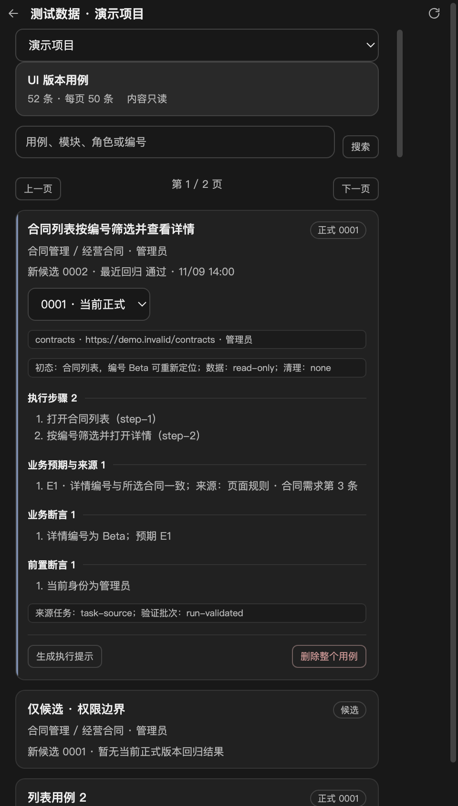
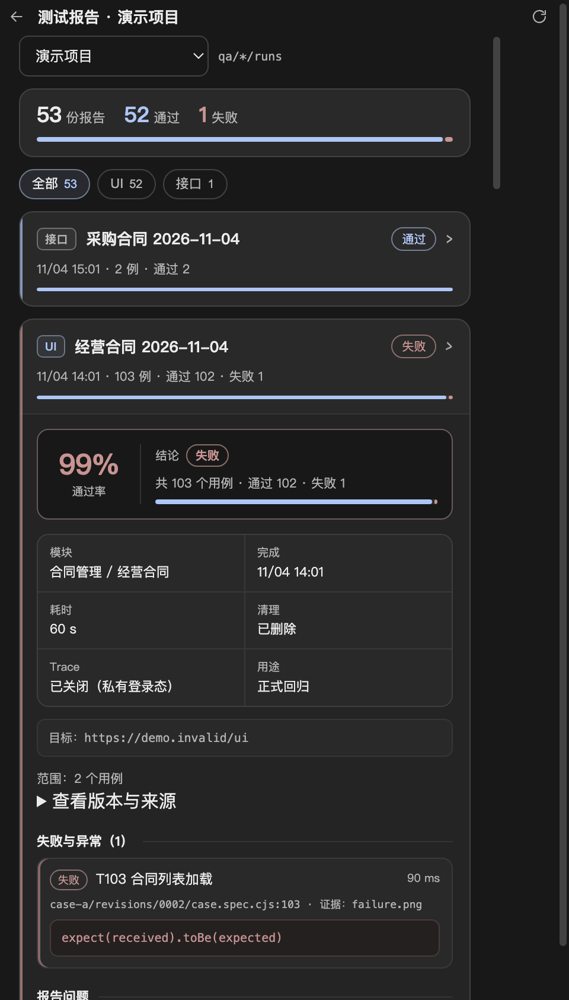

# browser-use + Playwright：阶段 2 只读闭环

核对时间：2026-11-09，Asia/Shanghai（UTC+08:00）。生产入口、独立 CLI、用例/报告面板及对应 IPC 已统一为新版只读工作流，定向离线验证通过。2026-11-09 11:03 真实 Qwen 整链重验通过（真实模型探索 → 候选冻结 → 定向验证 → 发布 → 正式回归）；此前首次真实请求超时保留在报告 B，首次恢复暴露的工作区内重复 Playwright 解析问题见报告 I。本次两面板及共用侧栏检查通过，缓存初始化已修复；报告页退出时的 GPU 日志仍保留下方记录。

## 已接入的链路

生产扩展工厂为 src/main/capabilities/ui-testing/extension.mjs 的 createUiTestingExtension(runtime)，由 pi-resources.mjs 通过官方 DefaultResourceLoader.extensionFactories 登记。createPiAgent 为每个会话复制运行时，并在官方模型目录刷新后注入该会话的 ModelRuntime；四工具闭包共用此引用。旧开发扩展已删除，不再保留两组入口或 MCP 设置过滤。

| 工具 | 行为 |
| --- | --- |
| `qa_ui_explore` | 按当前真实工作目录和目标地址匹配项目，后台登录，取得官方 Pi 模型认证，仅在内存传给 Python；返回任务编号和轨迹目录 |
| `qa_ui_save_candidate` | 从任务草稿读取一例一 test 的脚本和唯一 `case.json`，检查语法、字段、固定预期、实际步骤引用和明显违规，冻结新 revision 与 SHA-256 |
| `qa_ui_run` | `validate` 执行准确候选版本，每个 revision 仅一个定向验证批次；`regression` 仅执行当前正式引用。复用现有 `run.cjs`，每次重新后台登录并创建新回放上下文 |
| `qa_ui_publish` | 从磁盘核对准确版本、原生单个 passed、退出码、清理、执行前后哈希、快照和报告/截图清单，再原子更新正式引用 |

只读任务必须声明：`mode`（explore/candidate/complete）、目标、角色、可见身份标识、业务预期及 user/rule/baseline 来源、可重新定位的初态、`dataStrategy: "read-only"`、`cleanup: "none"`、完成时可见文本、允许的控件和输入值、明确 provider/model，以及最多 12 步/180 秒的探索预算。`explore` 不准保存候选，`candidate` 不准回放候选。

Python 只暴露 navigate/click/input/select_dropdown/done。动作前按实际页面目标的 role/name、稳定属性与业务容器核对约定；输入仅允许声明值，拒绝追加、坐标、密码框与未声明控件。导航限定项目 origin/路径；非导航动作要求当前页面仍在项目范围。结束要求观察到身份和全部完成信号，不以模型自行宣称成功替代。沿用已批准的严格运行时补丁，无模型自动重试、浏览器自动重连或默认逐步截图。

后台登录沿用私有临时状态和现有登录进程。公开页无登录表单时跳过凭据提交；验证码/MFA/身份无法确认返回 blocked。角色文本仍须在探索与用例中核对。只支持已验证的 cookie/localStorage；遇到 IndexedDB 状态明确 blocked。Qwen 的内网直连仅在 Python 子进程中按用户已确认的该 provider/model 配置，不改变宿主代理。

## 文件契约与发布门槛

```text
qa/ui/tasks/<taskId>/task.json
qa/ui/tasks/<taskId>/actions.jsonl
qa/ui/tasks/<taskId>/evidence/
qa/ui/tasks/<taskId>/drafts/<caseId>/case.spec.cjs
qa/ui/tasks/<taskId>/drafts/<caseId>/case.json
qa/ui/cases/<caseId>/asset.json
qa/ui/cases/<caseId>/revisions/0001/{case.spec.cjs,case.json}
qa/ui/runs/<runId>/{task.json,summary.json,summary.md,results.json,manifest.json}
qa/ui/runs/<runId>/{html,sources,artifacts}/
```

`case.json` 使用 `qa-ui-case/v1`，包含 caseId/title/project/modulePath/targetUrl/role/taskId、与任务相同的 initialState/dataStrategy/cleanup/expected、引用真实成功 `stepId` 的 steps，以及覆盖每条 expected.id 的 business assertions。完整示例见 `tests/helpers/ui-readonly-workflow.check.mjs`。保存后的 revision 不原地修改；同一新建任务最多初稿加两个补丁。已有用例的修复任务见下节。

候选必须实际包含一个 test 和 expect，并提供 `qa-initial-state`、`qa-business-result` 两个 PNG 附件。截图需先保存到 `testInfo.outputPath(...)`，再用 `testInfo.attach(name, { path, contentType: "image/png" })` 附加，保证清单可核验独立文件；仅内嵌 base64 的附件不满足本阶段发布要求。成功回放记录 `workflow: "browser-use-playwright"`、purpose 和准确 revisions。

发布同时检查原生 JSON/HTML、summary 和清单存在且内容哈希一致、所选脚本确有且仅有一个实际 passed、统计一致、退出 0、私有回放状态已删除、脚本与说明的执行前后哈希均等于 revision 哈希、相应源码快照已归档，以及两张必要截图存在并纳入清单。跳过、预期失败、普通失败、证据缺失、内容变化均不更新正式引用。失败结果保留原运行目录；后续回归不自动修改资产或调用模型。

所有工具共用工作区排他文件锁，跨扩展实例生效；取消直接传给进程，不等待该锁。Python 仍须同时确认 done、退出和浏览器收尾。回放取消先交给现有执行器收尾，超限才终止进程组；收尾未知时保留锁和现场，禁止新任务。应用重启不自动续跑或清理遗留锁，先核对原任务与相关进程。新路径拒绝链接越界，不创建旧 `qa/data/ui` 目录。tasks、runs 和互斥标记属于本地产物并被忽略。

静态检查是轻量规则检查，不能证明任意 JavaScript 与业务说明的语义一致，也不构成执行不可信脚本的隔离机制。只读控件的业务含义、初态和断言内容须基于任务来源；发布证明该脚本在记录条件下实际执行通过。此次集成检查中的候选是显式编写的夹具，并非 Qwen 生成脚本的验收。真实业务、跨 frame、IndexedDB、重启续跑、真实业务写操作、自动修复决策及真实应用操作均不扩大为已验证能力。

## 独立执行 CLI

`resources/testing/ui/execute.cjs` 与 `qa_ui_run` 共用 `workflow.mjs` 的执行核心。CLI 使用项目编号或唯一名称选择实际工作目录，支持 `--cases id1,id2` 或 `--all`，可用 `--config` 指定项目配置。只读取 `qa/ui/cases/<caseId>/asset.json` 的 `currentRevision`，要求正式版本具有成功验证引用；忽略未发布候选和旧平铺资产，不读取 `.env`，不调用模型或修改版本。

批次在工作区锁内固定准确版本、文件哈希及 `sourceTaskIds`，检查用例与已完成只读探索任务的项目、目标和角色一致。批量执行须项目、目标地址、角色及可见身份标识一致，否则在登录前拒绝；不同范围须拆批。每批仅后台登录一次，共用私有状态，再由原执行器运行准确脚本并保存原生报告。退出 0 仅表示全部通过；失败、取消、incomplete 和参数错误均退出 1。SIGINT/SIGTERM 传给共享执行器收尾，状态未知时保留锁与现场。

`qa-ui-execute` 及用例面板生成的执行提示已同步为此入口。旧生产录制工具已移除，旧资产不交给新 CLI。开发仓库中 CLI 直接引用 `src/main`；打包准备会把共享宿主模块复制到 `resources/testing/ui/lib`，CLI 通过 `shared.cjs` 自动识别并从随包副本加载。模拟 `resources` 布局的检查已通过，真实安装包、代码签名与跨平台运行仍未验收；打包后的项目配置默认路径与可写目录仍待打包阶段确定，当前检查显式传入 `--config`。

## 版本用例面板

右侧「测试数据」只将 `qa/ui/cases/<caseId>/asset.json` 的 `qa-ui-asset/v1` 纳入 UI 用例列表；无索引、旧 schema 和旧平铺资产不展示、不迁移。先完整枚举新格式目录，按模块、标题、caseId 排序并筛选，再每页 50 条；搜索范围是编号、标题、模块和角色。列表不携带步骤、预期或断言；展开时按准确 revision 读取详情，同时核对说明与脚本 SHA-256。

有正式版本时列表采用正式说明，展示后续未发布候选；只有候选时展示最新候选。详情可切换已登记版本，只读展示初态、数据策略、步骤、固定预期及来源、business/guard 断言和来源 task/验证 run。最近结果只关联同项目、真实工作区、准确 caseId/revision/脚本的新版 regression 摘要，不混入 validate 或其他版本结果。

只有正式用例提供「生成执行提示」，向输入框插入精确 `--project` 和 `--cases`，不自动发送；查看候选详情不改变正式执行目标。旧步骤/断言编辑、流程标记、批量删除 test 及 grep 入口已退出。删除需确认整个 case 的所有版本永久删除；主进程 idle 互斥及共享工作区锁内核对列表 assetHash、版本说明哈希、项目和 task 归属，版本变化或活动任务会阻止删除；tasks/runs 保留。其他 `qa/data` 普通文件仍可列表和单文件删除，最多展示 500 个并提示截断，排除旧 `ui/cases`。

接口为 `listTestData(projectId, { page, query })`、`getTestCase(projectId, caseId, revision)`、`deleteTestCase(projectId, caseId, assetHash)` 及普通文件的 `deleteTestData`。页面使用请求编号、项目和详情请求对象核对迟到结果。



## 新版报告面板

报告服务完整读取固定目录，UI 仅接受 `qa-report/v1` / `browser-use-playwright`、validate/regression、准确项目/真实工作区/runId/caseIds/revisions/sourceTaskIds；旧 UI 不推断、不转换，API 旧摘要仍可读。模块名称取摘要声明或执行时冻结的 `caseModules`，不回看旧资产。

列表完整排序、类型筛选后每页 50 份，统计覆盖全部有效报告；逐例每页 50 条，全批失败总数和前 5 条失败摘要独立返回。页面展示用途、准确版本和来源 task，保护同项目与切项目的迟到请求。单摘要 2 MiB，逐层拒绝链接，附件只返回名称与类型。

UI 删除经 idle 互斥和共享工作区锁，重新核对 summary/task 归属；prepared/running、遗留锁、损坏版本索引及任何 revision 的 validationRunId/validatedRunId 引用都会阻止删除。只删除无引用的运行目录，保留来源 tasks；仍被修复任务引用为父批次的报告也会阻止删除；任务删除尚未实现。接口旧批次可无 task，损坏/链接 task 或 running 拒绝删除。详见 [测试报告](test-reports.md)。



## 已有用例的修复任务与父批次关联

修复任务对只读和隔离写用例都适用。执行正式回归失败且用户明确授权修复后，Pi 读取失败批次、当前 revision、脚本和证据，只改脚本定位、等待与证据；不改变业务预期、步骤、断言说明、标题、模块、初态或写授权。修复后的自动决策与定时调度仍不在本切片范围。

```text
1. qa_ui_run {caseId, revision, mode: "regression"} → 失败批次 runId（保留原报告）
2. qa_ui_save_candidate {caseId, baseRevision, parentRunId}
   → 建立 kind=repair 的任务，返回 taskId 与 drafts/<caseId> 草稿目录；不启动浏览器、不产生 actions.jsonl
3. 写草稿 case.spec.cjs 与 case.json（业务字段与原 revision 一致），调用
   qa_ui_save_candidate {taskId, caseId, patchSummary} → 新 revision
4. qa_ui_run {caseId, revision, mode: "validate"} → qa_ui_publish
```

修复任务建立时核对：父批次是同工作区、同项目、该 caseId 与原 revision 的真实 failed regression；目标必须仍是当前正式版本且有已验证 runId；用例来自完成且只读的原任务。同一失败批次只建立一个修复任务，后续补丁沿用原 taskId，每个任务最多两个补丁、每个 revision 只能验证一次；正式版本已变化时拒绝继续。

修复 revision 的 `asset.json` 条目记录 `baseRevision`、`baseTaskId`、`parentRunId` 和可选 `patchSummary`，`case.json.taskId` 仍保留原探索任务。验证批次摘要带 `parentRunId` 与 `patchSummary`；报告列表显示“修复”标记，详情展示修复来源和补丁说明，历史失败报告不合并改写。父批次被修复任务引用时不能删除；删除用例时按原探索任务编号校验修复版本。

验证：`node --test tests/unit/ui-repair-workflow.test.js` 1 项通过，使用受控本地 Chromium 真实执行回归失败、修复任务建立、两个补丁、定向验证与发布，覆盖非失败父批次、错误 revision、预期/步骤/断言/标题/任务编号篡改、重复建任务、补丁预算和删除保护；`node --test tests/unit/test-report-service.test.js` 8 项通过（含修复字段）；报告页面检查 19 项通过（含修复标记与来源）。修复运行仍使用显式夹具脚本，不代表真实模型生成补丁已验收。

## 隔离写用例（阶段 4 写操作）

新增、编辑、删除等写操作仅在用户明确授权具体业务对象、且数据可每轮独立准备和清理时支持；仍用同一套探索、候选、验证和发布链路，不新增写工具或第二套执行器。真实业务写操作仅完成采购合同草稿创建/查询的授权验收：该测试环境当前没有草稿删除入口，用户明确接受残留后以 `cleanup: "residual"` 发布，每条回归都会新增草稿，详见下文与报告 K；提交审批、编辑、删除和跨系统清理仍未验收。

```text
contract.dataStrategy = "isolated-write"
contract.cleanup = "in-test"
contract.writeAuthorization = { kind: "user" | "rule" | "baseline", reference: "授权依据" }
```

- `cleanup` 为 `in-test`（用例内清理并附 `qa-cleanup`）或 `residual`（明确接受残留，附 `qa-residue` 和独立的 `residualAuthorization`）。`residual` 只用于已获授权、确实无法清理的测试环境，不能把“无法删除”写成清理成功。
- `case.json` 必须原样声明 dataStrategy、cleanup、writeAuthorization 与（残留时）residualAuthorization；只读用例不得携带写授权或残留授权。
- 脚本必须使用 `process.env.QA_RUN_ID` 生成每轮唯一业务标识，同上清理由用例自行完成；不得写死固定对象或复用上轮残留。执行器为每个批次注入唯一 runId。
- 用例内清理必须保存并 attach `qa-cleanup` PNG；声明残留则必须 attach `qa-residue`。成功回放缺少初态、业务结果或对应清理/残留证据任一项都不能发布，报告问题会明确列出缺少的证据。
- 静态检查只证明脚本引用了唯一标识和清理证据，不证明数据实际隔离或清理成功；执行结果以 Playwright 实际断言和原生报告为准。
- 未知提交不重放：中断、结果未知或清理未确认时保留现场和报告，先只读核对本次对象状态；不自动补交、重复删除或重建等价批次。
- 修复任务同样可用于隔离写用例，写授权与预期、步骤一起冻结；补丁只改脚本定位、等待和证据。

验证使用受控本地页面真实创建与删除数据：`node --test tests/unit/ui-write-workflow.test.js` 1 项通过，覆盖写授权不一致、只读任务携带写授权、缺 QA_RUN_ID、缺 qa-cleanup、两轮数据唯一且清理一致、缺清理证据验证失败且不能发布；报告服务 9 项通过（含数据策略与写授权归一化）；报告页面 19 项通过（含数据策略与写授权展示）。声明残留模式另由 `tests/unit/ui-residual-workflow.test.js` 1 项覆盖（残留授权、qa-residue、缺授权/缺证据拒绝与发布）。受控结果不代表真实业务写入或清理成功；真实采购合同草稿写入见下一节。

## 真实业务写操作授权验收（2026-11-09，部分通过，已声明残留）

用户明确要求真实业务写操作授权验收，并在发现当前版本草稿无删除入口后明确选择“接受测试环境残留，继续采购合同草稿写入”。

- 环境：测试环境项目管理系统（pms）；写授权来源为本次用户要求，测试环境此前已有写操作记录。
- 探索：`qwen3.8-flash-next`，taskId=`task-d441c65f-5daf-4c58-9174-ceb707ebdb3e`，3 个动作（navigate、点击“合同发起”、done），只进入新增页，未填写或提交。
- 用例：`pms-procurement-draft` revision 0001，采购合同草稿创建与按名称查询；`cleanup: "residual"`，附 `qa-residue` 与残留授权。定向验证 `run-c69aaa1f-0af4-4748-a288-388c5d35377b` 1 个实际 passed、退出 0、无问题，已发布。
- 残留（需要运维清理，均未进入审批流）：
  - 手工试跑：`QA-采购合同-20261109064334`，流程编号 `LC-HSKJ-CGHT-2026-11-049`，draftId `477290914328117248`
  - 定向验证：`QA-采购合同-run-c69aaa1f-0af4-4748-a288-388c5d35377b`，流程编号 `LC-HSKJ-CGHT-2026-11-053`，draftId `477293407015567360`
- 当前版本列表与编辑页均无草稿删除入口，因此这条正式用例每次回归都会新增一条草稿；不要把它加入定时回归，除非先恢复删除能力或确认持续接受残留。
- 边界：只验证采购合同草稿创建/查询，未验证提交审批、编辑、删除、附件、跨角色；残留是已声明的测试环境数据，不是清理成功。

## 定时回归真实项目验收（2026-11-09）

- 真实项目：项目管理系统（项目编号 `pms`，内网地址与账号来自本机项目配置，不写入文档），工作区 `18-00work space`。该工作区此前没有新版正式用例，只有旧平铺文件；因此先在真实经营总览页完成真实模型只读探索，再生成、验证并发布首个正式用例 `pms-business-overview`（revision 0001）。
- 真实探索：`qwen3.8-flash-next`，taskId=`task-9783efed-9720-433a-8e30-ace9d57ea672`，2 次模型调用、2 个动作（navigate、done），身份与完成文本由运行时核对。定向验证 `run-943c5f52-f341-42e9-867b-058d397be84e` 1 个实际 passed，发布成功。首次尝试 `task-4635f128-3116-4798-ac95-564c2932953e` 在第一次模型请求 502 超时后停止；探活恢复（同模型 1.4 秒返回）后做了一次有界重试，失败任务保留。
- 登录修复：SPA 在登录守卫前会短暂渲染身份区，`login.cjs` 曾把它误判为 `not-required` 而跳过登录。现在必须先等目标路由稳定、再确认身份；新增空壳闪现后跳登录页的回归场景，旧实现返回 `not-required`，修复后返回 `saved`。
- 定时执行：使用临时 launchd 任务（`RunAtLoad`、`StartInterval` 60 秒）调用独立 CLI `execute.cjs --project pms --all`，每次运行重新后台登录并创建新回放上下文，不调用模型、不修改版本。两次触发结果：`run-ad500913-298f-4ec5-859d-25fb6f1a7c6c`、`run-694093c8-908c-49f0-9f68-4938ccbe5a53`，均 passed、退出 0、约 5–7 秒、cleanup=deleted、无 stderr；用例资产哈希前后一致，工作区锁在运行结束后释放。验收完成后已 bootout 并删除 plist 与包装脚本，未常驻调度。
- 边界：应用内没有调度器，本次只验证外部短间隔调度；未验证失败/取消/并发调度、长期稳定性、跨平台调度或真实业务写操作。日志保留在 `/tmp/swqa-pms-schedule/launchd.log` 与 `launchd.err.log`（临时目录，不作为长期证据）。

## 验证记录

2026-11-09 报告面板：`node --test tests/unit/test-report-service.test.js tests/unit/agent-ipc.test.js tests/unit/project-service.test.js tests/unit/ui-readonly-workflow.test.js`，23 项通过、0 失败，退出 0。覆盖 205 批排序筛选分页、103 条逐例及全批失败摘要、新 UI 契约/API 兼容、归属/链接/大小/损坏拒绝、共享锁、两个验证引用字段、活动批次与坏索引保护、删除保留任务及 IPC 参数/互斥；共享闭环使用离线模型协议夹具和受控本地 Chromium。

`TEST_REPORTS_SCREENSHOT_PATH=docs/images/test-report-versions.png node_modules/.bin/electron tests/ui/test-reports.check.cjs`（实际使用截图绝对路径）：修正首次夹具触发错误后，一次恢复 18 项断言通过，退出 0。覆盖 53 份报告列表分页筛选、103 条逐例翻页并返回第一页、全批失败摘要、用途/版本/来源、同项目迟到列表和切项目迟到详情、删除确认及统计刷新、焦点与无溢出；截图已视觉核对。两次均有 Chromium 缓存日志，未新增缓存恢复；共用侧栏旧断言未重跑。详见异常报告 E、G。本轮未请求真实模型。

2026-11-09 用例面板：`node --test tests/unit/test-data-service.test.js tests/unit/agent-ipc.test.js tests/unit/project-service.test.js tests/unit/ui-readonly-workflow.test.js`，23 项通过、0 失败/跳过。覆盖 205 例完整排序筛选分页、正式/候选隔离、准确详情与回归、哈希/项目/链接拒绝、旧资产隔离、普通文件、锁/过期删除拒绝、整例删除及历史保留、IPC 转发与互斥；共享工作流仍使用离线模型协议夹具及本地 Chromium。

`TEST_DATA_CATALOG_SCREENSHOT_PATH=docs/images/test-data-versions.png node_modules/.bin/electron tests/ui/test-data-catalog.check.cjs`（实际截图参数为仓库绝对路径）：16 项断言通过，退出 0。覆盖每页 50 条、按需版本详情、来源只读、正式执行提示、候选无执行、筛选分页、删除确认、普通文件、切换项目后的迟到详情和无横向溢出；截图已视觉核对。首次及补齐缓存目录后的一次恢复检查均有 Chromium 缓存错误，不能视为环境检查完全通过。共用 `sidebar-layout.check.cjs` 两次均退出 1，恢复后仍停在旧模型设置断言，尚未到用例区域；不扩大为共用侧栏通过。详见报告 D–F。本轮未请求真实模型。

2026-11-09：`node --test --test-concurrency=1 tests/unit/execute-cli.test.js tests/unit/ui-readonly-workflow.test.js`，4 项通过、0 跳过。CLI 在含中文、空格及单引号的临时目录实际调用 Chromium，覆盖双用例正式版本选择、候选隔离、单次登录、来源记录、执行不改资产、项目/角色/来源/哈希/链接拒绝、跨实例锁、真实业务断言失败退出及 SIGTERM 取消与私有状态清理。来源任务和候选为显式文件夹具，保存、验证、发布及回放实际执行；不代表 browser-use 或真实模型生成已通过。执行技能文案定向检查 `node --test tests/unit/prompt-content.test.js`，7 项通过。本轮未请求真实模型。

此前阶段 2 检查：

- `node --test tests/unit/ui-readonly-workflow.test.js`：通过。真实官方 SDK 会话登记四工具；Python 使用明确标记的离线协议夹具，Playwright/Chromium 实际运行本地页面。覆盖筛选 Beta、排除 Alpha、同一业务行详情异步结果、准确候选回放、发布与正式回归；另外覆盖预期漂移、虚构步骤、跳过脚本、候选回归、重复候选验证、报告/版本变化、失败报告、跨实例互斥、取消终值、链接越界及收尾未知阻断。
- `node --test tests/unit/browser-use-bridge.test.js`：9 项通过，无模型请求。已通过的协议项未反复运行。
- `node --test tests/unit/ui-project-context.test.js`：4 项通过，旧入口默认目录及项目匹配行为仍通过。
- `node --test --test-name-pattern='：replay' tests/unit/ui-testing-runtime.test.js`：旧回放集成场景通过，确认共享执行器改动未破坏该旧入口。
- `resources/testing/ui/browser-use/.venv/bin/python tests/helpers/browser-use-probe.check.py`：11 项通过，未启动浏览器或请求模型。
- `resources/testing/ui/browser-use/.venv/bin/python tests/helpers/browser-use-readonly.check.py`：7 项通过，覆盖只读动作 schema、同名按钮业务行、身份、限定输入、写控件/坐标拒绝、项目 URL 和完成信号。
- 真实 Qwen：通过开发扩展的 `qa_ui_explore` 发起 1 次请求，0 动作，随后因超时停止。未保存候选、未执行 Playwright、未发布，也未发起第二次真实请求。

离线测试通过不代替真实探索验收。该次真实调用失败，本阶段在当时标记为“代码与离线闭环就绪，真实探索整链待验”；该待验状态已于 2026-11-09 11:03 真实整链重验通过，见下节。

2026-11-09 生产入口收尾：prompt-content、ui-project-context、ui-testing-runtime、ui-readonly-workflow 四组定向测试共 9 项通过、0 失败/跳过。真实 createPiAgent 工厂使用临时模型与认证配置，验证四工具、三 UI 技能及报告技能只登记一次、禁用资源与第三方 MCP 替换语义、设置文件未改写及原生工具保留；生产工具实际完成协议探索、候选冻结、本地 Chromium 定向验证、发布和正式回归。后台登录另覆盖公开页、验证码不提交、正确凭据单次提交及 cookie/localStorage、认证失败不重试、权限和清理。探索进程为显式离线协议夹具，不请求真实模型；未扩大为真实业务验收。补充移走临时磁盘模型登记后，生产工具仍通过会话运行时完成闭环；与正式 CLI 的定向检查合计 4 项通过（含重跑的 1 项闭环）。权限门禁 7 项通过，五份相关技能结构检查通过。按不同测试计，本轮共 19 项通过、无失败或跳过。

## 本轮编辑调用异常及恢复

| 项目 | 记录 |
| --- | --- |
| 任务与结论 | 2026-11-09，Asia/Shanghai（具体时刻未记录），阶段 3 收尾编辑调用曾在执行前解析失败；本轮另一次文档补丁被拒绝，相关调用均未产生部分写入，现已完成替换并验证 |
| 调用链路 | 用户修复目标 → 文件检查/编辑 → functions.exec → exec_command 或 apply_patch；没有下游服务请求。技能仅使用 /Users/liyingjun/.codex/skills/.system/skill-creator/SKILL.md 核对本地技能文案，未执行 UI 工作流技能 |
| 工具与结果 | 历史脚本文本解析错误含 Unexpected identifier、base is not defined，未进入 shell；本轮 apply_patch 返回 invalid patch: multiple operations target docs/ui-testing-runtime.md，原文未改动；调用编号未记录 |
| 已确认原因 | 脚本文本嵌套引用方式不正确；补丁工具不允许同路径删除再新增。并非应用运行故障。无证据表明存在模型或浏览器新故障 |
| 处置与依据 | 停止依赖编辑，核对文件后改用无插值原文脚本和单次原文件更新；修正传递方式后的写入成功，生产入口定向测试 9 项通过。未重放历史真实模型请求 |
| 影响与恢复 | 未发送模型/业务请求，未产生结果未知的外部写入；历史应用故障保持原记录。编辑链路已恢复，无需用户补充操作 |

## 异常报告 A：截图附件格式不满足文件证据契约（已修正）

| 项目 | 记录 |
| --- | --- |
| 任务与结论 | 2026-11-06 17:40:12–17:40:14 UTC+08:00，首次离线集成检查在回放结果检查处停止；Playwright 实际 passed、退出 0，但批次为 incomplete，发布及后续检查未执行 |
| 调用链路 | 用户阶段 2 目标 → `ui-readonly-workflow.test.js` → helper/官方 SDK 四工具（登记、探索协议夹具、保存候选成功）→ `qa_ui_run`/`run.cjs` → 本地 Chromium（断言成功）→ 附件检查失败；未使用技能 |
| 工具与参数 | `functions.exec` → `exec_command`，运行定向 Node 测试；测试进程退出 1。失败 runId 为 `run-4e2d795c-4359-4ca7-9336-4f0eece63a20`。协议测试同批 9 项成功 |
| 原因与证据 | 原生 `attachments` 中为 `body`，无 `path`；summary.problems 为“缺少必要截图：qa-initial-state / qa-business-result”。已确认是夹具证据格式问题；不是浏览器断言失败。现场保留于 `/private/var/folders/zl/dv8m7cfs0mj0j3vf6psss9y80000gn/T/ui-readonly-Dm7Acj` |
| 已执行处置 | 停止依赖链路；读取原生结果确认内嵌附件格式，将夹具改为实际保存 PNG 后按 path 附加，按已改变的前置条件做一次恢复验证，通过。后续代码复核增加“收尾未知保留锁”等独立边界后，按新改动再次定向验证通过；没有重放原失败 run |
| 影响与恢复 | 未发生模型或业务写请求；保留首次 incomplete 结果，不发布失败版本。截图文件契约已写入本说明，恢复后串联通过 |

## 异常报告 B：真实 Qwen 首次请求超时（未重试）

| 项目 | 记录 |
| --- | --- |
| 任务与结论 | 2026-11-06 17:42:23–17:43:13 UTC+08:00；实际模型探索在 agent-run 阶段停止。taskId=`task-88c86e04-ff2b-4425-8c42-500a6d17d058`；候选保存、独立验证、发布与正式回归均未执行 |
| 调用链路 | 用户授权的指定 Qwen 小验证 → `ui-readonly-workflow.check.mjs ... real` → 官方 SDK 加载开发扩展/`qa_ui_explore` → 项目匹配、后台公开页确认、官方 ModelRuntime 认证（成功）→ bridge/Python/Chromium 启动（成功）→ ChatOpenAI 调用指定模型（失败）→ 正常浏览器收尾（成功）；未使用技能 |
| 工具与参数 | `functions.exec` → `exec_command`，Node helper real 模式，仅 `qwen3.8-flash-next/qwen3.8-flash-next`，目标为受控本地页面，Python 子进程内使用已授权直连。helper 退出 1，Python code=1，signal=null，bridge fault=null |
| 原因与证据 | terminal.modelError：`ModelProviderError` 的 statusCode=502 / `Request timed out.`，下层 `APITimeoutError → ReadTimeout`。这是适配层的错误码；没有证据表明服务端实际返回 HTTP 502。已确认请求超时，尚不能确定是服务处理、链路还是超时预算原因。modelCalls=1、actions=0、usage=[]、reconnectAttempts=0、cleanupConfirmed=true |
| 已执行处置 | 首次异常立即停止，读取已保存 process-result。未换模型、未变更连接路径、未增大超时、未重跑或发起恢复模型请求；无证据证明故障条件改变。独立的离线代码复核与测试继续完成 |
| 影响与恢复 | 没有探索动作或业务写入；模型侧是否计费未确认，不把空 usage 当成零计费。浏览器收尾已确认，任务 private 目录已删除；保留失败 task/process-result。需先有该模型推理服务可用或明确前置条件已修复的证据，再按仓库规则做一次有界恢复验证；不能直接重复原调用 |

真实现场保留在 `qa/ui/browser-use-smoke/stage2-u6LLSr/`（已忽略），其中 `check-summary.json` 为检查摘要，任务目录下 `process-result.json` 为脱敏协议结果；无凭据或真实业务账号。后续“继续”应从故障恢复证据开始，不把阶段 1 的历史成功或离线协议夹具当作本次真实探索完成。

## 异常报告 C：只读源码路径检查错误（已修正）

| 项目 | 记录 |
| --- | --- |
| 任务与结论 | CLI 与用例面板接入期间的源码检查；日期 2026-11-09 UTC+08:00，具体时刻未记录。路径检查报错后分别暂停相应读取；没有写入或结果未知操作 |
| 调用链路与工具 | 用户继续接入 → `functions.exec` / `exec_command` → 本地文件读取；未使用技能。`src/main/services/ui*` 被 zsh 判为无匹配，依赖它的后续搜索未执行；读取 `src/main/storage/project-storage.js` 时文件不存在 |
| 原因与证据 | 错误为 `no matches found` 和文件不存在；`rg --files` 及实际源码导入确认目标位置，存储模块实际为 `src/main/storage/project-store.js` |
| 面板期间的路径检查 | `src/main/pi-resources.mjs` 不存在，实际为 `src/main/resources/pi-resources.mjs`；`src/main/capabilities/ui-testing/*.cjs` 无匹配，执行入口实际为 `resources/testing/ui/run.cjs`；`settings/model-settings.js` 不存在，实际为 `settings/model-providers.js`；`tests/ui/model-providers.preload.cjs` 不存在（rg 退出 2），模拟接口实际在 `tests/ui/model-providers.check.cjs` 内。均依据文件清单/实际导入修正后只读成功，未原样重试 |
| 已执行处置 | 未原样重跑；根据目录清单和真实 import 修正读取路径，各完成一次只读检查。未改变业务代码以绕过异常 |
| 影响与恢复 | 无文件写入影响，无待恢复操作；CLI 与共享执行器的定向验证随后通过。真实 Qwen 故障仍按报告 B 保留，不在此次检查中重试 |

## 异常报告 D：临时工作区路径别名（已修正）

| 项目 | 记录 |
| --- | --- |
| 任务与结论 | 2026-11-09 UTC+08:00，具体时刻未记录；用例服务首轮定向测试在最近结果关联处失败，停止该检查链路 |
| 调用链路与工具 | 用户继续接入 → `functions.exec` / `exec_command` → `node --test` → 临时工作区夹具 → test-data-service；未使用技能，无模型调用 |
| 原因与证据 | 夹具 summary.workspace 使用 `/var/...`，服务返回真实目录 `/private/var/...`，准确工作区核对不匹配；这是夹具路径问题，不放宽产品归属检查 |
| 已执行处置 | setup 改为 `fs.realpath(mkdtemp(...))`，在前置条件修正后完成一次定向恢复验证；23 项通过、退出 0 |
| 影响与恢复 | 仅临时测试数据，无真实业务写入、无结果未知；恢复已完成，未重放正式运行或模型请求 |

## 异常报告 E：Chromium 缓存初始化（已修复，历史保留）

| 项目 | 记录 |
| --- | --- |
| 任务与结论 | 2026-11-09 UTC+08:00，首次与恢复时刻未记录；新版用例面板页面断言均通过，但缓存初始化报错。共用侧栏 09:29:19 的恢复检查也有同类日志。已停止缓存恢复链路 |
| 调用链路与工具 | 用户面板接入 → `functions.exec` / `exec_command` → Electron 的 `test-data-catalog.check.cjs` → 临时 userData / Chromium；未使用技能。截图由 Electron capturePage 保存并经 view_image 核对 |
| 预期与实际 | 预期本地页面与临时缓存正常；两次均 16 项断言通过、退出 0。首次 `Failed to create directory .../Shared Dictionary/cache` / `wrong file structure on disk: 1` / `Unable to create cache`；恢复后 `Failed to write a new fake index.` / `wrong file structure on disk: 8` / `Unable to create cache` |
| 原因与证据 | 已确认 Chromium 缓存写入失败，根因待确认；补齐目录并未消除错误，因此不能归因为只缺目录。证据为本轮工具输出，未另存完整日志。共用侧栏还出现 GPU shared-image 日志，因果关系未确认 |
| 已执行处置 | 首次停止后读取已有夹具契约，补建 `Shared Dictionary/cache`，做一次恢复检查；仍有错误后停止，未再次更换缓存路径、启动参数或重跑该链路 |
| 报告页本轮观察 | 2026-11-09 09:45:21 与 09:46:43 UTC+08:00 的独立报告页面检查仍有 `Failed to create directory .../Shared Dictionary/cache`、`wrong file structure on disk: 1` 和 `Unable to create cache`；未修改缓存路径或参数。报告页恢复只针对报告 G 的明确夹具错误，不计为缓存恢复成功 |
| 影响与恢复 | 保留代码及 `docs/images/test-data-versions.png`；仅临时模拟接口，无真实认证/模型/业务写入。页面断言通过不代表 Chromium 环境无异常。后续需先确认缓存失败原因和修复依据，再由用户继续恢复检查；不能原样重复启动 |

## 异常报告 F：共用侧栏旧夹具与断言（已修复，历史保留）

| 项目 | 记录 |
| --- | --- |
| 任务与结论 | 2026-11-09 UTC+08:00，首次时刻未记录；09:29:19–09:29:20 恢复检查仍在模型设置断言失败，退出 1；停止后续共用检查，用例区域未执行 |
| 调用链路与工具 | 用户面板接入 → `functions.exec` / `exec_command` → `electron tests/ui/sidebar-layout.check.cjs` → sidebar-check 模拟接口及本地 renderer；未使用技能，无模型请求 |
| 预期与实际 | 首次接口调用报 `未登记的模拟接口：readModelCatalog`，继而“设置左侧纵向显示模型、主题与已归档，模型页使用官方配置入口”断言失败。补齐最小空 catalog 后，接口错误消失，但同一断言仍为 actual=false / expected=true；前 6 项通过 |
| 原因与证据 | 已确认夹具缺 catalog 接口。恢复后只读源码还确认旧断言的 `document.querySelector('[role=tablist]')` 首先匹配 `index.html` 的对话视图标签条，而非设置分类标签条，其没有 aria-orientation；本轮没有修改产品设置功能 |
| 已执行处置 | 首次停止、读取实际模型页面契约、补齐模拟接口，完成一次恢复验证；仍失败即停止，未继续改断言并重跑。已有缓存/GPU 日志另见报告 E，不据此推断断言失败原因 |
| 影响与恢复 | 共用侧栏回归结论未通过；新版用例面板 16 项独立断言仍有效。无真实业务写入或未知提交。最小后续修复是将旧断言的 tablist 查询限定到设置对话框，再按用户继续指令及有界规则验证；不能把尚未执行的其他共用检查标为通过 |

## 异常报告 G：报告页夹具刷新触发与退出码（已修正）

| 项目 | 记录 |
| --- | --- |
| 任务与结论 | 2026-11-09 09:45:21 UTC+08:00 首次报告页面检查在前 14 项断言通过后，等待刷新按钮恢复超时；停止依赖检查。09:46:43 UTC+08:00 在明确修正夹具后做一次恢复，18 项通过、退出 0 |
| 调用链路 | 用户继续报告面板接入 → `functions.exec` / `exec_command` → `electron tests/ui/test-reports.check.cjs` → 模拟 preload 与本地 renderer → Chromium；未使用技能，无真实模型请求。截图由 capturePage 保存并经 view_image 核对 |
| 工具与参数 | `TEST_REPORTS_SCREENSHOT_PATH=/Users/liyingjun/Desktop/SW-QA/17-00/docs/images/test-report-versions.png node_modules/.bin/electron tests/ui/test-reports.check.cjs`。首次输出 FAIL/超时但进程退出 0，与预期失败退出码不符，不能算通过；无任务编号，toolCallId 未记录 |
| 原因与证据 | 夹具连续触发两次 focus；产品处理器在 busy 时忽略第二次，测试却等待没有启动的新请求。已确认是测试触发条件错误，没有证据表明产品刷新失败。旧 catch 后 app.quit 也未可靠保留失败退出码。证据为工具输出及 `tests/ui/test-reports.check.cjs`，未另存完整原始日志 |
| 已执行处置 | 暂停后读取页面/夹具契约，改用公开 panel.open 入口启动更新请求并释放旧列表，核对迟到结果不覆盖；去除多余准备刷新，结束改为 app.exit 保留退出码，失败保留临时现场。前置条件改变后仅一次恢复验证，18 项通过 |
| 影响与恢复 | 仅临时模拟数据与截图，无真实认证/模型/业务写入，无结果未知。报告页恢复已完成；两次 Chromium 缓存日志仍按 E 保留，未换路径或参数处理，也未重跑共用侧栏或真实 Qwen 链路 |


## 2026-11-09 缓存与侧栏修复验证

本次仅修复报告 E/F 相关初始化、检查夹具与窄窗溢出，未增加阶段 4 功能、未请求真实模型、未读取真实认证或写入业务数据；未使用技能。以下记录更新 E/F 的当前结论，保留前文首次失败事实。

| 项目 | 记录 |
| --- | --- |
| 缓存原因与处置 | 三份 Electron 页面检查原先异步创建目录后才设置 userData/sessionData。安装包公开 `electron.d.ts` 要求 sessionData 在 ready 前设置；异步文件操作让初始化存在竞争。改为同步创建临时根目录并在首个 await 前设置路径，去除手工建立 Chromium 内部缓存目录。没有改缓存位置策略或启动参数 |
| 缓存恢复 | `electron tests/ui/test-data-catalog.check.cjs` 16 项、`electron tests/ui/test-reports.check.cjs` 18 项、侧栏最终检查 79 项均通过且退出 0，三份日志均无原 Shared Dictionary/cache 错误。对应日志为 `/tmp/swqa-data-recovery-20261109.log`、`/tmp/swqa-reports-recovery-20261109.log`、`/tmp/swqa-sidebar-recovery-20261109.log`；均通过 functions.exec/exec_command 启动，本轮 task/toolCallId 未记录 |
| 侧栏首次恢复 | 设置断言限定到设置对话框后通过；等待侧栏宽度过渡稳定后检查。首次恢复继续发现 390px 页面宽 399px；加入只读几何诊断后确认“对话/轨迹”标签栏固定宽度溢出，前 34 项通过后停止。日志 `/tmp/swqa-sidebar-20261109.log` 与 `/tmp/swqa-sidebar-diagnostic-20261109.log` |
| 侧栏最小修复与恢复 | 窄窗页头和标题行允许换行，视图标签栏限制在父容器宽度并允许换行，保留入口和键盘操作。明确修改前置布局后一次恢复，全部 79 项通过；包含用例面板区域与 390px 展开态无溢出。临时几何诊断已移除，截图 `docs/images/sidebar-narrow-expanded.png` 已视觉核对；宽度动画等待仍保留 |
| 次数与影响 | 缓存各页面修正后一次恢复；侧栏旧断言恢复发现新溢出，增加诊断定位后才修改产品样式并一次恢复。模拟添加/清单/打开/预览失败是既有预期负例，不作为环境故障。无未知提交或需重放的业务操作，真实 Qwen 超时仍按 B 保留 |

## 异常报告 H：报告页退出时 GPU 日志（待确认）

| 项目 | 记录 |
| --- | --- |
| 任务与结论 | 2026-11-09 10:41:16 UTC+08:00，报告页 18 项断言完成后出现 GPU shared-image 日志，进程退出 0；该日志不属于已修复的缓存错误，不能宣称检查环境完全无日志异常 |
| 调用链路与工具 | 用户修复请求 → functions.exec / exec_command → `electron tests/ui/test-reports.check.cjs` → 临时模拟页面 / Chromium；未使用技能，无模型请求；任务编号与 toolCallId 未记录 |
| 原因与证据 | `SharedImageManager::ProduceMemory: Trying to Produce a Memory representation from a non-existent mailbox.` 出现三次，完整日志 `/tmp/swqa-reports-recovery-20261109.log`。已确认出现于 PASS 汇总后；产生原因及是否与退出顺序有关仍待确认，不能仅据此判为网络、权限或产品渲染失败 |
| 已执行处置 | 仅只读检查报告夹具退出顺序，未改启动参数或重跑报告页；保留原日志，停止此独立 GPU 排查链路。侧栏与用例页本轮没有该日志 |
| 影响与恢复 | 页面断言有效、无真实数据写入或结果未知；本次未扩大为 GPU 生命周期修复。若后续需消除此日志，应先取得 Chromium/Electron 的可复现退出诊断及公开契约依据，再定向修正并验证，不原样重复启动 |

## 2026-11-09 真实模型整链重验

使用者明确授权使用既有已登记模型做一次真实整链验收。本轮未读取或输出凭据正文，未访问真实业务站点，只在隔离临时目录运行受控本地页面；候选脚本仍是显式编写的夹具，不是模型生成脚本。

| 项目 | 记录 |
| --- | --- |
| 前置探活 | `qwen3.8-flash-next/qwen3.8-flash-next` 认证来自已配置的 openai-completions 兼容 Provider（非 OAuth/订阅）。一次最小请求返回 HTTP 200，8 个 completion token 耗时 36.1 秒，usage 正常；说明报告 B 的超时条件已不成立，具备一次有界恢复验证的依据。 |
| 首次真实运行 | 2026-11-09 10:57:48–10:58:19 UTC+08:00，`node tests/helpers/ui-readonly-workflow.check.mjs <隔离目录> real`。真实模型探索成功：taskId=`task-0139ad54-80a9-4ea9-ad7c-8606f6e7d85c`，4 次模型调用、4 个动作（navigate/input/click/done），生成 3 张动作证据 PNG，身份与完成信号均经运行时核对，cleanupConfirmed=true。随后的定向验证批次 `run-e3fedac0-56c3-43de-b1a1-3dfe03295506` 为 incomplete，发布与正式回归未执行。 |
| 首次失败原因 | 验证子进程报 `Requiring @playwright/test second time` 和 `No tests found`。用例工作区位于仓库内，脚本就近解析到仓库根的 `node_modules/@playwright/test`，而 `playwright.config.cjs` 解析到 `resources/testing/ui/node_modules` 的随包副本；同进程加载两份 Playwright 触发其全局防护，配置加载失败，因而没有测试结果。与模型、浏览器断言和真实页面无关。 |
| 最小修复 | `resources/testing/ui/run.cjs` 启动测试 CLI 时增加 `--require playwright-resolve.cjs`，把 `@playwright/test`、`playwright`、`playwright-core` 统一解析到随包依赖；该解析器一并纳入批次 sources 归档。未改动模型、超时、浏览器或断言逻辑。 |
| 回归验证 | `tests/unit/execute-cli.test.js` 的工作区加入一份会抛错的 `@playwright/test` 占位依赖。移除修复时该用例失败（已观察），加回修复后 `node --test --test-concurrency=1 tests/unit/execute-cli.test.js tests/unit/ui-readonly-workflow.test.js` 4 项通过、0 失败，含真实回放、发布、取消收尾与离线模型闭环。 |
| 恢复结果 | 修复后在新隔离目录重跑一次，2026-11-09 11:03:08–11:03:36 全链通过：真实模型探索 taskId=`task-c3b660c7-a135-4c92-b420-8c4cc029a22a`（4 次模型调用、4 个动作、4 段 usage，cleanupConfirmed=true）；定向验证 `run-cce7a3d7-12ca-478f-adda-f34593c92951` 1 个实际 passed、退出 0、cleanup=deleted；发布写入 `qa-ui-asset/v1` 正式引用 0001（validationRunId 与 validatedRunId 均指向该批次）；正式回归 passed。两次验证截图 `qa-initial-state`、`qa-business-result` 均为独立 PNG 并纳入清单；纯只读访问记录为 3 次 Beta，无 Alpha 点击。 |
| 边界 | 本次只证明该模型在该受控页面上的探索与整链闭环，真实业务站点、跨 frame、IndexedDB、真实业务写操作、自动修复决策及模型生成候选脚本仍未验证。真实现场保留在 `qa/ui/browser-use-smoke/stage2-real-20261109-105736/`（首次失败）与 `stage2-real-20261109-110217/`（恢复通过），均被忽略且不含凭据。 |

## 异常报告 I：工作区内重复 Playwright 解析导致验证批次无结果（已修复）

| 项目 | 记录 |
| --- | --- |
| 任务与结论 | 2026-11-09 10:58:19 UTC+08:00，真实模型整链验收在定向验证阶段停止；真实探索已完成，发布与回归未执行，批次为 incomplete |
| 调用链路 | 用户授权真实整链验收 → `ui-readonly-workflow.check.mjs ... real` → 官方 SDK 四工具 → `qa_ui_explore`（真实 Qwen，成功）→ `qa_ui_save_candidate`（成功）→ `qa_ui_run`/`workflow.mjs`/`run.cjs` → 随包 node + Playwright CLI（失败）；未使用技能 |
| 工具与参数 | `node tests/helpers/ui-readonly-workflow.check.mjs <base> real`，模型 `qwen3.8-flash-next/qwen3.8-flash-next`，受控本地页面；失败 runId=`run-e3fedac0-56c3-43de-b1a1-3dfe03295506`，任务编号 `task-0139ad54-80a9-4ea9-ad7c-8606f6e7d85c`；退出 1 |
| 原因与证据 | 失败批次 `summary.json` 的 problems 记录 `Requiring @playwright/test second time` 与 `No tests found`；对照实验确认：脚本位于仓库工作区内时解析到仓库根副本，配置解析到随包副本；把同一脚本复制到仓库外目录后不再出现该错误。已确认是重复解析问题，不是模型超时、浏览器断言失败或页面缺陷 |
| 已执行处置 | 首次异常即停止后续发布与回归；只读检查运行器、配置与 Node 解析后以最小解析补丁修复，并新增占位依赖回归用例；先确认移除修复时用例失败、加回后通过，再做一次真实整链恢复验证。未重放首次失败批次 |
| 影响与恢复 | 首次失败批次保留原结果，不更新正式引用；真实探索证据与任务记录保留。恢复运行全链通过，未发生业务写入或结果未知操作；需用户补充的信息：无 |

## 异常报告 J：确认框第二次打开被旧 close 事件关闭（已修复）

| 项目 | 记录 |
| --- | --- |
| 任务与结论 | 2026-11-09 11:30–11:45 UTC+08:00，用例面板检查在“取消删除后再次打开删除确认框”处间歇性超时；产品行为是确认框打开后在数毫秒内被关闭，非检查断言错误 |
| 调用链路 | 阶段 4 页面检查 → `electron tests/ui/test-data-catalog.check.cjs` → 本地 renderer / `confirmAction` → 原生 `<dialog>`；未使用技能，无模型或真实业务请求 |
| 原因与证据 | `dialog.close()` 的 close 事件异步派发；取消后立即再次打开确认框时，上一次排队的 close 事件命中新实例的 close 监听器，触发 `finish(false)` 并关闭新对话框。几何诊断记录到 `open` 在 1–5 毫秒内由 true 变为 false，事件顺序为旧 close → close called → 新 close |
| 已执行处置 | 先确认与本次业务改动无直接关系并保留两次失败现场；对照基线复跑排除版本差异后，读取确认框实现并用页面内诊断定位到 close 事件竞态；改为只监听 Esc 的 `cancel` 事件、不监听异步 `close`，不再让旧事件命中新实例。修复后连续 5 次诊断运行与 3 次正式用例页检查、1 次报告页检查均通过 |
| 影响与恢复 | 仅本地模拟页面，无真实数据或结果未知操作；确认按钮、取消按钮与 Esc 行为保留。未重放真实模型或业务请求 |

## 异常报告 K：真实写操作验收发现草稿无删除入口（已停止，等待清理）

| 项目 | 记录 |
| --- | --- |
| 任务与结论 | 2026-11-09 14:39–14:45 UTC+08:00，在测试环境项目管理系统执行真实业务写操作授权验收。已真实创建一条采购合同草稿，但当前列表与编辑页均只有“编辑”，没有 2026-11-04 录制时存在的“删除”入口；按异常规则立即停止，未提交合同、未继续尝试其他写操作 |
| 调用链路 | 用户要求真实写操作授权验收 → `qa_ui_explore` 真实只读导航（task-782ad281-4474-45b4-82eb-cf0ae1420655：navigate、点击“合同发起”、done）→ 手工受控写入脚本（非产品工具）→ `/pms/ProcurementContractCreate` 暂存 → 列表查询 → 查找删除入口失败；未进入候选/验证/发布 |
| 工具与参数 | 模型 `qwen3.8-flash-next`；测试环境内网 PMS；创建数据：合同名称 `QA-采购合同-20261109064334`，对方单位 `QA-对方单位-20261109064334`，流程编号 `LC-HSKJ-CGHT-2026-11-049`，draftId `477290914328117248`，关联采购计划“第三方测试服务采购计划”（`HSKJ-CGJH-2026-007`），创建人“项目管理系统管理员” |
| 原因与证据 | 列表行只有“编辑”，编辑页只有暂存/提交/取消；无删除按钮、无更多菜单。该结果与 2026-11-04 同环境录制（草稿行含编辑、删除）不一致，判断为当前页面/权限版本变化，而非本次操作错误。写入本身成功，故不作为“未生效”处理 |
| 已执行处置 | 创建后立即只读查询并尝试列表与编辑页清理；确认无删除入口后停止，没有提交审批、没有重试创建、没有调用内部接口或数据库。用户明确选择接受测试环境残留后，新增受控的 `cleanup: "residual"` 约定（独立残留授权 + `qa-residue` 证据），并据此完成 `pms-procurement-draft` 的探索、候选、定向验证与发布；详见上一节 |
| 影响与恢复 | 测试环境残留 1 条采购合同草稿（未进入审批流，不影响采购计划本身）。需运维按 draftId/流程编号删除该草稿；清理完成后，真实写操作验收需选择具备可验证清理路径的模块，或明确接受测试环境残留。后续不得在未确认清理能力前重复写入 |
