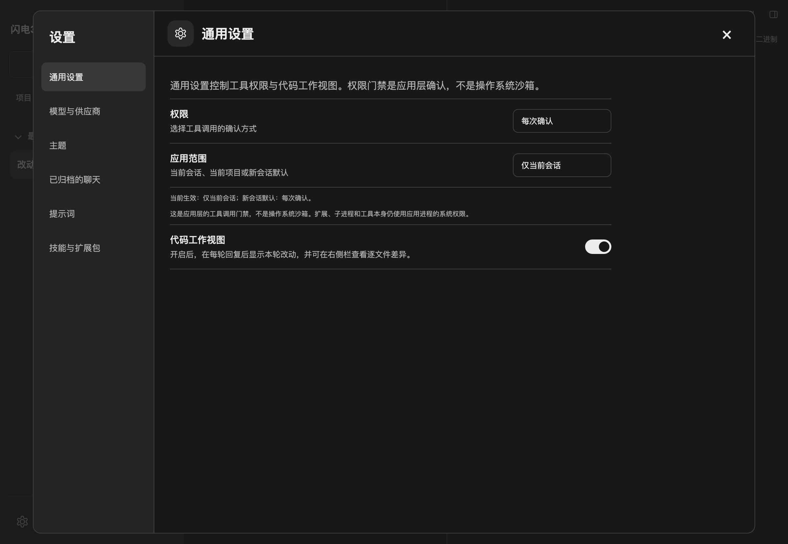
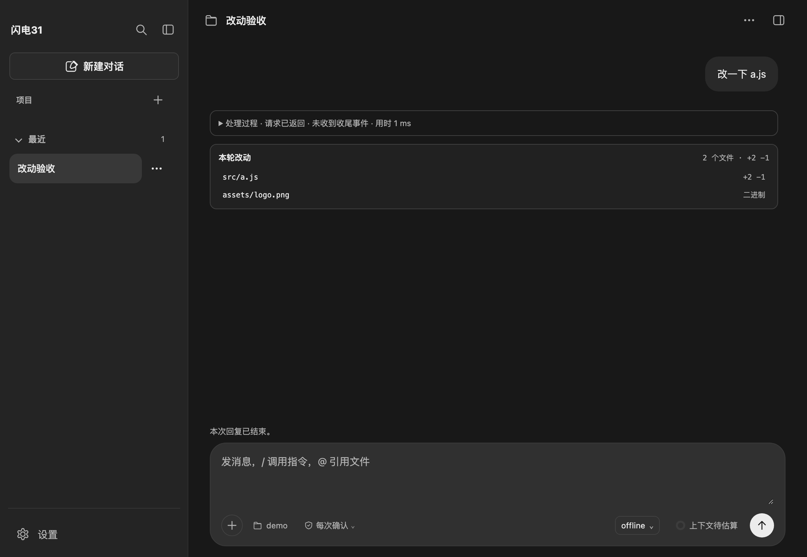
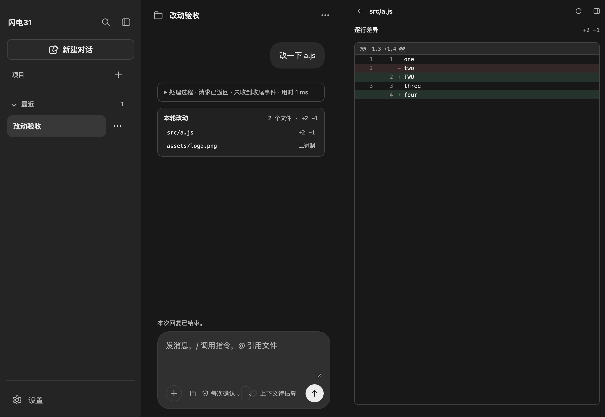

# 代码工作视图

设置 → 通用设置 → **代码工作视图**。开启后，每轮回复结束后显示「本轮改动」卡片，列出本轮修改的文件与增删行数；点击文件在右侧栏查看逐文件差异。关闭后不展示卡片、不请求摘要，也不在发送时拍摄工作区快照。

偏好保存在页面 `localStorage` 的 `agent-client:code-work-view`，默认开启。该开关只影响桌面展示与记录，不改变 Pi 的发送、工具选择、系统提示词或文件写入。



## 记录方式

1. 发送前，主进程在系统临时目录创建本轮记录目录，用临时 `GIT_INDEX_FILE` 给 git 工作树拍基线；仓库对象库以只读 alternate 挂接，新对象写入临时目录，不改仓库 index、refs 或对象。
2. `write` / `edit` 的 `tool_call` 扩展在工具真正执行前把目标文件复制到本轮目录，避免写入后拿不到旧内容。捕获失败不会阻止工具执行。
3. 请求结束后再拍一次工作树，`diff-tree --numstat -M` 得出文件与行数；文件工具捕获覆盖 git 忽略、仓库外和未跟踪文件。
4. 摘要和两份内容只保留在主进程内存与临时目录，不写入 Pi 会话历史，也不进入模型上下文。

无 git 或 git 不可用时，只记录文件工具在写入前捕获的文件；通过 shell 修改的仓库外文件、被忽略文件不会出现在卡片中。二进制文件显示「二进制」，超过 2 MiB 的文件显示「过大」，均不提供逐行对比。

## 呈现



- 卡片位于本轮最终回复之后，显示文件数、合计 `+N −M` 和每个文件的状态；最多直接列出 6 个文件，其余通过「查看全部」进入右侧栏。
- 右侧栏列出全部文件，点击进入差异页；逐行差异带旧/新行号、新增/删除底色和三行上下文，支持横向滚动。
- 大文件或差异计算超过 150 ms 时退化为整文件变化提示；渲染最多保留页面可承受的行数。
- 关闭开关时，已经显示的卡片立即隐藏；重新开启只影响之后的新请求。



## 边界

- 记录跟随请求使用的真实工作目录；切换目录后旧卡片按原记录打开，不重新读取当前目录。
- 摘要按请求编号保存在主进程，最多保留最近 100 轮；应用重启或记录被淘汰后，旧卡片无法再打开差异，与 DSH 的「Host 重启后没有上一轮对比」一致。
- 只读预览与历史恢复不会重建卡片；卡片不随历史消息持久化。
- 子代理会话不记录；模型上下文、工具结果与 Pi 历史不受影响。
- 仅行尾或文件末尾换行不同时，git 行数与逐行对比的显示可能不一致：对比按行内容比较，不把 CRLF 与末尾换行差异当成独立行。
- 临时目录位于系统临时目录，应用退出时清理；启动时清理超过 24 小时的残留目录。

## 实现入口

| 位置 | 职责 |
| --- | --- |
| `src/main/services/workspace-changes-service.js` | git 快照、写前捕获、摘要与逐文件差异 |
| `src/main/services/line-diff.js` | Myers 逐行差异、上下文分块与降级 |
| `src/main/resources/workspace-changes-extension.mjs` | Pi `tool_call` 写前捕获 |
| `src/main/services/chat-service.js` | 请求开始/结束记录与 `changesRequestId` |
| `src/main/ipc/agent-ipc.js`、`src/preload/preload.js` | 摘要/差异只读接口与发送选项 |
| `src/renderer/components/turn-changes.js` | 轮末卡片 |
| `src/renderer/components/code-work-view.js` | 偏好读取、保存与设置绑定 |
| `src/renderer/components/right-sidebar-panel.js` | 右侧栏文件列表与差异页 |

## 验证

自动检查（临时目录与离线模拟，不读取真实会话、不请求模型）：

```sh
node --test tests/unit/line-diff.test.js tests/unit/workspace-changes-service.test.js \
  tests/unit/workspace-changes-extension.test.js tests/unit/workspace-changes-ipc.test.js \
  tests/unit/chat-workspace-changes.test.js
node_modules/.bin/electron tests/ui/turn-changes.check.cjs
```

结果：29 项单元检查通过；页面检查覆盖卡片、文件列表、逐行差异、二进制提示、关闭后隐藏且不再请求摘要、重新开启后的新卡片，以及设置开关文案；截图由该检查生成。另运行 `output-trace.check.cjs` 与 `permission-settings.check.cjs` 作为相邻页面回归，均通过。

单元检查使用真实 git 临时仓库与真实文件写入，但不请求模型；真实模型触发 write/edit、真实项目工作区与重启后的表现尚未人工验收，自动检查不能替代这些场景。
