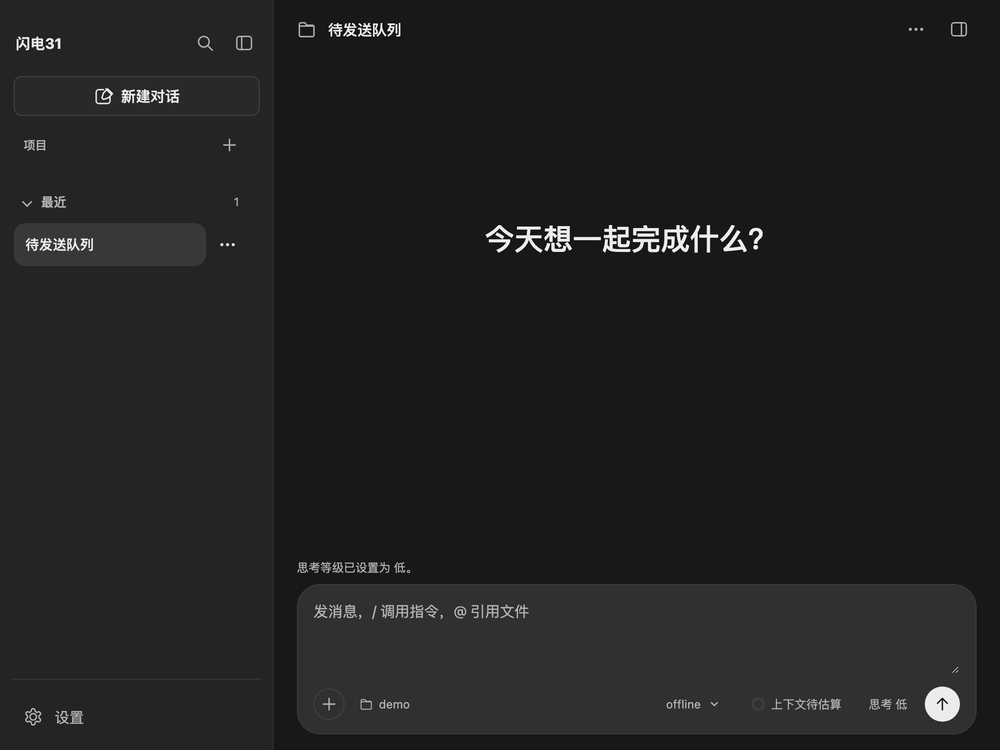

# 输入区（Composer）优化评估

评估日期：2026-11-04。对象：DeepSeek Harness `0.2.1-rc.5` 的 `ui-conversation`（`packages/client/ui-conversation`）与本项目当前输入区（`src/renderer/index.html` 的 `.composer`、`renderer.js`、`composer-persistence.js`）。只读代码与文档，未运行 DSH 界面；工作量为按现有结构估算，不含输入法与真机验收。

## 结论

1. **可以改造，但不能搬代码。** DSH 的输入区建立在 React + Lexical 富文本编辑器 + slot 组合上，组件不能直接复用；它的**提交语义、队列、附件和引用行为**可以按原生 DOM 重做。
2. **优先级**：忙碌时排队/插话 > 双 Esc 停止 > 图片附件 > 文件/引用插入 > 富文本编辑器。前两项只动主进程与少量 UI，收益最直接。
3. **不建议**引入 Lexical 或重写为 contenteditable 富文本：会波及输入法、草稿结构、无障碍与关闭保存，风险和收益不成比例。

## 一、DSH 的输入区做了什么

- **编辑器**：Lexical contenteditable。文本之外还有原子 chip：文件/目录/会话引用、已认领的斜杠命令；命令、引用与普通文字共用一套撤销和选区规则。
- **提交语义**：普通 Enter 按设置发送（空闲发送 / 忙碌时 Queue 或 Steer），`Ctrl/Cmd+Enter` 使用另一种投递方式，`Shift+Enter` 换行；发送按钮文字跟随当前模式（排队发送/插话发送）。
- **队列**：`QueueDock` 显示已排队消息，可编辑、删除、插话；本地回显与 Host 队列行按 `requestId` 对账，失败时恢复草稿。
- **附件**：粘贴/拖入图片（缩略图、灯箱）；拖入带真实路径的文件或目录生成 `@路径` chip；浏览器文件走后台上传队列；不支持的类型整批拒绝。
- **引用**：`@` 文件/会话选择、斜杠命令菜单、模板参数；引用带图标与悬停预览。
- **草稿**：按会话持久化，结构化保存（chip 与普通文字），恢复后仍可编辑；输入法组词期间不提交。
- **周围控件**：上下文用量/统计 dock、模型选择、活动区、待处理交互接管（composer takeover）。
- **键盘**：双 Esc 停止当前轮（间隔可配置，默认 500 ms），Tab 确认补全，Esc 关闭菜单。

## 二、我们的现状

| 能力 | DSH | 本项目 |
| --- | --- | --- |
| 编辑器 | Lexical + chip | 纯 `textarea` |
| 草稿 | 结构化、按会话 | 纯文本 + 版本校验、按会话、关闭前 flush |
| 发送 | 空闲/排队/插话三种 | 单请求串行，忙碌时禁用发送 |
| 并发 | 排队或插话，队列可编辑 | 主进程 `send` 直接拒绝“已有消息正在生成” |
| 附件 | 图片 + 文件 + 目录 | 无 |
| 引用 | @文件/会话、命令 chip | 仅斜杠命令菜单（插入文本） |
| 停止 | 按钮 + 双 Esc | 仅停止按钮 |
| 上下文/模型 | composer 控制行 | 模型选择在 composer 行内，上下文用量在输入框下方独立面板 |
| 输入法 | 组词期间不提交 | 已有同等保护 |
| 关闭保存 | flush | 已有 `flushAll()` 与失败留窗 |

## 三、可复用性判断

| 层 | 结论 |
| --- | --- |
| 组件代码 | 不可用：React、Lexical、slot 运行时与 CSS Modules，和本项目原生 DOM 无对接边界 |
| 提交状态机 | 可以借鉴：空闲/排队/插话三分支与按钮语义；Pi SDK 已提供同名语义 |
| 队列与对账 | 可以借鉴：本地回显 + 按请求编号对账；我们已有 `requestId` 与未确认发送快照的基础 |
| 附件与引用 | 可以按原生实现：`@` 用下拉 + 文本 token 代替 chip，先不做富文本 |
| 富文本编辑器 | 不建议 |

关键有利条件：Pi 的 `session.prompt(text, { streamingBehavior: "steer" | "followUp", images })` 已经支持排队、插话与图片，SDK 侧不需要自造协议；当前只是宿主把并发请求挡掉了。

## 四、可行改造项

| 改造项 | 收益 | 成本（人日） | 主要风险 |
| --- | --- | --- | --- |
| 忙碌时排队发送（followUp）+ 队列条 | 生成中不再被迫等待，最接近 DSH 体验 | 3–5 | 主进程并发、事件归属、队列与草稿/关闭流程交叉 |
| 插话（steer） | 生成中补充约束 | 2–3 | 中断语义与停止按钮、未确认状态互相影响 |
| 双 Esc 停止 | 低 | 0.5 | 输入法组词、菜单打开时需排除 |
| 图片粘贴/拖入 | 截图直接提问 | 2–3 | 主进程校验、草稿不持久化 File、预览与失败恢复 |
| 拖入文件转 `@路径` 文本 | 快速引用用例/日志 | 1–2 | 目录与非法类型拒绝 |
| `@` 文件/会话下拉 | 少打字、路径准确 | 2–3 | 需要工作目录搜索接口；“文本 token”不是 chip，删除体验较弱 |
| 上一条输入（↑） | 低 | 0.5 | 与草稿恢复、历史消息区分 |
| 上下文用量并入控制行 | 界面更紧凑 | 1 | 与现有面板、设置布局交接 |
| Lexical 富文本 + chip | 与 DSH 一致 | 8+ | 输入法、无障碍、草稿结构、关闭保存全面回归 |

## 五、建议路线

1. **第一步：排队发送**。主进程允许在 `activeRequest` 期间调用 `session.prompt(..., { streamingBehavior: "followUp" })`，维护待处理队列；页面在输入框上方显示队列条（编辑/删除/立即插话），发送按钮在忙碌时按模式命名。保留现有“未确认发送”快照与关闭 flush 语义。
2. **第二步：双 Esc 与停止语义**。输入框/消息区连续两次 Esc 调用现有停止；组词、菜单、弹窗打开时不触发。
3. **第三步：图片附件**。粘贴/拖入图片 → 主进程校验类型与大小 → 随 `prompt({ images })` 发送；草稿只记录引用，不持久化原始字节。
4. **第四步：文件与引用**。拖入文件插入 `@相对路径` 文本，`@` 触发工作目录文件搜索下拉；不做 chip 和富文本。
5. **不建议的第五步**：Lexical 或任何 contenteditable 重写。若未来确实需要 chip，再以独立提案评估。

## 六、边界

- 未运行 DSH 界面，交互细节取自其包文档与源码；真实手感（如队列对账的时机）未比对。
- Pi 的排队/插话语义与 DSH 的名称一致，但 DSH 的队列行、投递模式设置与本地回显是其宿主实现，移植到本项目仍需自建 UI 与测试。
- 附件与引用都涉及新的主进程校验入口；需要同时补单元检查与页面检查，不能只按界面验收。

## 已实现（2026-11-04）

本轮实现评估中的输入区改造：默认排队走**宿主侧顺序发送**，生成中插话使用 Pi 原生 `steer`（见下）。

- 生成中按 Enter 或提交：输入进入输入框上方的「待发送」队列，输入框清空，当前请求不被打断；结果区域不会出现第二条消息，直到它真正开始发送。
- 当前请求**正常结束**后自动发送队首；停止或结果未确认时不自动续发，队列保留，可点「发送下一条」手动继续。
- 队列项可「编辑」（仅在输入框为空时）或「移除」；切换会话、新建对话时清空，避免把旧内容发到新会话。
- 队列只保存在页面内存，关闭应用不恢复；宿主仍保证一次只有一个 prompt，事件归属与未确认发送语义不变。
- 验证：`tests/ui/send-queue.check.cjs` 覆盖生成中排队、输入清空、移除/编辑后重新排队、本轮结束后自动发送，以及连按两次 Esc 停止（单次与组词中的 Esc 不触发）；`output-trace.check.cjs` 与 `sidebar-layout.check.cjs` 回归通过。

### 输入区控制行

- 左侧新增「+」：通过主进程原生对话框选择普通文件，复用拖入的路径归一化后插入 `@相对路径`；单次最多 20 个，目录、缺失和越界内容跳过。
- 工作区入口显示当前目录名，点击展开右侧栏文件浏览；复用会话信息同一次 `getSessionInfo()` 读取，不额外请求。
- 模型选择改为紧凑内联，上下文入口与发送按钮保持右侧分组；窄于 480px 时控制行换行，避免窄主列横向溢出。
- 说明：Pi 没有 DSH 的工作区权限沙箱，这里显示**真实工作目录**，不提供没有实际效果的权限选择器；Pi 原生工具仍可直接读写文件（见 AGENTS 的边界说明）。
- 验证：`tests/ui/send-queue.check.cjs` 断言添加入口与工作目录名；`context-usage-page.check.cjs` 与 `sidebar-layout.check.cjs` 的窄窗无溢出检查通过。原生文件对话框需要人工验收。

### 生成中插话（⌘/Ctrl+Enter）

- 生成中按 `⌘/Ctrl+Enter`：通过 Pi 的 `session.prompt(text, { streamingBehavior: "steer" })` 排队，在当前轮工具结束后、下一次模型请求前投递；普通 `Enter` 仍进入宿主侧待发送队列。
- 插话项在待发送区标记「插话」，不提供本地编辑/移除（文本已交给 Pi）；投递事件到达后从面板移除，并在消息区按真实位置补一条用户消息。
- 插话只追加到当前活动请求的会话，不新建请求或输出订阅；本轮结束仍未投递的插话转回待发送队列，停止后不自动续发。
- 验证：`tests/unit/output-events.test.js` 覆盖会话绑定、未生成时拒绝、`queue_update` 移除后补发用户消息；`tests/ui/send-queue.check.cjs` 覆盖 ⌘+Enter 插话排队、投递后落到消息区。

### @ 文件引用

- 输入框里输入 `@` 及其后的片段时，在输入框上方列出当前工作目录内的文件与目录；目录带「目录」徽标，方向键切换高亮，Enter/Tab 插入 `@相对路径 `（目录以 `/` 结尾），Esc 关闭。
- 只插入纯文本路径，不做 chip；插入后走原有 `input` 事件，草稿保存与发送校验沿用同一链路。
- 主进程限制：只搜索工作目录内的普通文件与目录，跳过 `node_modules`、`.git`、`sessions`、`.env` 与符号链接；最多扫描 2000 项、返回 50 条、深度 10，只返回相对路径。
- 不提供会话引用：Pi 没有跨会话引用的消费契约，插入一条模型读不到的会话编号没有意义。
- 输入法组词期间不弹出；光标离开 `@` 片段、点击菜单外或切换会话时关闭。
- 验证：`tests/ui/file-reference.check.cjs` 覆盖列举（含目录）、按名称过滤后回车插入、目录带斜杠插入、方向键与 Esc 关闭；`tests/unit/workspace-search-service.test.js` 覆盖跳过规则、目录类型、过滤排序与结果上限。

### 输入历史（↑/↓）

- 每个会话保留最近 50 条**实际发送**的原文（排队项在真正发送时才记录）。
- 输入框为空时按 ↑ 调出最新一条，继续 ↑ 向更早；↓ 返回较新，越过最新一条恢复进入历史前的草稿。
- 输入框有文字时不接管方向键，保留多行光标移动；手动编辑或切换会话退出翻阅。
- 验证：`tests/ui/send-queue.check.cjs` 第 5 项覆盖调出、前进/后退、边界保持与「有文字不接管」。

### 文件拖入

- 拖入普通文件时高亮输入框，松开后按主进程结果插入 `@相对路径`；工作目录外保留绝对路径，目录、缺失或读不到系统路径的内容都不插入。
- 不读取文件内容；插入走原有 `input` 事件，草稿保存与发送校验不另走链路。
- 依赖 Electron `webUtils.getPathForFile`（preload 暴露），主进程单次最多接受 20 个文件。
- 验证：`tests/unit/dropped-path-service.test.js` 覆盖相对/绝对、目录/缺失/上限；`tests/ui/send-queue.check.cjs` 覆盖拖拽高亮与无系统路径提示。**真实系统拖拽仍需人工验收**。

### 双 Esc 停止

- 生成中连续两次 Esc（间隔 500 ms）调用与停止按钮**相同**的取消路径，不另建停止接口。
- 单次 Esc、输入法组词中的 Esc、长按重复按键、斜杠命令菜单打开、任意 `<dialog>`（含扩展交互）打开时都不计入；切换会话清空序列。
- 停止按钮的悬停提示改为「停止生成（连按两次 Esc）」。

**排队与插话的分工**：默认排队仍是宿主侧顺序发送（一次一个 prompt），插话使用 Pi 原生 `steer`。`steer` 不新建请求，仍归属当前请求的事件流；未使用 `followUp` 实现队列，因为它会改变“一次请求”的结束语义。插话的用户消息只在适配器确认 `queue_update` 移除后补发，普通用户消息仍由页面本地回显。

**边界**：队列不持久化；停止后不自动续发；排队不打断当前请求。插话由 Pi 排队且只在下一轮请求前生效，投递前关闭应用会丢失；宿主不持久化插话队列。
