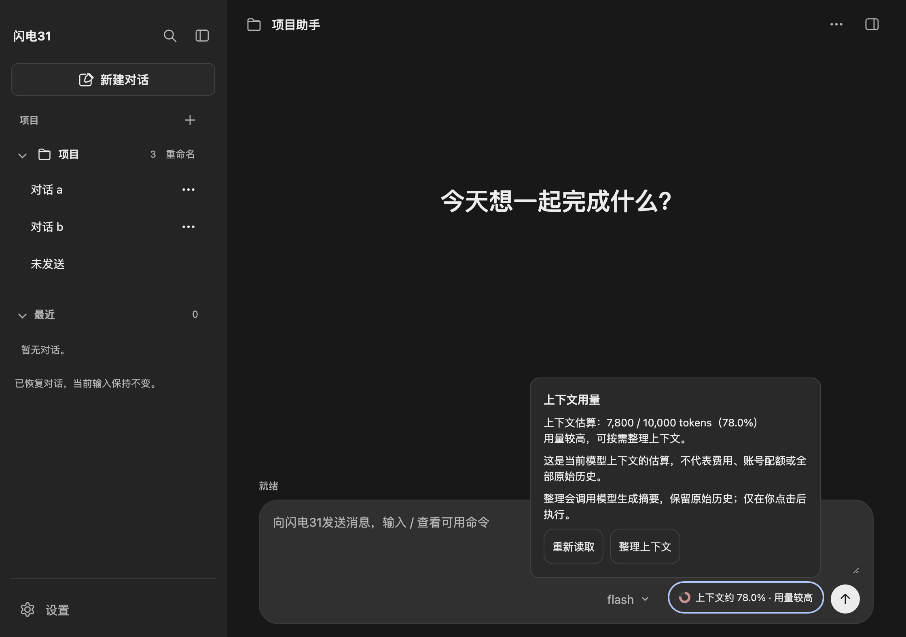
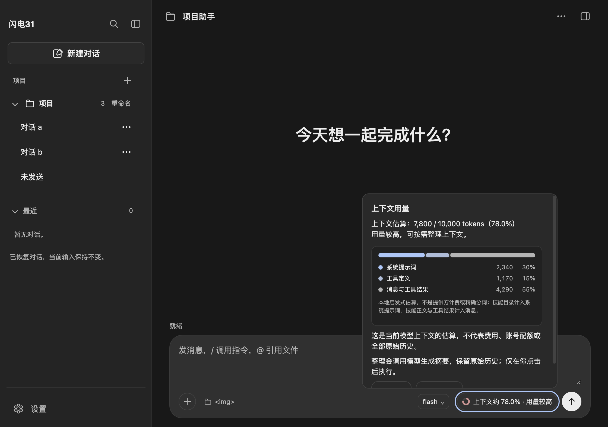

# 上下文用量

2026-11-02：输入区常驻入口已接通。下一步为项目重命名的完整接线。

## 使用

输入区控制行（模型选择与发送按钮之间）显示环形指示与“上下文约 32.0%”。点击可查看估算tokens、模型窗口及说明，并可“重新读取”或沿用原有“整理上下文”。窄于 560px 时只保留环形指示，完整文案进入悬停提示与无障碍名称。Enter打开，Tab进入详情按钮，Escape收起并返回入口；输入法组词时不拦截Escape，点击外部或焦点移出也会收起。

### 上下文构成（DSH 风格）

详情面板新增三段式构成，只在展开详情时读取，不参与发送、压缩或模型请求：

- **系统提示词**：Pi 生成的 system prompt，包含技能目录（name/description/location）；
- **工具定义**：当前活动工具的名称、描述与参数 schema；
- **消息与工具结果**：对话消息、工具结果和已加载的 `SKILL.md` 正文。

三段都使用本地启发式估算（约 4 字符/token，另加消息/工具结构开销；图片按固定占位），不是提供方分词器或计费数据。技能目录计入系统提示词，技能正文与工具结果计入消息，因此没有单独的“skill”行；这与 DSH 的 `contextBreakdown` 口径一致。环形百分比仍只使用 Pi 的 `getContextUsage()`，构成条只显示三段之间的相对比例。

| 情况 | 展示及行为 |
| --- | --- |
| 有效零值 | 上下文约0.0%，与未知区分 |
| 暂无估算 | 上下文待估算，不显示0%；整理后未知仍保留已知窗口大小 |
| 达到75% | 显示“用量较高” |
| 达到90% | 显示“接近上限”；仍可发送，不自动整理 |
| 生成中 | 保留上次估算并标明“生成中”，可看详情，暂停重读与整理 |
| 读取失败 | 清除旧数字，显示失败与只读重试入口 |
| 切换会话或模型 | 立即清除旧估算，重新读取实际目标；迟到响应不能覆盖当前展示 |

估算不是费用、账号配额或全部原始历史的总量。75%/90%是提醒阈值，不保证请求一定成功或失败。“重新读取”不调用模型；只有主动点击“整理上下文”才执行既有模型摘要流程，保留原始历史，取消入口仍在页头。

会话内容过少或最近刚整理过时，SDK 会拒绝整理。此时页面提示“当前对话内容较少，无需整理。”或“最近已整理过，暂无可整理的新内容。”，不重建消息区、不追加错误，主进程也不把它当作失败抛出。只有真实整理失败才显示错误信息。

菜单会话信息与常驻用量共享同一次`getSessionInfo()`读取，没有额外轮询或模型请求。初始化、新建、历史打开、项目/目录切换、未发送会话恢复、当前会话归档、模型切换、发送结束/停止/失败、整理成功/取消/失败及文件保存事实后均更新。切换失败重新读取实际会话，文件保存后的信息读取失败不改变已确认保存结果。

输入、文件草稿及归档恢复保持原有行为。关闭准备或归档结果尚未核对时冻结入口，避免开始新操作。





## 实现

- `src/renderer/components/session-info-panel.js`：统一读取并发布状态，按请求序号和当前会话编号保护迟到响应，支持失效、失败后的必要刷新与页面释放。
- `src/renderer/components/context-usage.js`：消费统一状态，展开详情时通过专用接口读取构成，展示估算与提示、管理详情和忙碌状态。
- `src/renderer/renderer.js`：接入组件、各切换入口使旧估算失效、文件保存后刷新，并将模型选择器与设置页的实际切换接入同一保护。
- `src/main/services/session-service.js`：`getContextBreakdown()` 按系统提示词、活动工具和消息做本地估算，不替代 Pi 总量。
- `src/main/ipc/agent-ipc.js`、`src/preload/preload.js`：新增只读 `agent:read-context-breakdown`，仅在展开详情时调用。
- `src/renderer/index.html`及`styles/context-usage.css`：控制行入口、构成条、图例、详情及窄窗布局，沿用深色主题变量。只保留一个用量状态播报区域；窄窗下详情相对 composer 定位，避免越出视口。

本轮新增一个只读 IPC，不修改 Pi 的上下文计量、发送、压缩或历史语义；不请求模型。

## 验证

实际工作区与仅包含本轮变更的精确副本均通过5个脚本语法、以下9文件62项单元检查：

```bash
node --test \
  tests/unit/context-usage-view.test.js \
  tests/unit/context-breakdown.test.js \
  tests/unit/session-info-refresh.test.js \
  tests/unit/session-info.test.js \
  tests/unit/context-compaction.test.js \
  tests/unit/proposal-apply.test.js \
  tests/unit/agent-ipc.test.js \
  tests/unit/model-switch.test.js \
  tests/unit/model-settings.test.js \
  tests/unit/window-close-controller.test.js
```

上下文19项页面专项（含三段式构成）及归档17/置顶19/未发送28/关闭14/侧栏79项回归通过；`context-breakdown` 3项单元检查通过：

```bash
node_modules/.bin/electron tests/ui/context-usage-page.check.cjs
node_modules/.bin/electron tests/ui/session-archive-page.check.cjs
node_modules/.bin/electron tests/ui/session-pin-page.check.cjs
node_modules/.bin/electron tests/ui/unsent-session-page.check.cjs
node_modules/.bin/electron tests/ui/window-close-page.check.cjs
node_modules/.bin/electron tests/ui/sidebar-layout.check.cjs
```

专项使用实际页面、preload和IPC，业务与模型均为模拟，覆盖零值/未知/阈值/纯文本安全、共享一次读取、失败重试、会话与模型迟到响应、各切换入口、保存事实、生成及请求失败、整理四种结果（含空操作）、键盘导航/输入法保护，以及1120/760/375宽度的入口、展开详情和内部溢出检查。

实际报告/截图在系统临时目录`context-usage-ui-gvjezl`，精确副本报告在`context-usage-ui-D9mhNf`；已查看375宽度展开详情截图。全部使用临时userData、阻止页面HTTP/HTTPS，不读取真实.env、配置、会话或验收文件，不请求真实模型。整理测试使用模拟返回，不代表已执行真实摘要；尚无本轮用户真实界面验收反馈。
