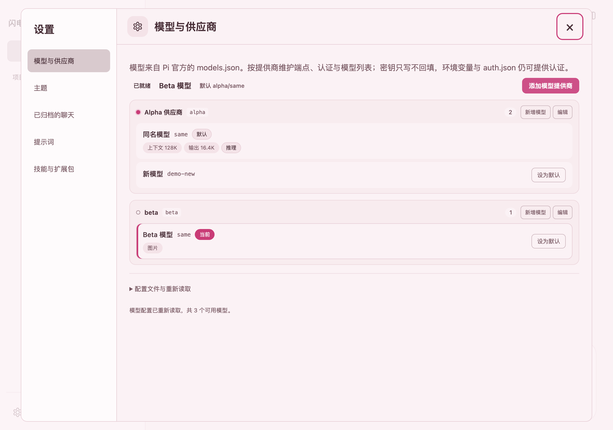
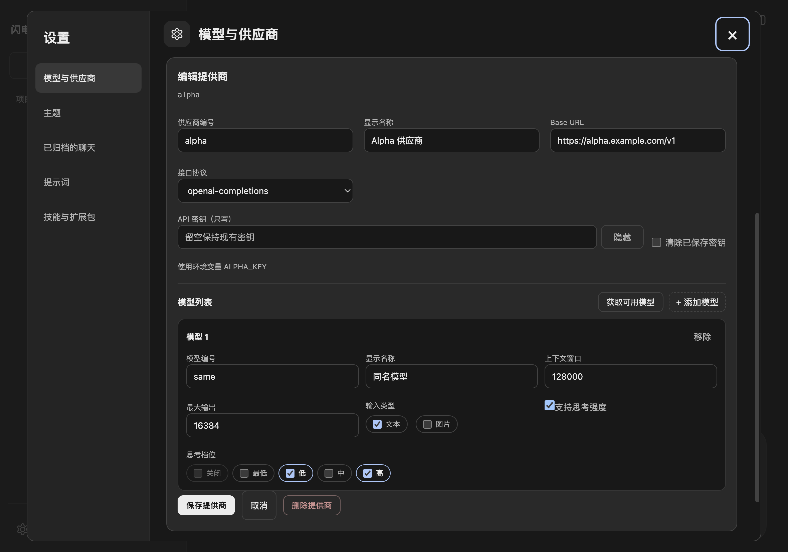
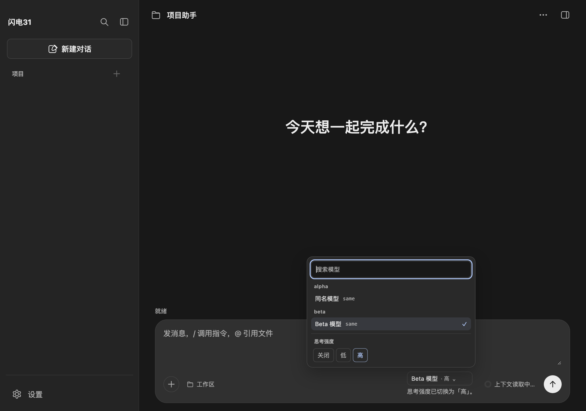

# 模型与供应商（DSH 风格）

模型数据仍写入 Pi 官方 `models.json`，但设置页按 DSH 的模型管理方式重做：提供商卡片、单个提供商编辑器、只写密钥、模型行与模型发现。旧的自定义模型表单、当前模型大卡片、独立思考强度下拉和 `model-settings.json` 私有配置入口已从模型页移除；`.env`、`auth.json`、`models.json` 仍由 Pi 官方运行时解析。

## 设置页

设置 → 模型与供应商：

1. **提供商卡片**：每个供应商显示认证状态点、名称、编号、可用模型数，以及「新增模型」「编辑」。状态点区分 `models.json` 已配置密钥、环境变量可用、环境变量缺失、未配置四种情况；未配置不代表不可用，`auth.json` 仍可能提供认证。
2. **模型行**：显示名称、编号、上下文、输出、推理/图片能力，以及「当前」「默认」标记；可把任意模型设为新对话默认。配置了但运行时未加载的模型标记「未加载」。
3. **添加提供商**：打开空白提供商编辑器，填写编号、名称、Base URL、接口协议和模型行；保存后写入 `models.json` 的 `providers`。提供商编号是配置键，编辑时只读。
4. **编辑提供商**：可改名称、端点、协议；模型列表逐行编辑。未在 `models.json` 中登记的运行中提供商也能打开编辑器，保存后补登记。
5. **API 密钥**：输入框只写，保存后不回填。可输入明文密钥，也可输入 `$ENV_NAME` 引用环境变量；勾选「清除已保存密钥」并保存会删除 `models.json` 中的 `apiKey`。页面从不读取或回显已存密钥。
6. **模型列表**：每个模型可编辑编号、显示名称、上下文窗口、最大输出、输入类型（文本/图片）、是否支持思考强度及思考档位；每行可移除。保存时以模型编号为键合并，未在表单中出现的未知字段（如 `headers`、`cost`、`compat`）按原条目保留；全新模型使用 `models.json` 的官方字段。
7. **获取可用模型**：对 `openai-completions`、`openai-responses`、`anthropic-messages` 请求端点 `models` 目录（OpenAI 追加 `/models`，Anthropic 追加 `/v1/models`），返回候选列表；重复模型不勾选，确认后加入编辑行。请求使用表单中刚输入的密钥，或已有 `apiKey` / `$ENV`，超时 15 秒；密钥不返回页面、不写日志。
8. **删除提供商**：二次确认后移除整个 `providers` 条目及其模型；当前/默认模型可能因此不可用，运行时重读会给出实际结果。
9. **保存与重新读取**：保存提供商和模型后主进程立即重读模型运行时；底部「配置文件与重新读取」保留路径复制、打开 `models.json`、重新读取入口。

## 对话框中的模型选择

composer 的模型位改为 DSH 风格：

- 触发器显示当前模型名称和当前思考强度；
- 菜单按提供商分组，支持名称/编号/提供商搜索与键盘上下移动；
- 菜单底部直接切换当前模型的思考强度，不再单独显示「思考」下拉；原独立控件保留为隐藏兼容节点，避免旧界面/检查误用；
- 选择模型、思考强度仍通过主进程受限接口提交，原有会话级模型记忆和默认模型语义不变。

## 安全与边界

- `models.json` 以 `0600` 原子写入；用户输入的 `apiKey` 会以明文或 `$ENV` 引用保存在该文件。页面只接收 `credential`/`credentialDetail`，不接收密钥原文；`headers` 不返回、不覆盖。
- 模型发现只访问用户填写的 Base URL；不跟随任意页面地址，不在日志或错误消息中输出密钥。仅支持上述三类协议，其他协议提示手动填写。
- 不实现 DSH 的 Cordis settings/credentials 命名空间、账号登录、版本冲突 revision、provider slots 或 OAuth；这些依赖 DSH 自有宿主，不属于当前 Pi 桌面应用。
- `apiKey` 直接写在 `models.json` 是 Pi 支持的配置方式；如果组织要求只用环境变量，可只输入 `$ENV_NAME` 或留空，改用环境变量/`auth.json`。

## 代码位置

- `src/main/services/model-provider-service.js`：`models.json` 读取、提供商/模型保存与删除、密钥字段保留、模型发现。
- `src/main/ipc/model-ipc.js`、`src/preload/preload.js`：受限的 `save-provider`、`delete-provider`、`discover-models` 与既有模型接口；写入后重读运行时。
- `src/renderer/components/settings/model-providers.js`：提供商卡片、提供商编辑器、模型行、密钥只写与发现交互。
- `src/renderer/components/model-selector.js`：composer 的分组搜索模型菜单与思考强度。
- `src/renderer/styles/model-settings.css`、`model-selector.css`：设置页与对话框样式。

## 验证

```bash
node --test tests/unit/model-provider-service.test.js tests/unit/model-ipc.test.js tests/unit/model-list.test.js
node_modules/.bin/electron tests/ui/model-providers.check.cjs
node_modules/.bin/electron tests/ui/send-queue.check.cjs
```

- 模型管理页面检查 **27 项**：提供商卡片与认证点、当前/默认标记、只写密钥与显示切换、添加/移除模型行、模型发现候选、保存后目录刷新、新增/删除提供商、设置默认、配置文件入口、深色与樱粉三档宽度无横向溢出。
- `model-provider-service` 11 项、`model-ipc` 2 项、`model-list` 3 项：提供商/模型写入保留密钥与未知字段、删除边界、环境变量认证状态、OpenAI/Anthropic 模型发现、IPC 互斥与重读。
- 既有页面回归：主题 42、侧栏 79、上下文 19、未发送会话 28、`send-queue` 通过；确认隐藏原生模型选择/思考兼容节点未破坏发送链路。以上均为临时夹具与模拟接口，未请求外部模型。
- 真实目录读取实测：使用临时 `PI_CODING_AGENT_DIR` 和 `models.json`（`verify-provider/verify-model`，`apiKey: "$VERIFY_KEY"` 并设置进程内占位值），Pi `ModelRuntime` 返回该模型，`readCatalog()` 返回 `credential: "environment"` 且不含密钥原文。该检查不发起模型请求。
- 真实读写回环：临时 `models.json` 经新提供商保存接口写入 `roundtrip/roundtrip-model`，随后 `readCatalog()` 返回该模型、`ModelRuntime.getAvailable()` 返回 `roundtrip/roundtrip-model`，目录序列化中不包含密钥。






