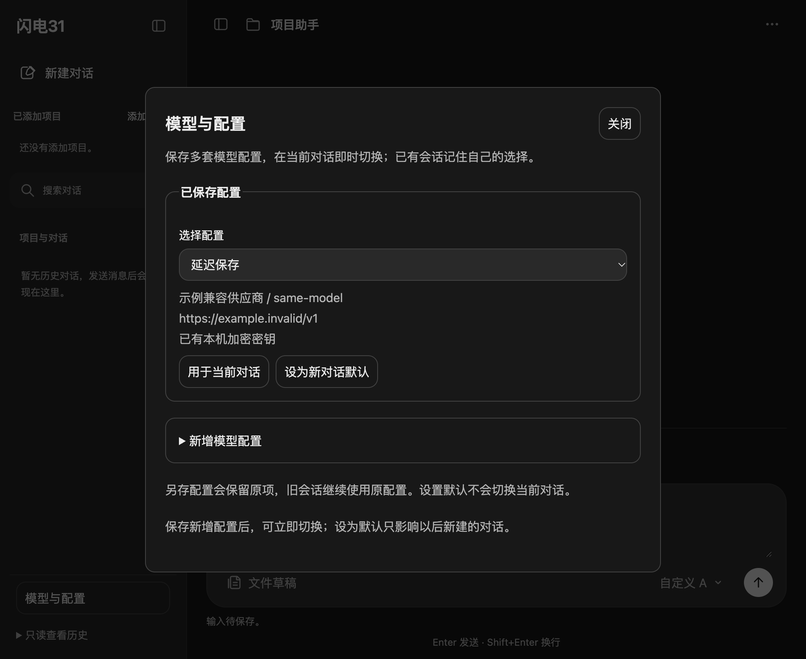

# 模型与配置

在侧栏底部打开“模型与配置”。可以保存多套配置；同一个模型 ID 可以使用不同名称、地址或密钥。右下方模型选择器按配置切换，当前对话的编号、上下文、输入与文件草稿保留。已有消息的会话重新打开或重启后恢复自己的配置。

- **保存为新配置**：新增一项，不改变当前对话或已有默认项；没有原配置时第一项自动成为默认。
- **用于当前对话**：立即切换当前会话的模型；不改变新会话默认项。
- **设为新对话默认**：以后新建会话使用该项；不切换当前对话。
- **修改配置**：用新名称另存，保留原项供旧会话恢复。首版没有编辑或删除已有配置的入口。

## 读取 .env

启动时仍通过 `loadEnvFile()` 读取项目根目录的 `.env`。没有保存过本地配置时，`PI_PROVIDER`、`PI_MODEL`、`PI_BASE_URL` 作为“原有模型配置”；凭据由对应供应商读取，例如 DeepSeek 的 `DEEPSEEK_API_KEY`。已有本地配置时，保存的默认项优先，不会被 `.env` 自动覆盖。

即使已经保存过其他配置，也可以展开“新增模型配置”，点击“读取 .env 配置”，将启动时的供应商、模型 ID 和地址填入表单。此操作不保存、不改变默认、不切换当前对话，密钥不回填。确认名称后保存即可使用。修改 `.env` 后需要完全退出并重新启动，才会重新读取文件。

示例只描述字段，不包含真实凭据：

```dotenv
PI_PROVIDER=deepseek
PI_MODEL=deepseek-flash
PI_BASE_URL=https://api.deepseek.com
DEEPSEEK_API_KEY=填写你自己的密钥
```

读取到的模型必须已登记在 SDK 中；不会把无效模型 ID 自动替换成其他模型。

## 供应商与密钥

新增内置配置支持 OpenAI、Anthropic、DeepSeek。其他服务可以使用“自定义兼容接口”，填写供应商名称、模型 ID、完整地址、真实上下文窗口及最大输出，选择 OpenAI Chat Completions、OpenAI Responses 或 Anthropic Messages 协议。自定义首版支持文本输入和 API Key，不包含云厂商签名、OAuth 或额外认证头。

新增配置可以独立输入 API 密钥，使用 Electron `safeStorage` 加密保存；也可以为内置供应商选择已有 SDK API 密钥。SDK 凭据选项不复制 OAuth 令牌。关闭页面及保存完成后清除未保存的密钥原文。请求和密钥会发往填写的地址；保存配置本身不联网，也不验证远程权限或接口兼容性。

本地配置位于 `app.getPath("userData")/model-settings.json`。V1 单配置在首次成功写入时升级到 V2，原密文保留。配置编号与会话历史绑定，应保留配置文件及本机密钥保护环境；配置缺失会明确失败，不会仅凭同名模型套用另一套密钥。SDK 未发送消息的空会话尚不保证落盘，不能承诺这类空会话重启后恢复模型选择。

## 验证

本轮在实际工作区运行 15 个相关测试文件，共 82 项通过，覆盖配置、真实 SDK 无推理初始化、同名模型凭据隔离、即时切换、历史/分支恢复、启动与通信接线，以及输入和目录操作回归。12 个改动脚本语法检查通过。实际渲染代码的临时副本通过 25 项 Electron 模拟检查，包括 .env 表单、失败恢复、草稿保留、键盘操作和 1400/900/390 三档布局。

```bash
node --test \
  tests/unit/model-settings.test.js \
  tests/unit/model-profiles.test.js \
  tests/unit/model-settings-env.test.js \
  tests/unit/model-config.test.js \
  tests/unit/model-switch.test.js \
  tests/unit/model-list.test.js \
  tests/unit/model-restore.test.js \
  tests/unit/pi-agent-init.test.js \
  tests/unit/session-info.test.js \
  tests/unit/agent-ipc.test.js \
  tests/unit/session-service.test.js \
  tests/unit/workspace-switch.test.js \
  tests/unit/composer-draft-ipc.test.js \
  tests/unit/draft-send-ipc.test.js \
  tests/unit/composer-send-dismiss.test.js
```

自动测试只使用临时文件、占位密钥和模拟接口，不访问真实会话或请求模型。另对本机现有 `.env` 做了只输出通过状态的离线检查：配置可解析、地址格式有效、模型已登记、凭据可解析、临时 SDK 会话可初始化；未输出凭据、改写 `.env`、读取真实会话或发起推理。以上不代表已验证远端接口和账号权限。

下图为模拟数据的配置窗口：


