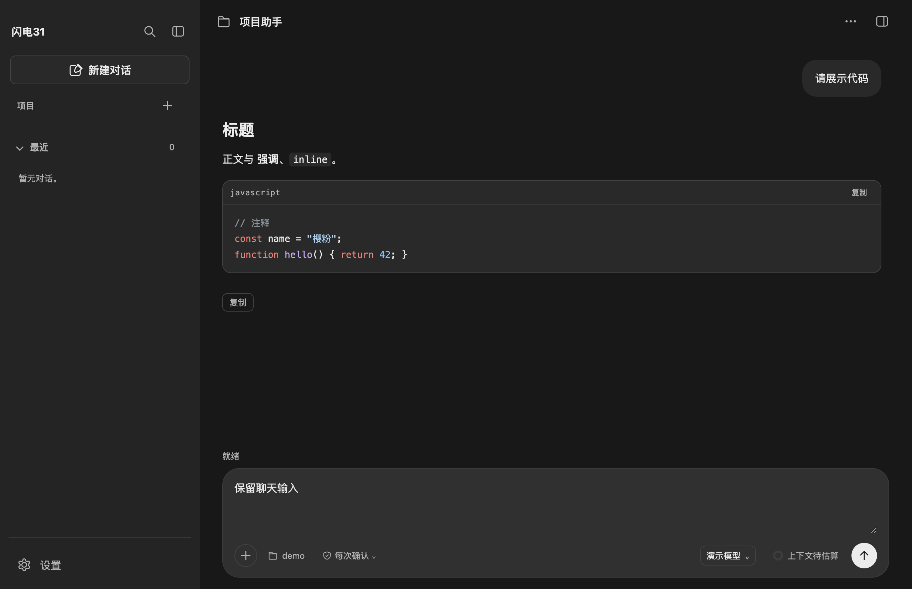
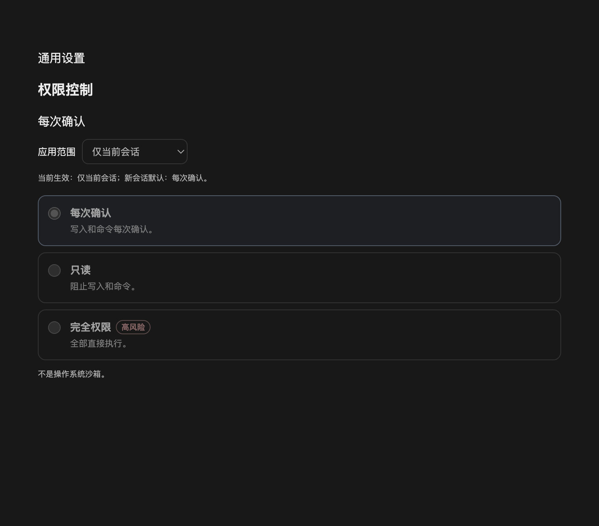

# 通用设置：权限控制

## 为什么需要应用层门禁

Pi 官方没有类似 DSH 的沙箱 + 审批器。按 [Pi 扩展文档](https://github.com/earendil-works/pi/blob/v1.4.0/packages/coding-agent/docs/extensions.md)，应用只能在官方 `tool_call` 事件里拦截模型发起的工具调用；项目信任只解决“项目内的扩展/技能/配置是否加载”，不控制运行时工具。

DSH 的模型是 `read-only`、`workspace-write`、`full-access`（以及实验 Auto）预设加 `approval` seam。本应用没有 Pi 侧沙箱，因此不伪装成 workspace-write；改为三个可解释的应用层模式：

| 模式 | 行为 |
| --- | --- |
| 每次确认（默认） | 读取/搜索/项目检查直接执行；写入、命令、登录、录制等工具每次弹窗确认 |
| 只读 | 阻止写入、命令、登录、录制等工具；读取、搜索和项目检查仍可用 |
| 完全权限 | 所有工具直接执行，不再确认；系统提示词同时声明用户已授权本任务的工具和写操作，模型不再按“未授权”只做只读；自动信任当前项目资源；设置页显示高风险提示 |

权限按范围保存，优先级为**会话 > 项目（工作区）> 新会话默认**：

| 范围 | 存储 | 影响 |
| --- | --- | --- |
| 仅当前会话 | `sessions[sessionId]` | 只影响当前会话；其他会话按项目/默认 |
| 当前项目所有会话 | `workspaces[workspace]` | 同一真实工作区的所有会话；保存时清除当前会话的旧覆盖 |
| 新会话默认 | `defaultMode` | 没有会话/项目覆盖的新会话 |

## 输入框里的权限选择器

输入框底部、工作区入口右侧提供 DSH 式的权限触发器（盾牌 + 当前模式 + 下拉箭头）。点击后可切换：

- **每次确认**：读取类工具直接执行，写入和命令逐次弹窗；
- **只读**：阻止写入和命令；
- **完全权限**：确认风险后直接执行。

输入框切换写入**当前会话**范围；设置页的「应用范围」可选择仅当前会话、当前项目所有会话或新会话默认。两个入口共用同一份设置，设置页保存后会通知输入框更新，输入框切换后当前会话立即生效。



## 实现

- `src/main/services/permission-service.js`：保存在 `app.getPath("userData")/permission-settings.json`，v2 结构为 `defaultMode`、`sessions`、`workspaces`；兼容旧版 `{version:1, mode}` 并在下次保存时升级。写入 `0600` 原子临时文件；损坏文件回到安全默认但不自动覆盖。
- `src/main/resources/permission-gate.mjs`：官方 `tool_call` 扩展。读取类工具（`read`、`read_workspace_*`、`list_workspace_directory`、`search_workspace_text`、`get_current_time`、`todo_write`、`qa_ui_project`、`web_search`、`web_fetch` 等）直接执行；带 `readOnlyHint` 的 MCP 工具也直接执行；`browser_snapshot`、`browser_verify_*`、`browser_network_*`、`generator_read_log` 等观察类录制工具按只读处理；其他工具按模式确认或阻止。确认使用 Pi 官方 `ctx.ui.confirm`，没有 UI 时失败关闭。门禁从 `ctx.sessionManager.getSessionId()` 和 `ctx.cwd` 解析会话/项目范围，不接受页面提供的编号或路径。
- 同一扩展在 `before_agent_start` 写入 `app-permission` 系统提示词段，按当前模式告诉模型：完全权限视为已授权本次任务，不要逐项询问或只做只读；每次确认直接调用工具、由应用弹窗确认，但弹窗只决定本次工具调用，任务需要写操作而测试环境未说明时仍按技能先确认一次；只读不要尝试写操作。模式保存后在下一轮提示词立即生效。
- `src/main/pi-agent.mjs` 在创建会话时按会话/项目解析权限；`src/main/resources/pi-resources.mjs` 的 `resolveTrust` 在完全权限下直接信任项目资源，不弹项目信任确认，也不写入 `ProjectTrustStore`。
- `src/main/ipc/agent-ipc.js`、`src/preload/preload.js`：`agent:read-permission-settings` / `agent:save-permission-settings`，主进程从当前实际会话与工作区解析范围，保存走共用空闲互斥。
- `src/renderer/components/settings/permission-settings.js`：设置页「通用设置 → 权限控制」提供模式和范围下拉；当前生效范围以说明展示。
- `src/renderer/components/permission-selector.js`：输入框内的权限选择器，默认保存到当前会话；设置页变更通过 `permission-settings-changed` 事件同步。
- 设置页新增「通用设置」分类；模型、主题、归档、提示词、技能与扩展包分类保持不变。

## 边界

- 这是**工具调用门禁，不是操作系统沙箱**。工具、扩展和子进程仍使用应用进程的系统权限；`bash` 能做的事不会因为“只读”而变成文件系统只读。
- 只读模式会阻止所有未声明为只读的工具；未知工具按“可能写入”处理。
- 完全权限会跳过所有确认，包括命令和文件写入；只在明确信任当前任务时使用。系统提示词会把它声明为本次任务的授权，但不会绕过操作系统权限或用户在提示词里明确排除的范围。
- 完全权限自动信任项目资源是**本次会话的加载决定**，不写入 `ProjectTrustStore`。会话创建后再切换到完全权限，不会自动补载之前因未信任而被排除的项目扩展/技能；需要新开会话或重新加载。
- 确认只对本次工具调用有效，不形成永久授权，也不替代测试环境授权；任务需要写操作而测试环境未说明时，仍按技能先确认一次。权限模式改变后当前会话的后续工具调用立即使用新模式，系统提示词在下一轮更新。已有会话若未加载权限扩展，需要新开会话或重启客户端。
- `todo_write` 仅更新界面任务列表，不视为文件写入；`qa_ui_project` 只读取项目配置和目录，不返回凭据。

## 验证

```bash
node --test tests/unit/permission-service.test.js tests/unit/permission-gate.test.js tests/unit/permission-trust.test.js
node_modules/.bin/electron --no-sandbox tests/ui/permission-settings.check.cjs
node_modules/.bin/electron --no-sandbox tests/ui/permission-selector.check.cjs
node_modules/.bin/electron --no-sandbox tests/ui/theme-settings.check.cjs
```

- 权限服务：6 项（默认值、会话/项目/默认优先级、旧版迁移、未知/缺少上下文、损坏输入）。
- 权限门禁：7 项（读工具直通、写工具确认、只读阻止、完全权限放行、MCP 观察/点击分类、无 UI/拒绝失败关闭、系统提示词按模式更新、会话/工作区上下文传递）。
- 完全权限项目信任：2 项（完全权限不弹信任确认、非完全权限仍按既有流程）。
- 权限设置页面：6 项（三种模式、会话/项目范围、完全权限风险提示、忙碌禁用）。
- 权限选择器：5 项（默认状态、菜单、会话保存、设置同步、Escape 关闭）。
- 主题设置 43 项复跑通过，确认新增「通用设置」分类、范围选择和输入框选择器没有破坏现有设置页导航与窄窗布局。


