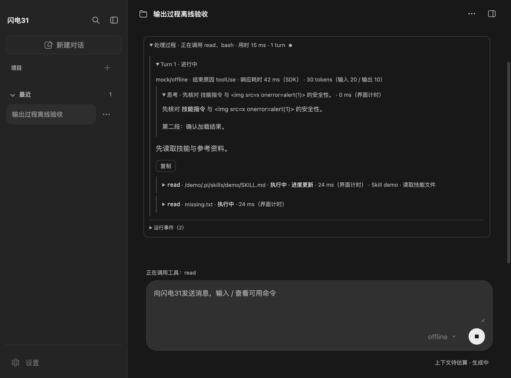
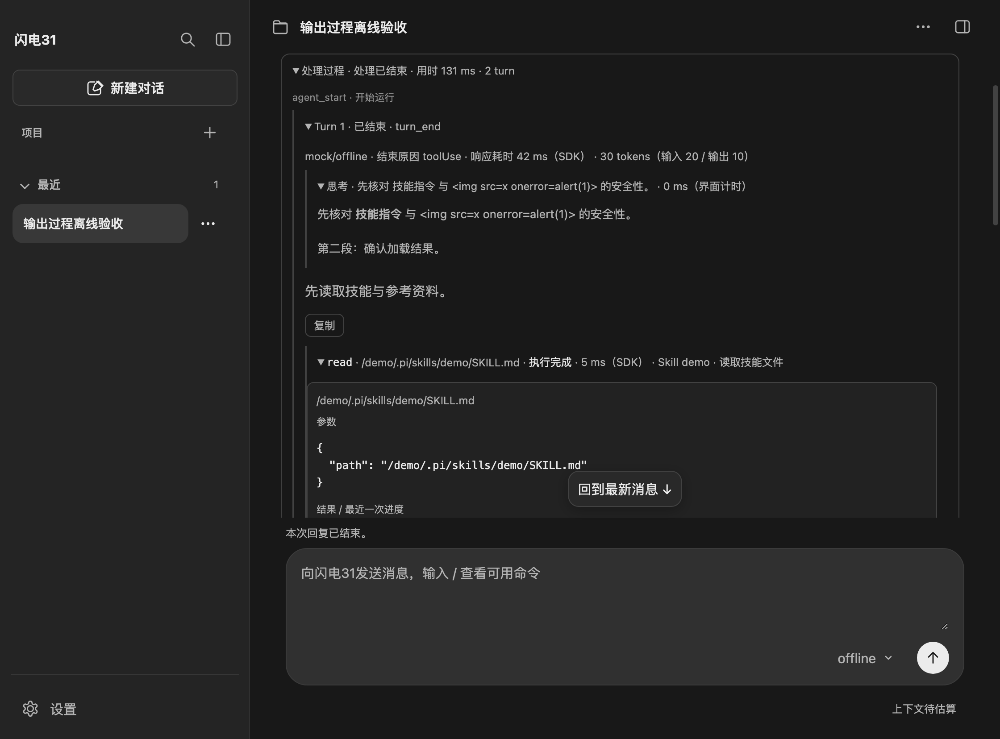
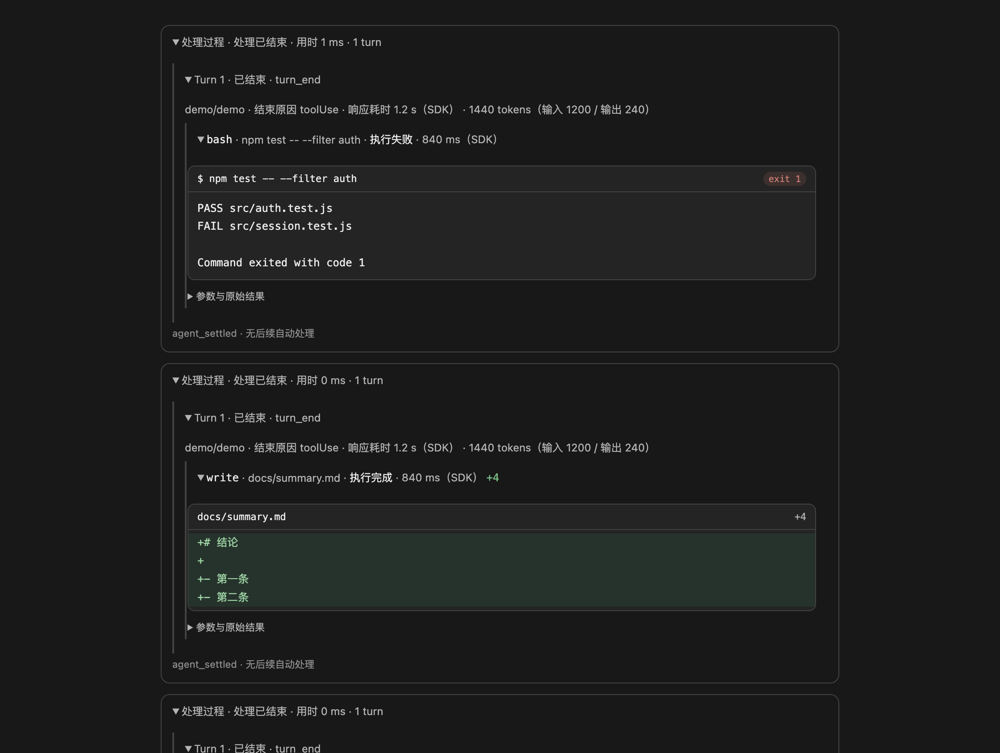
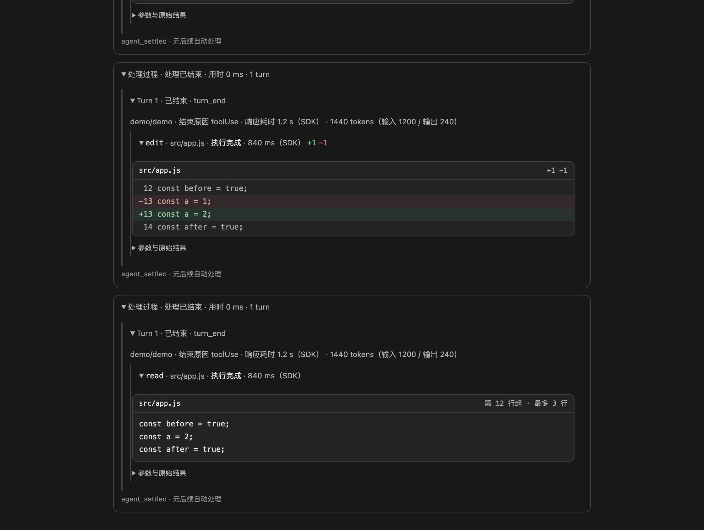

# Pi 原生模型输出过程

每次请求开始即显示 **处理过程**，生成时展开，随原生事件更新准备、等待模型、思考、生成回复、调用工具、重试和收尾状态，以及本次实时用时。thinking 与 turn 默认展开；思考折叠时只显示一行预览，展开后按 Markdown 排版。工具摘要依次展示名称、目标（命令或文件路径）、状态、耗时及 write/edit 的行数变化，展开后的参数与结果收在一张卡片里。回复中的代码块带语言标签与复制入口，流式正文末尾显示光标。SDK 收尾后自动收起过程与内部详情，外部保留最后一条不含工具调用的回复正文；中间说明移入过程区，仍可重新展开查看、复制。正文沿用 Markdown。

停止、异常或未收到收尾事件时也停止计时、收起过程并显示实际状态，不制造最终回复。最后一条含工具调用的说明保留在过程区，没有独立结果时不改写为成功答复。工具支持同名并行及按 `parentToolCallId` 嵌套展示，均按调用编号关联。历史恢复采用相同的折叠布局。

## 当前呈现

以下截图来自 `tests/ui/output-trace.check.cjs` 的模拟事件与临时数据，不是真实模型回复，也不代表供应商侧耗时。





工具卡片使用离线合成的演示数据，仅用于核对排版：





## 官方依据

已阅读 [Pi 最新文档](https://pi.dev/docs/latest)，并核对本项目固定的 Pi 1.4.0 安装包文档、公开导出和类型：

- [How Pi works](https://pi.dev/docs/latest/how-pi-works)：Agent 循环与工具执行。
- [SDK](https://pi.dev/docs/latest/sdk)：订阅 `AgentSession` 事件。
- [JSON output](https://pi.dev/docs/latest/json)：内容块增量、完成快照及生命周期。
- [Message types](https://pi.dev/docs/latest/message-types)：text、thinking、toolCall、toolResult 与 usage。
- [Skills](https://pi.dev/docs/latest/skills)：渐进加载、原生 read 与 `/skill:name` 展开。
- [Settings](https://pi.dev/docs/latest/settings)：`hideThinkingBlock` 是隐藏思考块的交互设置，默认 `false`。

官方规定了事件和内容语义，提供 thinking 隐藏/展开交互；没有找到“桌面生成时展开所有过程、结束后统一折叠并突出最终结果”的明确规范。此处采用使用者要求的类似 Codex 的桌面呈现，不复用 Pi 内部 TUI 组件，不宣称这是 Pi 强制规范。Pi 也没有独立的“最终正文”内容类型，本页面以是否出现后续助手响应和工具调用进行呈现归类，保留原始消息与结果。

Pi 没有单独的 trace 对象或“skill 执行成功”事件。本功能是原生事件的桌面展示，不增加模型请求，不替换 SDK 的执行、资源发现或持久化。

## 计时来源

| 时间 | 来源与边界 |
| --- | --- |
| 本次用时 | 页面准备完输入、开始发起请求，到 `agent_settled`；缺失该事件时以发送返回或异常结束。使用单调时钟 `performance.now()`，包括等待、重试和工具阶段，不等于供应商纯推理耗时 |
| 模型响应耗时 | 响应结束后优先采用 Pi `AssistantMessage.durationMs`。SDK 类型规定它是响应起始至结束的单调计时，旧历史或之后获取的 deferred 结果可能缺失 |
| 响应中用时 | 从页面收到 `message_start` 观察计时；最终缺少 SDK 耗时时明确标为“界面计时” |
| 思考阶段 | 从收到 `thinking_start` 或首段 thinking 增量，到 `thinking_end`，缺失时以响应结束/请求收尾停止。明确标为“界面计时”，不声称是供应商内部思考耗时 |
| 工具调用耗时 | 结束后优先使用 Pi `tool_execution_end.durationMs`，即工具 `execute()` 的单调计时；执行中按页面收到的事件计时，标为“界面计时”。没有实际执行或未提供 SDK 时间时不制造官方时间 |

页面每 250 ms 仅刷新时间文字，不轮询模型、不重排 Markdown。自动收尾、异常、停止及页面销毁释放计时器，完成后时间冻结。历史只显示已保存的 SDK 耗时，不重建本次总用时或思考阶段时间，不把未知显示为零。摘要的悬停说明也标明计时来源。

## 事件与显示规则

| 原生内容 | 桌面行为 |
| --- | --- |
| `agent_start` / `agent_end` | 记录本次底层运行开始、结束；`willRetry` 时继续等待，不提前宣布请求结束。运行事件收进折叠的「运行事件（N）」区，默认不打断正文阅读 |
| `agent_settled` | 标记“处理已结束”或“已停止”，冻结用时并收起过程；表示没有后续自动处理，不代表业务成功。发送结果未确认时优先显示未确认 |
| `turn_start` / `turn_end` | 实时 turn 编号与状态；一个 turn 是一次助手响应及其产生的工具执行 |
| text / thinking 增量 | 按 `contentIndex` 关联，按帧合并页面更新；块结束值替换增量，`message_end.message` 替换整个响应 |
| thinking | 仅展示供应商实际返回的可见文本；没有则不补写。redacted 内容隐藏，签名不传页面。折叠预览取首行（运行中取最近完成段落的首行）并去掉强调标记，展开正文与回复共用 Markdown 清理链路 |
| toolCall 增量 | 区分参数生成和实际执行；完成参数替换 JSON 片段 |
| `tool_execution_start/update/end` | 按 `toolCallId` 更新参数、最近一次进度和最终结果；保留父调用关系及实际耗时 |
| retry / compaction | 单独记录生命周期，不混入模型正文；自动处理仍由 SDK 决定 |

部分工具的进度更新是累积快照，另一些是独立片段。本页面只展示最近一次进度，不擅自拼接未知工具的协议；最终结果覆盖进度。长工具参数和结果仅在页面预览截断为 12000 字符，Pi 历史与模型上下文不受影响。工具参数与结果使用 `textContent`；思考正文、回复正文与代码块沿用现有 Markdown 清理链路，代码语言标签和复制按钮只读取已清理的纯文本。

工具没有结束事件时显示“结果未确认”。发送结束却没有收到 `agent_settled` 时明确提示，不凭发送返回猜测成功。停止后仍接收工具结束和 settled 收尾。监听只发送到发起请求的页面，按请求会话过滤；官方扩展替换会话时保留原请求归属，结束/异常均解除订阅。旧草稿操作入口保持兼容。

## 工具卡片

结构明确的工具用卡片展示，其余继续使用通用参数/结果。卡片只从调用参数与已记录结果派生，字段缺失或格式不符时回退，不猜测文件内容。

| 工具 | 卡片内容 | 数据来源 |
| --- | --- | --- |
| bash / pwsh | 命令行抬头、终端输出、`exit N` 徽标 | `args.command`、结果文本；退出码优先用 `structuredContent.exit_code` |
| read | 文件路径、起始行与行数上限、正文 | `args.path/offset/limit`、结果文本 |
| write | 文件路径、`+N`、正文行 | `args.path/content` |
| edit | 文件路径、`+N -M`、差异行（新增/删除/上下文） | `details.diff`；缺失时按 `edits[].oldText/newText` 逐段还原 |

卡片存在时，参数与原始结果收进默认折叠的「参数与原始结果」；没有卡片的工具保持原来的直接展示。主进程只投影 `exitCode`、`diff`、`fullOutputPath` 三个标量字段，不把 `details` 或 `structuredContent` 整体送到页面。历史消息只保存 `details`，旧记录没有结构化退出码时从 Pi 追加的 `Command exited with code N` 文本读取。

页面最多渲染 200 行卡片内容、12000 字符文本；超出部分只在页面截断，Pi 历史和模型上下文不变。

## Skill 的证据边界

- **显式展开**：本次输入为 `/skill:name`，且实际 user 消息经 SDK 公开 `parseSkillBlock` 解析后，与当前 loader 的技能名和路径一致。只说明指令已展开，不说明技能任务成功。
- **读取技能文件**：原生 `read` 参数归一为绝对路径后，与当前 loader 登记的技能文件匹配。工具结果显示读取完成或失败，不把名字中含 `SKILL.md` 的普通文件误认为已加载技能。别名、`~` 或不同链接路径未匹配时保留普通 read，不猜测技能身份。
- **技能展开记录**：历史中由官方解析器识别的技能块。以记录展示，不重新执行技能或验证当前文件。只读历史预览不加载资源，因此自然语言触发的历史 read 可能仅显示为普通工具。

读取技能的参考文件、运行其脚本仍按真实工具展示。没有独立的技能成功、技能执行耗时或宿主关键词路由。

## 历史与验证

沿用 Pi 的消息历史，不另存一份 trace 日志。重新打开和只读预览恢复 thinking、toolCall、toolResult、模型、usage、stopReason、已记录耗时及 `nestedCalls` 摘要。历史标为“历史恢复 / 响应记录”，不虚构实时 turn 事件、重试顺序或缺失计时。嵌套摘要不含结果正文；`complete: false` 明确标记不完整。

自动检查（临时配置、工作目录和历史，不读取真实认证/会话，不请求付费模型）：

```sh
node --test tests/unit/output-events.test.js tests/unit/pi-output-runtime.test.js tests/unit/session-preview.test.js tests/unit/message-adapter.test.js tests/unit/agent-ipc.test.js tests/unit/chat-service.test.js tests/unit/window-close-preload.test.js tests/unit/session-info.test.js
node_modules/.bin/electron tests/ui/output-trace.check.cjs
```

上述 37 项单元/集成检查及完整页面检查通过。真实 SDK 检查只替换公开 Agent 的模型流函数，实际使用 Pi 1.4.0 会话、原生 read、技能展开与历史保存，覆盖两 turn 和订阅释放；另模拟会话替换以核对原请求归属和新订阅清理。页面检查覆盖增量终值覆盖、同名工具乱序结束、嵌套、自动重试、停止、缺失结束、历史恢复、重复发送、Markdown 复制、安全文本及 1120/680 宽度；脚本输出临时截图位置。本轮补充思考行预览与 Markdown、工具目标与 write/edit 行数统计、代码块语言标签与复制、流式光标，以及 bash 退出码、write/read/edit 卡片与折叠原始区的页面断言。既有 `context-usage-page.check.cjs` 的 19 项检查也通过，覆盖旧文本通道兼容、上下文用量、切换、停止、整理与窄窗。

扩大运行 `session-service.test.js` 时，“缺少模型配置必须报错”的旧断言失败；隔离的修改前提交 `bd3623b` 同样失败（实际先报缺少工作目录），不将它记录为本功能通过，也未改动该无关断言。本轮没有进行真实供应商推理验收。

自动页面检查已增加固定时钟验收：等待状态、思考/响应/工具各阶段、SDK 时间优先、重试不提前折叠、完成冻结、缺失时间不伪造、键盘焦点保护、异常未确认优先及计时器释放。另保存 `process-live.png` 和 `result-collapsed.png` 供检查；截图与模拟结果不代替真实模型验收。

手动验收：重启应用，在有工具需求的对话中观察自动展开的过程、状态与用时；使用支持 thinking 的模型核对思考内容，发送 `/skill:qa-requirement-review` 核对显式展开，再用自然语言触发技能并观察 read 标记；结束后过程应自动收起且只突出最后结果，可以重新展开查看中间说明。检查停止和重开后的历史。模型不返回 thinking 或未读取技能时，页面应如实保持缺省。
