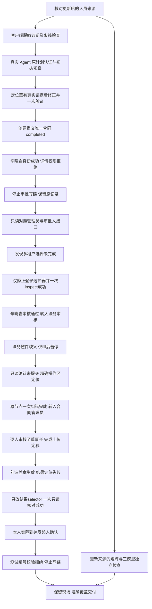
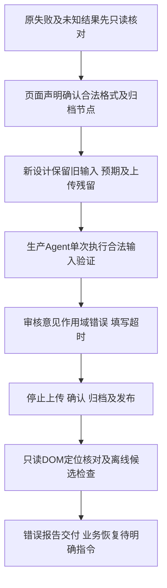
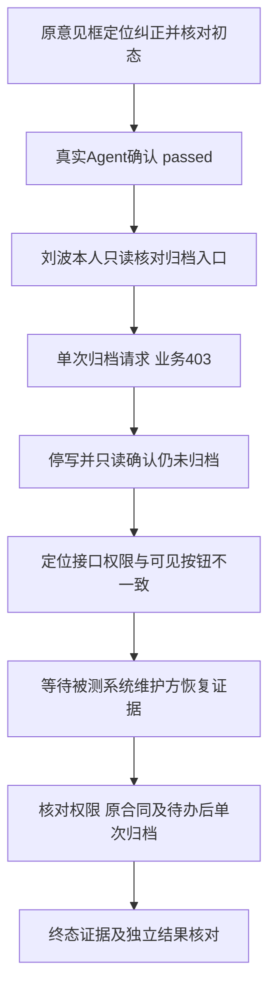

# 采购合同真实 Agent 续验（2026-11-12）

时区：Asia/Shanghai（UTC+08:00）。本轮遵循用户新增约束：严格按实际功能测试，不修改被测系统源码，不代审、不改账号权限或业务配置来凑通过。

## 已确认的进展与停止位置

**当前结论：发起人确认已真实通过；2026-11-13新登录预检发现刘波已有经营合同归档权限，但仍缺本次采购合同归档权限，尚未再次归档。** 原合同 `478297089609900032 / HSKJ-CGHT-2026-900` 仍为归档、finalDraftConfirmed=1、archiveFlag=0，编号/日期/扫描件保留。12日采购归档业务403仍是原始失败；13日只读预检未通过即停止，未发新归档POST、未修改权限或被测系统。需补齐准确的procurement-contract/archive授权并重新核对后，才能由生产Agent执行一次定向归档。完整链终态与独立全链回放均未通过。


客户端补齐脱敏登录子阶段、有限请求 HTTP 状态/数字业务码及审批页面失败观察；不保存认证头、请求/响应正文。inspect、execute 成功及页面失败增加有限 pageText，截图使用 fullPage，内嵌滚动区不承诺全部展开；inspect 保留隐藏文件输入框，text/value 检查为全等、须定位具体节点。验收启动器在进程内从现有项目配置读取已授权密码并注入原 QA_UI_TEST_PASSWORD 入口，未改写凭据文件，没有新增凭据库、重试器或流程引擎；这不代表已重启用户桌面窗口或验证其既有进程环境。

用户更正的“姜干才”已核对并同步至实际测试工作区人员表，除8处姓名外与原文件一致；旧候选、失败批次和来源快照保持不变。新增目标按更新来源建立独立任务，不把新预期伪装成旧用例定位修复。

真实生产 Pi Agent（Electron 主进程，既有 qwen3.8-flash-next 模型）已创建并提交独立测试合同，未用模拟模型代替业务验收：

实际链路：用户目标 → 临时 Electron 验收启动器 → 本仓库 createPiAgent（会话目录临时隔离、真实模型及已登记qa_ui工具）→ qa_ui_approval / qa_ui_explore → 生产登录与浏览器执行资源 → pms 测试环境。只读候选随后经 qa_ui_save_candidate → qa_ui_run(validate) → qa_ui_publish；没有使用 Codex 子Agent替代业务Agent，也未向其他人员发送消息。

| 项目 | 实际结果 |
| --- | --- |
| flowId / 配置版本 | approval-procurement-new-20261111；创建版本2；逐人修订租户控件，董事长纠正选择器后为版本12，保持 frozen |
| 创建 Agent 会话 | 01a1cd56-c8b3-7471-890b-d146e82f79f5 |
| 合同名 | QA-采购合同-approval-procurement-new-20261111 |
| 记录 ID / 流程编号 | 478297089609900032 / LC-HSKJ-CGHT-2026-11-109 |
| 创建提交 | completed，20个动作有原始轨迹；并未重复新建 |
| 首次停止时状态 | APPROVING / APPROVAL，部门负责人审核、辛晓岩 |
| 首个审批人恢复 | 版本3，check-ce9725f4-b9d1-42ab-ad55-00b869c7568a inspect completed，已选择正确租户，有本人同意入口 |
| 首个审批动作 | department-review completed，check-b54e0cda-95d2-4422-9875-cd0e1fa97c73，3条原生动作；10:13:57（UTC+08:00）转入法务审核，页面处理人科技公司法务 |
| 法务 / 合同管理员 | legal-review completed（含原失败attempts）、contract-admin-review completed（check-70a4b245-e060-465a-9f6c-ba5b8dc7a834），转入经营发展部审核 |
| 经营发展部串行 | operation-development-first completed（check-ded44780-6ecb-4261-a708-098eafafeb94）后仍待朱栋华；operation-development-second completed（check-f13c6023-ad1f-41a9-849f-68b91f3b29ce）后进入市场营销部／许玲懿；逐人独立登录和3条动作 |
| 市场营销部 / 分管领导 | marketing-review completed（check-9795b065-b8c2-4c2e-b651-89ec5ab3d432）；executive-review completed（check-6512d474-2dc9-48ee-bae1-5eb78a95753e）；转入总经理审核／陈振飞 |
| 总经理审核 | general-manager-review completed（check-43e31608-3985-45d9-9e15-08db98f60124）；只读接口确认转入董事长审核，顶层开关false与配置内true差异仍保留 |
| 董事长审核 | chairman-review completed（check-d526c8bf-f7cf-4499-a13f-d8e7d945d3c6），10:52:25 进入发起人上传定稿 |
| 发起人上传定稿 | upload-final completed（check-779f1de8-edd2-4dc9-b387-6992c50380fd），真实上传测试fixture并提交，10:58:52 进入合同管理员盖章／刘波 |
| 合同管理员盖章 | seal 3动作完整，原check-131127f1-5714-428e-b049-68990cdbfd69因结果标签层级错误保留unknown；只读纠正定位后check-1faca40a-5688-4e13-aeed-9b960fd7bf34 completed，未重复盖章 |
| 发起人确认 | 本人inspect completed（check-0b5c4fe9-deff-4984-a048-4ec03d8e5471）；execute check-142835be-dc8d-4721-be22-c793c0badb9d为unknown/target-unconfirmed，7动作完成、最后列表链接未出现。测试编号格式不合法，未确认通过 |
| 归档 / 完整链独立验证 | 未执行；没有完整链candidate/run/publish，不计通过 |
| 残留 | 用户已接受的唯一测试合同及测试附件，保留现场，不清理其他数据 |

管理员只读详情业务码200，确认上述记录及节点；辛晓岩账号真实登录后，同一详情接口 HTTP200但业务码403，页面提示“权限不足／详情加载失败”；其 department-tree 和 permission 两接口 HTTP200、业务码500。管理员的相应接口均为业务码200。已证实当前账号访问被拒绝；403/500的服务端根因（权限、租户或流程权限判断）仍缺服务端日志，不能仅凭状态码认定某种配置错误。不更换管理员审批，不提升账号权限绕过。

09:58（UTC+08:00）独立首页观察进一步确认：辛晓岩登录后进入 `/tenant/switch`，有「项目管理」(20220107) 和另一个租户，尚无已选择租户标记；目标合同 tenantId 也是20220107。已部署的正常登录机制要求多租户账号先选择卡片，而原验收配置缺少此步骤、直接访问目标页。因此前述403/500是在未完成租户上下文时观察到的，不能据此宣判账号需要授权或被测系统存在权限缺陷。证据为工作区 `qa/ui/tasks/approval-remediation-20261112/tenant-membership.json` 及截图。

针对实际前置条件补充最小修复：租户卡片单击即选择时省略 confirm，等待选择页完成跳转后才访问业务页；`configure-login` 仅对已登记人员修订登录选择器，须当前 baseRevision 与来源，保留旧配置及修订原因、递增版本。已执行步骤均 completed、无候选时才允许；业务账号、身份、记录、入口、审批规则及旧执行步骤不变。未知写入仍禁止修改。该操作明确替代原“冻结后连登录定位也无法纠错”的过严限制，不开放通用冻结配置修改。

生产 Agent 已使用新接口将辛晓岩登录选择器修订为版本3，随后唯一一次 inspect 成功，并已完成其部门负责人审核。原403/500阻塞在正确租户下解除；这里的成功指同一合同及本人审批入口、流转到下一节点均有真实证据，不是仅凭登录返回成功。未修改被测系统或其权限。完整链尚需后续节点及独立回放，不在首节点成功时提前结束验收。

工作区证据（下列路径相对 `/Users/liyingjun/Desktop/SW-QA/18-00work space`）：

- `qa/ui/approvals/approval-procurement-new-20261111/flow.json`：冻结步骤与真实编号。
- `check-b946e776-80fb-44d8-b443-f0357f8f3db0`：本轮最初初态失败；只读DOM证实旧 button:text-is 定位不到嵌套 span，提交按钮真实存在；修正定位器后一次 inspect 成功。
- 同 flow 下 `check-85406306-f07a-409f-bc70-d0eef1c49035`：修正后的创建前 inspect。
- 同 flow 下 `check-8c0bf926-11ae-437e-b695-015fb3d71953`：创建提交 completed、意图与20步成功轨迹、记录ID及截图。
- 同 flow 下 `check-ba97145a-d782-4ecf-9376-e9f4f74108bc`：辛晓岩 record-unconfirmed，无审批意图。
- `qa/ui/tasks/approval-remediation-20261112/{reviewer,administrator}-api-observation.json`：脱敏真实接口对照及业务状态；同目录保留截图与创建Agent报告。
- 脱敏精选事件已保存至工作区任务目录 agent-*-events.json；原始 Agent 事件与临时历史：`/private/tmp/procurement-remediation-20261112/agent-{diagnose,create,coverage}.json` 及对应 sessions 目录。

## 本轮执行路径



恢复路径：以多租户页面新证据为依据，仅修正原人员的登录选择器，选择与合同一致的项目管理租户；沿原 flowId/recordId 一次只读 inspect，通过后从首个未执行审批节点继续。仍被拒绝则保留结果并停止，届时再依据带正确租户的证据排查服务端。不得重建合同或修改业务预期。审批人、当前待办、记录和下一节点均须逐人核对；发起人确认严格等真实到达该节点后验收。

## 法务控件歧义及有界恢复

法务账号正确租户下 inspect completed（check-902953e6-5c40-4735-88c3-699c27a182e1）。首次 execute 的 check-1f70471c-4585-4c6b-9a07-e0f8e1fb43e6 为 unknown / target-unconfirmed，actionIndex=1；原生 actions/intents 均仅一条 fill，未点击同意，已记录请求均为GET。业务页仍是法务节点；只读观察确认同意文字有两个：历史 approval-status 标签与当前 footer.form-actions 下操作按钮。不是业务提交超时，不重放已提交动作。法务节点已由生产Agent一次纠正完成（check-9744a177-92a3-4ee9-8c2b-85ab51f01aec，3条成功动作），进入合同管理员审核，原失败作为attempts保留。

新增的 retryEvidence 校验仅允许该类有完整证据的 target 失败、此前所有动作均fill、cleanup确认、原节点最多一次、仅改失败selector；before/after/人员/输入均冻结。新尝试保留旧attempts，重新登录核对原状态后才操作。已开始click/upload/select、action/after未知、预期变化或第三次尝试全部拒绝；本地夹具已验证提交生效后未知仍只能reconcile。实际唯一按钮定位为 `footer.form-actions button.primary:has-text("同意")`，不以全页文字匹配历史标签。

原记录分支只读核对（record-branch-before-gm.json）另发现顶层 chairmanReviewRequired=false，而 approverConfig.chairmanReviewRequired=true；两字段不一致按原值保留，不修改被测系统或记录。总经理节点预期只验证本人完成及同意留痕，后续按真实待办观察可选分支，不提前假定董事长已启用或已跳过。

## 定向验证与其他覆盖

最终客户端定向检查通过：

```sh
node --test --test-name-pattern='auto-login' tests/unit/ui-testing-runtime.test.js tests/unit/ui-approval-preparation.test.js tests/unit/ui-approval.test.js
node --test tests/unit/ui-approval.test.js tests/unit/ui-approval-preparation.test.js
```

第一条命令按名称筛选，仅计入 auto-login 的实际检查；第二条单独运行审批和准备检查为2项通过。增加隐藏上传输入观察及reconcileAfter后又分别运行 `node --test tests/unit/ui-approval.test.js`（1项通过）和 `node --test tests/unit/ui-approval-preparation.test.js`（1项通过）；未把名称筛选跳过项记为通过。新增单击租户选择（无独立confirm）、冻结业务下版本化登录选择器纠错、只填写意见后定位纠错一次、拒绝已提交未知结果重放与保留原尝试的检查均通过。登录检查验证失败仅提交一次、禁用按钮不发请求、凭据与查询参数脱敏；审批检查验证有限页面文字、HTTP200内业务403诊断且不泄露响应token，并保留三账号隔离、真实本地上传、完整链候选回放和未知结果只读核对。均使用临时本地夹具、不请求付费模型或访问真实账号。语法与差异检查通过；发布包、跨平台和全量测试未执行。

真实补覆盖与上述本地检查分别记录：

| 目标 | 实际任务 / 资产 / 结果 | 结论边界 |
| --- | --- | --- |
| 更新姓名及采购合同七部门矩阵 | `task-88fe3e3e-51e9-4059-b091-ec2e1bf46aaa` completed，4次模型调用、4动作、cleanupConfirmed=true；`pms-procurement-approver-matrix-updated-20261112@0001`；`run-282344b4-1bda-406e-b18c-d2d394a05641` passed，1 test、退出码0、cleanup=deleted；已发布 verified | 七行负责人/分管领导、六固定列以及新增经营发展部/市场营销部两列检查通过。此矩阵测试本身不证明真实串行；本轮另有审批专用分支的逐人串行证据，二者不混算。脚本没有精确的11列全集及顺序断言，不据此宣布 AP-01 全覆盖。 |
| 采购结果及三模型切换隔离 | `task-3f14447e-7dd5-414f-bad3-e1e5c5dcc87b` failed，2026-11-12 09:46:42（UTC+08:00）；agent-run / RuntimeError / undeclared-readonly-control，6次模型调用、5个成功动作、cleanupConfirmed=true | 成功点击采购结果选项后，下一点击目标为 LI、role=none，未匹配 contract 中 role=option 的只读声明，执行守卫停止；不放宽守卫、不原样重试。未完成采购文件及回切，未生成候选、未 validate/publish；不能将部分截图视为三模型隔离通过。 |

本轮新增独立回放只有1个 test且通过，不是48条设计全通过；旧姓名不符的 failed run 保持原值。旧采购合同↔采购文件两模型的 passed 记录也不能替代采购结果模型。本轮矩阵 case 的 S1–S5 是同一目标的多个断言，不拆成五条 test。round 快照里的 conversionRate 分母仅是 eligibleFeatures，不是48条设计；候选关联计数也不是语义覆盖率。

进一步核对脚本：人员断言使用 toContain，经营发展部还检查两人文本先后位置。因此通过证明预期姓名出现及所测顺序，不证明单元格没有额外人员、人员全集严格相等，也不证明真实审批串行执行。不能把补覆盖设计中“全等”的表述扩大为脚本已经验证的事实。

新48条逐例状态另存工作区 `qa/design/采购合同-审批流程-执行映射-2026-11-12-rev5.md`，与原设计编号集合一一对应，保留旧rev4。新映射区分已回放资产、仅业务观察、部分覆盖和未执行节点。

## 异常及处置

- 本地浏览器首次因监听本机端口 EPERM 未启动，经所需运行权限解除后登录检查通过；失败现场保留，未访问业务。
- 最初诊断 Agent 在只读分析后未按时收尾，20分钟上限触发 client aborted；没有业务写入，不再重启该阶段。后续创建 Agent 已正常收尾，不能把诊断超时写为完整通过。
- 创建 Agent 首次 execute 缺少动作数组，被校验以“每个节点需要1–40个明确动作”拒绝，尚未执行业务；补齐已准备的20步后执行成功。工具调用有两次，业务创建仅一次，未掩盖首次拒绝。
- 创建前旧选择器导致 before-unconfirmed；只读DOM与截图证明按钮存在、定位器不匹配；修正后一次验证通过。
- 首个审批人的 record-unconfirmed 之后仅做只读接口诊断及管理员状态对照，未重放审批、未改权限。当时依据业务403与基础接口500暂停；后续查明缺少多租户选择，按新证据修复并恢复，原失败保留。
- 最终并发测试暴露既有夹具预设某方必先取得文件锁，依赖调度顺序；已改为观察执行持锁后的首个请求再竞争准备操作，一次修正后定向验证通过。
- 三模型任务的只读控件不匹配已停止该分支；模型请求当次有6次成功调用，没有证据将其归因为模型服务超时。该失败不构成重启旧超时任务或放宽控件权限的理由。
- 补覆盖 Agent 保存 round 时一次因 baseRevision 过期被拒；读取实际0002后更新引用，保存0003 partial成功。随后触发20分钟上限、client aborted，未完成最终 coverage.md；已有原生 passed run 和0003快照仍有效，Agent整体不记成功，由本报告补齐交接。

round 0003 的原始计数为 plannedChecks=8、checksWithCandidate=1、missingChecks=7，包含已聚合到同一 case 的旧断言登记，不能将7解释为七个语义缺口。该冻结快照不回写。快照中“用户要求暂停AP-46”来源不准确：这是补覆盖阶段调度限制，用户总体仍要求业务验收；后续AP-46有恢复证据时另做一次定向只读取证，不能拿本阶段限制缩小总体授权。

实际业务技能由生产 Agent 读取工作区 `.pi/skills/qa-approval-workflow/SKILL.md`，执行规则通过 `qa_ui_approval instructions` 读取客户端 `resources/testing/ui/prompt/approval-control.md`。未调用钉钉审批服务。

AP-46 已在同通道恢复证据下做唯一一次定向只读恢复：`task-33ed66a5-ff3f-4690-8396-950dbce8864f`，09:54:04–09:54:31（UTC+08:00），failed / undeclared-readonly-control，2次模型返回、1个导航动作、cleanupConfirmed=true；模型生成导航带有额外尾缀，下一 BUTTON 点击不匹配仅允许 tab 的契约，被守卫停止。没有 done、字段文本或截图，不声称页面无部门字段或AP-46通过；不放宽守卫、不再重试。原两个超时任务保留。详细报告位于工作区 `qa/ui/tasks/approval-remediation-20261112/ap46-recovery.md`；其中“需新增授权”的表述是阶段Agent自行扩大的限制，用户已有总体授权持续有效，后续依本仓库有证据修复与有界验证规则处理。

创建 Agent 的阶段报告 `create.md` 中，关于“record 定位器可能与只读页面形态不匹配”的解释是当时未取证的猜测；后续接口对照已确认实际详情403，应以本报告和脱敏接口产物为准。该报告的动作列表漏列合同主要内容填写，原生 actions.jsonl 实际保留20条成功记录，本报告不据摘要漏项改动原生轨迹。

本轮验证过程另有两处工程异常：新增登录修订测试第一次因较早校验先拒绝完整config而未匹配测试预期文字，改为传同一config验证目标分支后通过；复制脱敏控件证据时自动审批审核一次超时未执行，依工具返回规则重试一次成功，没有业务调用。AP-46启动器首次拒绝含数字的阶段名，尚未创建会话，原进程退出并修正参数校验后才执行实际唯一探索。

## 后续节点的定位异常与恢复

董事长 Agent 首次 configure-login 的 selector 少了最外层右括号，check-0748ac4f-ecce-486d-b99e-e33787d35fb6 为 tenant-incomplete / tenant-selection / browser-error；此时接口业务码200，不能据此判认证或权限失败。读取实际配置与已证实的正确选择器后，版本11→12只补齐括号；一次 inspect（check-f15a7f5e-8eef-4513-b273-c2a0bb405880）成功，随后本人审批完成。首次 execute 遗漏 actorId 被参数校验拒绝、未开始业务，补齐后业务执行仅一次。原失败保留。临时 chairman-tenant-membership.cjs 未执行，不记为证据。

发起人首次上传前 inspect 使用 body 与片段文字作全等，check-eab6ca24-8093-42e5-8f64-c2addde01648 为 before-unconfirmed，pageText 同时显示真实上传区和同意按钮。只读 DOM（creator-final-controls.json）核实原发起人、节点和唯一文件输入；修正为节点级全等后，一次 inspect（check-4fc20587-f67d-4b50-bb80-36e048fd8104）成功，执行 upload-final 的4动作完成。本轮不把错误的 body 断言解释为页面缺失。客户端补齐 inspect 对隐藏文件输入框的观察，隔离夹具验证该控件可发现及完整链上传回放仍通过。

## 盖章结果定位及一次只读核对

11:01:41（UTC+08:00），刘波 `seal` 的 fill、同意和返回原合同3条成功动作均落盘，`POST .../procurement-contract/seal` HTTP200/业务200；随后页面实际进入 `BusinessProcess?kind=procurement&id=478297089609900032` 的发起人确认。Agent生成的第二个 after 错写为 `.approval-person ... .approval-status`，真实状态标签位于同一 `.approval-step` 下，因而结果核对失败；不是权限拒绝或盖章业务失败。最初口头更新提及“合同标识定位”是当时未定位的猜测，以本节DOM证据和最终结论为准。

只读 `seal-readonly-controls.json` 与 `creator-confirm-controls.json` 确认原记录、刘波意见、同意标签和新待办。新增 `reconcileAfter:{source,checks}` 仅对 after 阶段、动作完整且收尾确认的未知节点允许一次只读纠正 selector；原文字、kind、顺序和数量全等保留，禁止用于 execute。原 step/check不改，成功另存 reconciledStep，后续候选回放继承正确定位。check-1faca40a-5688-4e13-aeed-9b960fd7bf34 已确认盖章结果；没有再点盖章。隔离夹具验证拒绝修改预期、拒绝用于execute、保留原失败、无新增业务写入和回放计划继承，最终 `node --test tests/unit/ui-approval.test.js` 通过1项（74.7秒）。

## 最终停止报告：发起人确认测试数据不合法

| 项目 | 事实 |
| --- | --- |
| 时间与目标 | 2026-11-12 11:10:38–11:10:47，Asia/Shanghai；原唯一合同的发起人确认，后续归档及全链验证未完成 |
| 实际调用 | 用户目标→生产Electron/Pi Agent→qa_ui_approval instructions→seal reconcile completed→creator inspect completed→creator execute unknown；模型为既有qwen3.8-flash-next |
| 关键调用号 | reconcile `chatcmpl-tool-a7d531b2cdde56aa`；creator execute `chatcmpl-tool-bb9cbd9f002fca56`；完整顺序见 `agent-confirm-events.json` |
| 预期 | 合法测试编号、签订日期、有效期及扫描件由本人确认，流转到刘波归档并保存编号/签订日期 |
| 实际 | 7条动作完成：4次fill、1次upload、1次意见fill、1次确认click；actionIndex=7等待列表链接失败。页面仍显示发起人确认及“请输入正确的合同编号，例如 HSKJ-CGHT-2026-001” |
| 已确认原因 | 本次准备的测试输入 `QA-CG-20261112-109` 违反实际格式；该输入来自本轮验收准备错误，不能归因系统缺陷。此前未先核对该字段格式，且把错误字面值同步写入after，冻结后不可静默改为实际值 |
| 原生状态 | check-142835be-dc8d-4721-be22-c793c0badb9d unknown/target-unconfirmed，cleanupConfirmed=true，原check、7动作和意图保留；确认步骤不计通过 |
| 请求证据 | 10条已记录请求；唯一POST为 `/api/base-service/upload`，HTTP200/业务200，另有download GET；没有记录到确认业务请求。不能只凭click成功推断确认成功 |
| 只读核对 | 11:13:58–11:14:01，原详情HTTP200/业务200，recordId/名称一致，processTaskName=发起人确认、contractStatus=APPROVING、processStatus=APPROVAL、finalDraftConfirmed=0；详见 record-after-confirm-check.json |
| 部分写入与残留 | 测试扫描件上传已发生；是否形成孤立文件及其文件ID未记录。唯一测试合同、定稿及该次上传保留，不自动删文件或补交 |
| 已执行处置 | 确认Agent已正常收尾；停止确认及依赖它的归档、candidate/validate/publish；没有重复确认、上传、盖章或新建合同。只读核对不是重试 |
| 最小恢复条件 | 先核实并选择唯一、符合页面格式的测试编号，按真实表单规则建立有来源的新设计修订，显式保留原错误输入、after和失败证据；不得使用仅改selector的retryEvidence修改测试输入/预期，也不得因未流转就重放包含已成功上传的原动作序列。现有冻结计划没有通用输入/预期修订入口，本轮未扩大为任意预期编辑器 |

本人页面真实具有合同编号、签订日期、有效期、扫描件及确认按钮；此前技能中“BusinessProcess必定只读”的旧说法已在仓库和实际工作区同步修正。用户关于“到确认节点才有对应页面”的说明已被本轮实际页面验证。旧静态代码中的提示没有在本次有效输入下触发，不能声称已证明该功能缺失或系统修复必需。当前只能确认测试数据阻塞，合法输入的业务确认及归档仍待真实验收。

临时启动器事件文件在写入时曾被读取，出现一次JSONDecodeError；没有重启业务，后续读取已落盘终值成功。文件匹配和文档补丁的本机检查异常均未触发业务重放。所有业务执行Agent（含gm/chairman/upload/seal/confirm）已settled，超时阶段保留原deadline与failed，不把停止等待写成取消业务。

## 独立交付核对

生产Pi Agent以独立临时会话执行只读证据核对（sessionId与终值见工作区 `agent-final-events.json`），03:20:01Z正常收尾；报告 `qa/ui/tasks/approval-remediation-20261112/final-evidence-audit.md`。没有启动浏览器、登录或执行业务，没有把本报告写成完整链批准。核对确认48个唯一AP编号、共享1个passed test、创建至盖章的业务轨迹及确认编号错误、归档未执行；另指出顶层/配置内董事长字段差异、扫描件ID缺失及seal当前条目仍带原unknown原因。

最后一项客户端显示问题已修正，最终审批夹具1项通过（72.5秒）：今后 reconcile 成功后清理当前条目的过期reason，原失败check仍保留；本轮真实seal条目保持旧现场，不为修正文案再执行核对。字段差异及上传残留继续保留待确认。独立审计列出的后两项为本报告已披露的限制，不构成全链批准，也不能反过来宣判被测系统存在缺陷。

审批执行提示词同步补充输入前置检查：冻结确认步骤和上传前，核实编号、日期等实际格式、必填及唯一性，不用任意QA前缀替代业务编号。此为后续行为约束，未把本次非法编号尝试改记为通过，也不等于合法输入已验收。


## 合法编号恢复验证与定位失败（15:31–15:44，UTC+08:00）

本节为新增恢复证据，不覆盖前文历史停止记录、旧 check、原冻结计划或旧 round 0003。真实工作区为 `/Users/liyingjun/Desktop/SW-QA/18-00work space`，本次产物目录为 `qa/ui/tasks/procurement-confirm-recovery-20261112/`。

### 已纠正的交接口径

- 新精确矩阵 `pms-procurement-approver-matrix-precision-20261112@0002` 已核实：首次 `run-19381daa-661f-4a42-8bfb-7a9fbf099fcc` failed；修订 `run-fd954eed-51ca-4256-9177-1871cb9a3150` passed 并发布。两个 case.json SHA256均为 `207d1d93c33c19e177991f0bf6b5501ad46101f1972def370f81b8c3352f5f0a`。脚本等待表头11列与数据7行，另新增分页“共7条”断言，因此不能准确概括为“仅改等待/定位”。没有放宽原11列表头全序断言。
- `check-01e57800-e962-4797-b76d-1126556edbf4` 支持叶圣炯本人在发起人确认节点没有可见审批入口的页面证据；不等于接口越权已验，也不是独立回放资产。
- 原记录创建至盖章共12个 completed 前置步骤（含创建），交接的“11个”计数不准确。没有确认POST不代表没有写入：旧扫描件上传成功，文件ID未记录，残留保留。
- 编号字段可编辑且错误输入被拦，不能据此判定产品缺陷；不以用户未选择A/B/C为由默认结案。优先查明已有页面声明与实际表单规则。

### 新设计及恢复前提

只读访问原记录本人页面并保存当前部署静态资源，未修改被测系统源码。`BusinessProcess-BATIci2l.js` 的采购编号规则为 `/^HSKJ-CGHT-\d{4}-\d{3}$/`；表单该字段必填且可编辑。部署声明同时显示发起人确认实际调用 confirm，下一节点名为“归档”，该节点 finalDraftConfirmed=1 且 archiveFlag!=1 时呈现归档动作。声明只用于设计来源，不能代替实际提交成功证据。

`number-availability.json/png` 记录采购列表完整7条、单页且下一页禁用，当前无合同编号占用 `HSKJ-CGHT-2026-900`；它不保证后端并发唯一性。新设计 `recovery-design.md` 明确纠正原非法编号及无来源的“合同管理员归档”字面预期，保留旧输入/after/失败。独立命名测试扫描件拟用于新设计，不重放旧上传，不把测试文件声明为真实签章文件。

这次使用本仓库生产 Agent 的原生 bash 调用已审阅 Playwright 恢复脚本，属于单独业务验收，不冒称 `qa_ui_approval` 原flow已完成，不调用 selector-only 修订入口修改输入或预期。没有为一次性恢复新增通用预期编辑器或第二套客户端执行引擎。

### 错误报告

| 项目 | 已核实事实 |
| --- | --- |
| 任务、时间、结论 | 2026-11-12 15:42:01–15:42:15，Asia/Shanghai；合法编号确认的单次纠正验证 failed；确认提交及依赖归档、全链回放停止 |
| 实际调用链 | 用户完整链验收目标 → 生产 Electron / `createPiAgent` → 原生 read读取设计及脚本 → bash执行 `node /private/tmp/procurement-confirm-recovery-20261112/confirm-once.mjs` 一次 → 生产 openLogin/Playwright → pms原合同页面；归档及完整链发布未执行 |
| Agent与调用号 | qwen3.8-flash-next；sessionId `01a1ceb4-932f-72c4-b9ad-28808fa2fec6`；业务脚本 bash toolCallId `chatcmpl-tool-b54695bfcbbd1f34`。Agent正常settled，不等于业务passed |
| 技能 | 外层读取 `/Users/liyingjun/.codex/skills/ui-testing-workflow/SKILL.md` 作阶段/证据边界核对；未安装其Pi1.2运行包、未调用其中ui_test_workflow。生产Agent本次未读取额外SKILL，按已有设计和已审阅原生脚本执行；未使用钉钉审批技能 |
| 预期与实际 | 预期合法输入后确认并验证刘波归档待办；实际4项本地填写完成，第5项审核意见fill等待10秒超时，退出码1；上传、确认click和归档均0次 |
| 原始错误 | `locator.fill: Timeout 10000ms exceeded`，等待 `.operation-confirmation textarea[placeholder="请输入审核意见"]` |
| 已确认原因 | 本助手准备脚本时错误假设意见框属于确认资料区。后续只读DOM：旧selector计数0，按“审核意见”标签计数1且可编辑，`insideConfirmation=false`。不是权限拒绝、后端报错或意见框缺失 |
| 请求与状态证据 | confirm-result.json捕获8条请求均GET，未观察到上传/确认业务请求；before为原合同、发起人确认、APPROVING/APPROVAL、finalDraftConfirmed=0、archiveFlag=0。after未取得，不能把before写成新的后置接口核验；15:43只读页面仍在发起人确认 |
| 已执行处置 | 未重复运行v1，原独占启动标记保留；只读诊断未填表/上传/提交。保存v1及失败；v2候选按标签定位并提前核对意见框可编辑和文件输入唯一，未执行业务 |
| 验证与停止依据 | v2语法检查及基于真实DOM片段的离线唯一定位/填写检查通过。按仓库“该验证仍失败……立即停止并交付错误报告，不再自动重试”停止，未以新脚本、会话或工具清零次数 |
| 残留与未完成 | 本次无新增扫描件或业务提交；旧成功上传残留、唯一合同及定稿保留。合法编号落库、扫描件绑定、确认流转、刘波归档及完整链独立回放均未验收 |
| 最小恢复 | 收到明确恢复指令后，先只读核对原记录、本人、待办及未确认写入；使用已修正候选单次验证，任何异常停止。确认成功后才检查刘波真实归档页面并冻结归档验证，不重建原合同 |

生产 Agent 总结中把 before 字段称为“终态仍为……”及“与执行前一致”，该表述超出脚本未取得 after 的证据，应以上表和15:43只读节点观察为准。工具回包 isError=false 也不覆盖脚本退出码1与 confirm-result.status=failed。

### 受影响步骤与产物



| 文件 | 用途及状态 |
| --- | --- |
| recovery-design.md | 新设计及本次失败补记，未改写旧frozen flow |
| confirm-once.mjs / confirm-started.json / confirm-result.json | 已执行v1、不可重启标记、原始失败/动作/请求；v1 SHA256 `e418b6b8b25232cb50a4cb5c7f60c430236a958166e51a90209534e52c0d0eca` |
| confirm-v2-candidate.mjs | 待恢复候选，未执行；SHA256 `42c5e9ce3aeaa813ec6cfb7a5e4766dfdb627c79802916c47eb49ad05f10816d` |
| confirm-initial.png / confirm-failure.png | 本人初态及失败现场 |
| agent-recovery-confirm-events.json | 真实Agent会话、工具调用及最终摘要；摘要限制见上文 |
| confirm-rule-observation.json/png / number-availability.json/png | 格式声明、表单与编号当前可用性只读来源 |
| readonly-locator-diagnosis.json/png | 作用域错误和唯一标签定位证据 |
| offline-locator-check.log | 根据实际只读DOM片段构造的离线验证，不连接被测系统 |

本次只更新验收文档与工作区本地证据/候选，没有发现需修改客户端公共实现的这处选择器，也未修改被测系统。未新建或冻结round，没有将precision资产按generated计数；旧partial轮次仍保留。完整链报告与48条设计最终覆盖快照尚未完成，不能用本节代替正式结果评估或全链批准。


## 确认恢复成功与归档权限阻塞（17:16–17:22，UTC+08:00）

用户“帮我解决这个问题”明确恢复后，沿上节已修正的定位继续原合同。工作区产物目录仍为 `qa/ui/tasks/procurement-confirm-recovery-20261112/`；完整当前报告为 `current-result.md`。旧v1失败、旧check、frozen flow revision12及旧round均保留。

### 已解决的确认阻塞

执行稿 `confirm-v2-execute.mjs` 使用真实label关联的唯一“审核意见”框，填写前核实可编辑及文件输入唯一；上传成功（HTTP/业务200）后才点击确认。没有改业务预期，没有修改被测系统。

生产 Agent（sessionId `01a1cf0a-ee73-754e-bbf0-3c226a20f969`，既有qwen3.8-flash-next）17:16:22–17:16:26执行一次，7动作completed、退出码0，`confirm-v2/confirm-result.json` 为passed。上传POST一次、confirm POST一次（HTTP200）；随后重新打开原记录详情业务200，且页面核实下一处理人为刘波。

| 检查 | before → after |
| --- | --- |
| 记录 | 始终478297089609900032，未创建替代合同 |
| 节点 | 发起人确认 → 归档 |
| finalDraftConfirmed / archiveFlag | 0/0 → 1/0 |
| 编号 | 未提供 → HSKJ-CGHT-2026-900 |
| 签订日 / 有效期 | 2026-11-12 / 2026-11-12至2027-11-11，真实保存 |
| 扫描件 | 本次独立测试文件真实上传并绑定，文件名及存储地址记录在after.contractScan |

确认脚本业务执行调用号为 `chatcmpl-tool-b6a7901877e5ce37`。之前只读进程存在性检查返回 `NOT-RUNNING`/退出码1，不是确认脚本失败；后续实际确认脚本仅执行一次，不能将该检查误算为业务重试。confirm响应摘要没有取得数字业务码，不补写为200；真实成功依据为后续详情和页面状态。新扫描件绑定已确认，旧无文件ID的成功上传残留仍保留，不因新文件成功自动删旧文件。

### 归档错误报告及实际恢复条件

| 项目 | 已核实事实 |
| --- | --- |
| 时间、目标及停止位置 | 2026-11-12 17:19:28–17:19:46，Asia/Shanghai；刘波本人归档原合同；已停止归档及依赖终态的完整链回放/发布 |
| 实际链路 | 用户恢复→生产Electron/createPiAgent→原生read/bash→archive-once.mjs→生产openLogin/Playwright→pms archive；未使用qa_ui_approval修改旧frozen flow |
| Agent / 工具 | sessionId `01a1cf0d-f56a-7569-8d24-2db0e20def7f`；bash toolCallId `chatcmpl-tool-be9098d8fbce13ef`；脚本退出码1、archive-result.status=failed。Agent settled不代表业务通过 |
| 实际技能 | 外层读取工作区 `.pi/skills/qa-approval-workflow/SKILL.md`核对流程与终态来源；两个生产业务Agent未额外加载SKILL，按审阅脚本执行；未使用钉钉服务 |
| 前置核对 | 刘波隔离登录、项目管理租户、本人身份、原ID及归档/刘波待办、finalDraftConfirmed=1、archiveFlag=0；真实只读页面有唯一确认归档按钮，意见框label为“处理意见”，不同于确认页“审核意见” |
| 实际动作 | 填意见一次，确认归档click一次；无新建、上传、代审或重复确认 |
| 直接业务错误 | `POST /api/project-management-backend/v1/web/contract-mgt/procurement-contract/archive`：HTTP200，业务码403；因此未返回列表，脚本等待15秒超时。不能把后续等待超时作为唯一根因 |
| 已确认权限差异 | 刘波GET `/api/base-service/permission`业务200，按钮权限包含采购合同approve、seal、upload-final-draft、initiate、confirm，未包含archive；页面仍显示确认归档，流程指定处理人刘波 |
| 尚缺证据 | 完整403响应message、服务端日志及准确拒绝判断分支未记录；不能确定应修哪张角色表、接口注册还是服务端校验，也不能仅凭缺失项宣称已证明服务端源码缺陷 |
| 只读复核 | `archive/archive-after-rejection.json`：详情业务200，原ID/编号，processTaskName=归档、contractStatus=APPROVING、processStatus=APPROVAL、finalDraftConfirmed=1、archiveFlag=0；诊断浏览器阻断所有非GET请求，未重复归档 |
| 已执行处置 | 保留失败截图、原请求和两动作轨迹；停止写入，不改账号权限/业务配置/被测系统源码，不换管理员归档，不重建合同 |
| 影响 | 确认成功及已绑定扫描件保留；本次未归档，没有终态通过证据。旧flow仍unknown不改写；没有全链candidate/validate/publish |
| 最小恢复 | 被测系统维护方核对并修复归档接口与流程处理人权限不一致，提供恢复证据；刘波重登后只读核对接口授权和原待办，再单次归档、核对终态；当前不自动重试 |

实际权限响应使用的精确接口授权标识为：`POST/project-management-backend/v1/web/contract-mgt/procurement-contract/archive`。这是定位线索，不是本轮已执行的授权变更；不能用授予管理员或通配权限代替核对。用户既定边界禁止修改被测系统源码、权限和业务配置，因此该环境问题未在本任务中擅自修改。

只读响应中未匹配到原业务ID的待办对象，因接口字段关联尚未核实，不据此宣称待办缺失；本轮处理人结论以当前原合同流程与本人页面为准。正式恢复仍需核对完整任务关联，不能只看有无按钮。

### 后续流程与验证状态



本轮脚本语法检查通过、确认真实业务passed、归档真实业务failed；没有扩大为客户端全量测试、发布包验证或48条设计全覆盖。新设计已同步“处理意见”定位、上传完成等待、归档权限恢复前提和失败停止条件。工作区新增 `current-result.md`、`confirm-v2-execute.mjs`、`archive-once.mjs` 及相应截图/请求/Agent事件，均为本地验收产物，不纳入客户端Git提交。


独立生产 Pi Agent 以新临时会话 `01a1cf11-153b-74e3-bdf3-7f6edcbe7be2` 只读核对六份原生结果/事件文件，正常收尾；确认“真实确认passed、归档403未通过”的结论，未批准全链或正式回归。原始复核意见为工作区 `independent-result-review.md`，事件为 `agent-result-review-events.json`。其指出六文件未包含语法输出、NOT-RUNNING原回包及归档前观察，现另存 `syntax-checks.json`、`process-check-output.json`并明确引用此前两份归档前只读观察。原flow执行后只读状态快照为 `original-flow-current-status.json`，不能将其冒称为执行前后哈希对照。

复核还将诊断字段 `opinionCount=0` 与“处理意见”框存在视为矛盾：该历史字段实际上统计“审核意见”label，归档页为0；真实归档脚本按“处理意见”唯一且可编辑检查通过，失败发生在提交之后。保留旧诊断并补充字段语义，不为结论改写原证据。复核自行使用的S1等级没有项目分级来源，本报告不采用该严重级别。


## 2026-11-13权限恢复预检：经营合同权限不能替代采购合同

用户通知刘波已加归档权限后，09:01:25–09:01:29（Asia/Shanghai）使用新的隔离登录及项目管理租户，只读核对实际权限和原合同。结果为observed，表示观察完成，不表示业务前提通过。实际GET `/api/base-service/permission` HTTP200/业务200，包含 `POST/project-management-backend/v1/web/contract-mgt/operation-contract/archive`（经营合同归档），仍无 `POST/project-management-backend/v1/web/contract-mgt/procurement-contract/archive`（本次采购合同归档）。没有据用户口头通知直接重试旧403。

| 项目 | 结果 |
| --- | --- |
| 身份/原记录 | 你好 刘波；478297089609900032 / HSKJ-CGHT-2026-900 |
| 真实初态 | 归档/刘波，finalDraftConfirmed=1、archiveFlag=0、APPROVING/APPROVAL；原已确认编号、日期和扫描件仍在 |
| 可见控件 | “处理意见”1个、确认归档按钮1个；按钮可见不代替精确接口权限 |
| 实际链路 | 用户恢复通知→exec_command运行工作区permission-preflight.mjs→本仓库openLogin与Playwright→pms登录/租户→只读权限及原合同页面 |
| 工具与状态 | node脚本退出码0；权限前置条件不通过；本轮未额外读取SKILL、未启动生产Pi Agent归档，不把准备好的脚本记成已调用 |
| 已执行处置 | 业务页面阻断非GET；业务请求全为GET，0次归档/上传/新建/确认。未改被测系统源码、权限或配置，未重放12日的归档请求 |
| 停止原因 | 本次目标为采购合同，当前只有经营合同归档权限；旧403失败条件没有证据已经解除 |
| 最小恢复 | 在项目管理租户补齐准确采购合同archive接口授权；新登录只读确认生效及原待办，再由生产Agent单次归档并核对终态 |
| 未完成范围 | 归档与终态、独立完整链回放/发布仍未执行；旧flow、旧round及旧失败保留 |

证据位于实际工作区 `qa/ui/tasks/procurement-archive-recovery-20261113/permission-preflight.json/png`；本轮报告为同目录 `current-result.md`，恢复设计为 `recovery-design.md`。新执行候选 `archive-once-after-permission.mjs` 语法检查通过，尚未运行；它再次校验精确采购权限，归档HTTP/业务码失败立即停，避免仅报随后等跳转超时。归档日期断言随本轮日期为2026-11-13，原签订日及有效期保持12日已保存值，不改旧预期记录。

当前继续步骤：补齐采购接口授权证据 → 新登录只读核对权限、本人及原记录 → 生产Agent单次归档 → 原详情FINISH、archiveFlag=1、刘波/本轮时间/意见/材料 → 列表/详情终态与独立结果核对。前提不通过停在只读阶段，业务结果未知先核对而不重放；失败仍停止并报告。权限视图仅保留采购/合同/归档相关字符串，不保存认证信息，也不推断具体服务端拒绝代码分支。
