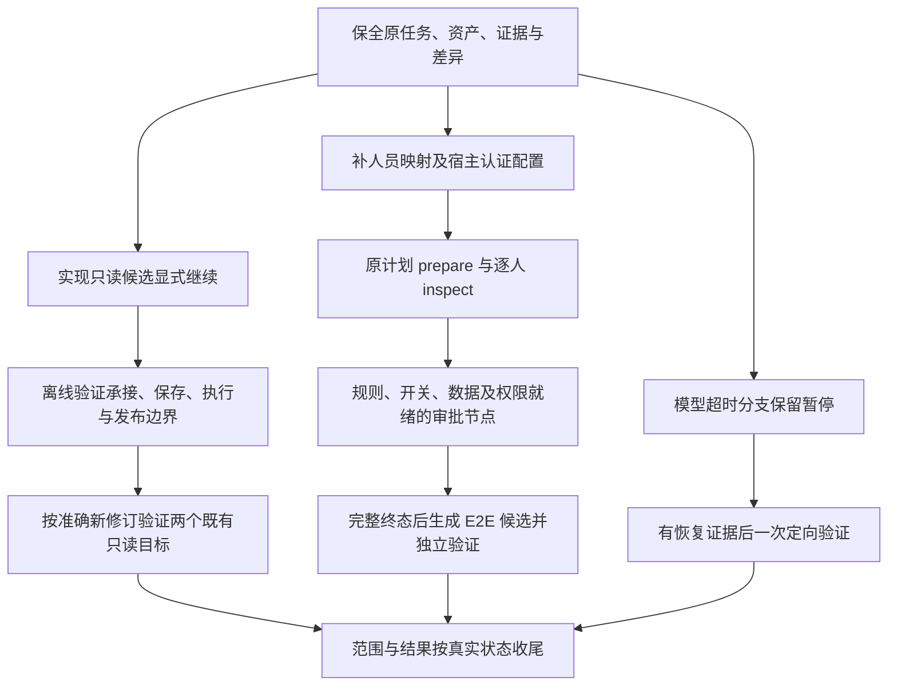

# 采购合同审批测试阻塞修复方案

日期：2026-11-11，Asia/Shanghai（UTC+08:00）。

状态：**修复方案，尚未实施**。本次仅核对源码与既有产物并编写方案，不修改运行逻辑、不配置真实密码、不运行真实模型或审批。本文件中的新增字段与入口均为拟议契约，当前不可调用。

## 1. 目标与边界

本次要修复的是测试工作流无法继续、配置缺口没有落到实际审批计划、覆盖声明超过真实资产范围的问题。现有 candidate 不可直接验证、正式版本才能进入回归修复等门禁本身有明确作用，不能直接删除。

完成目标：

1. 两个已有只读候选能够经明确授权承接到完整验证，复用真实证据，不重新调用探索模型，也不改写原任务和原 revision。
2. 审批准备能够准确说明检查了哪份配置、缺哪些实际人员和认证；补齐后沿原零执行计划继续。
3. 设计、脚本、来源、范围快照和交付统计一致；产品不符合预期可以产生真实失败结果，不能为了发布修改预期。
4. 模型超时只暂停依赖它的探索分支，不扩大到已有有效候选或不依赖模型的准备工作。

本方案不承诺让全部48个设计用例通过。驳回、自审自批、同人去重、可选节点和归档等缺口须逐例处理；完整链一条 E2E 不能计为17条独立节点用例。

客户端仓库：`/Users/liyingjun/Desktop/SW-QA/17-00`。

测试产物工作区：`/Users/liyingjun/Desktop/SW-QA/18-00work space`，其中 `qa` 是产物目录，不是工具应使用的 cwd。实际工作流 cwd 应为该工作区根目录，避免形成 `qa/qa/ui`。

## 2. 已确认事实与修复类型

| 编号 | 事实及源码/产物依据 | 分类 | 处理 |
| --- | --- | --- | --- |
| F1 | 两个资产均为0001、currentRevision=null、validatedRunId=null，绑定 completed/candidate 任务；workflow.mjs 的 executeSelection 拒绝非 complete 来源验证 | 工作流缺少承接能力 | 增加有来源、有限范围的候选继续入口，保留原门禁 |
| F2 | saveCandidate 普通分支要求同一 case 的所有 revision 来自同一 task；createRepairTask 只接受正式版本及失败 regression 父批次 | 工作流缺少承接能力 | 同步补齐承接任务保存规则；不能只创建一个 complete 任务 |
| F3 | 两份 flow.json 都只有管理员 creator=pms_admin，steps=[] | 审批计划未完成 | 补齐真实人员，prepare 修订原计划；不需要重写审批引擎 |
| F4 | 历史 preflight 报 sharedTestPasswordConfigured=false；approval.mjs 从主进程环境读取，bootstrap.js 启动时加载客户端根目录.env | 宿主环境配置 | 安全配置后在实际主进程重新预检；不新增凭据库 |
| F5 | 不带 flowId/config.actors 的 preflight 按空数组检查，不会自动读取某个旧计划 | 调用和诊断不清 | 调用带准确 flowId；补充配置来源诊断，避免误称计划为空 |
| F6 | 既有规则已确认串行、全部通过；矩阵同格展示两人不能证明规则改变 | 规则执行及报告偏差 | 保留既有规则，单独核实节点类型和启用配置，不重复索要已确认口径 |
| F7 | 矩阵脚本只检查6个固定角色列，未覆盖经营发展部/市场营销部两列人员；模型隔离脚本不检查采购结果模型 | 覆盖范围不足 | 先纠正声明；新增目标另建有来源的完整任务与独立 case，不塞入冻结预期 |
| F8 | 硬件分管领导页面“姜干才”，来源表“姜千才” | 待业务判定的差异 | 保留旧预期和差异证据；确认后才决定修资料或修系统 |
| F9 | AP-46 两个探索任务在 agent-run 发生502超时，cleanupConfirmed=true | 模型服务故障 | 保留任务，等待恢复证据后仅一次定向验证，不盲目重跑 |
| F10 | 当前摘要把两个 eligibleFeatures 的转换率100%用于描述进度；48条是设计数量 | 统计/交付偏差 | 分列设计数、脚本数、验证状态及逐条映射，不承诺回答三题解锁30例 |

两个源任务：

- `task-2ae70f93-ff4e-4fd4-92e2-28fcd208743c` → `pms-procurement-approver-matrix@0001`。
- `task-9e43b0a1-e6a8-4da9-bd93-0f35a0ebf4f6` → `pms-approval-flow-model-isolation@0001`。

## 3. 推荐实施顺序



B/C 是客户端代码修复；E/F 是配置和计划准备；D/G/H/J 是后续真实验收。本次仅交付方案，不能把后续真实验收记为已授权执行或已完成。

## 4. P0：已有只读候选的显式继续能力

### 4.1 采用方案

在现有 `qa_ui_save_candidate` 上增加明确的候选继续操作，复用现有工作区互斥、草稿、revision、validate 和 publish 链路。拟议参数：

```json
{
  "operation": "continue-candidate",
  "caseId": "pms-approval-flow-model-isolation",
  "baseRevision": "0001",
  "authorization": {
    "kind": "user",
    "reference": "可定位的用户继续执行该只读候选的授权来源"
  }
}
```

这是新增契约设计，不是现有命令。保留旧调用行为；operation 缺省仍沿用现有保存/正式修复分派，不能与新参数混用后静默选路。工具仍受应用 full-access/ask/read-only 权限控制；authorization 记录可追溯来源，不能只凭模型填写一段文字就绕过应用权限。

成功只建立一个 `kind=candidate-continuation` 的本地任务与可编辑草稿，不运行浏览器、模型或测试，不自动发布。返回 taskId、draftDirectory、sourceTaskId、caseId、baseRevision 和下一步。复用源约定，将新任务 mode 明确设为 complete；原任务继续保持 candidate。

### 4.2 限定条件

- 仅支持同工作区、同项目、同目标、同角色、同身份的未发布只读候选，dataStrategy=read-only、cleanup=none；不接审批计划和隔离写候选。
- 源任务 completed 且 cleanupConfirmed=true；源 revision 两个文件哈希、asset 登记、任务归属及步骤来源有效。
- 沿用原目标、预期、来源、初态、步骤和断言说明。继续执行不是修改业务预期的入口。
- 源批次 running、prepared、收尾未知或工作区留锁时，先停止新链路并核对现场；不删锁、不创建等价任务绕过。
- 同一基准 revision 只建立一个承接任务；重复请求返回已有任务，参数冲突明确拒绝。新任务不能再次被当成另一份原始探索证据。
- 保留未发布资产当前最多3个修订的边界，承接不重置预算。已有两个补丁耗尽后明确停止，不通过新任务循环续命。

### 4.3 来源与版本处理

新任务保存只读的 continuation 信息：源 caseId/revision/taskId、源文件哈希及授权引用。草稿 case.json.taskId 使用新任务编号，steps 保留原成功步骤编号；校验时明确回查原任务 actions.jsonl，不新造动作、不声称发生了新探索。

保存承接草稿时增加专门分支，允许新任务在同一资产下生成0002；校验它确实继承0001及其来源，不把普通新任务都放开。原0001、原 task.json 和原 actions.jsonl 字节保持不变。

承接阶段允许保持原脚本，或只修定位、等待、证据保存；修改前后均核对冻结的业务字段。补齐新业务目标或更改人员预期应进入新的完整设计任务，不能伪装成定位修复。

当前 removeUiCase 的归属校验、removeUiReport 的引用保护、coverage 的来源校验及报告展示均须沿实际字段核对。沿用新 taskId 可兼容的地方不改；确实需要展示继承来源时仅增加必要字段，避免制造另一套报告模型。源任务被破坏或证据消失时拒绝保存，不补造材料。

### 4.4 验证与发布

承接生成的新 revision 仍按 `validate → 读取原生结果 → passed才publish`。保留一 revision 一次定向验证、真实截图、快照、哈希和清理检查。原候选不能未经承接直接运行；regression 仍只接受 currentRevision。

矩阵目标保留“姜千才”的原预期，当前页面条件下预期会产生失败，但本方案不能预报它已经失败。失败后检查实际停留步骤与截图，后续未执行断言如实记录。

### 4.5 验收清单

| 场景 | 应有结果 |
| --- | --- |
| 原 candidate 直接 validate | 仍拒绝，且无运行批次被错误记为通过 |
| 有合法来源授权的 completed/read-only 候选继续 | 建立一次承接任务；不调用模型或浏览器 |
| 重复继续同一基准 | 返回原承接 taskId，不另开任务 |
| 承接保存0002 | 保留原0001与原任务；0002指向新任务并可追溯原证据 |
| 改 expected、source、步骤、项目、身份或数据策略 | 拒绝保存，保留草稿供核对 |
| 跨工作区、符号链接、源文件被改、清理未知、写候选 | 拒绝承接 |
| 0002 的受控真实验证失败 | 保存 failed 原生结果，不发布、不修改预期 |
| 0002 的受控真实验证通过 | 通过全部原发布校验后才更新 currentRevision |
| 同修订重复validate/普通回归执行未发布候选 | 仍拒绝 |
| 取消或中断 | 沿原run核对；收尾未知时保留锁，不重放 |

退路：完全不改客户端时，可用新 caseId、新 complete 任务重新探索并生成资产，文档登记与旧候选关系。但它依赖模型恢复且重复探索，不作为首选。不能把新任务直接挂到旧0001，也不能在现有保存规则下假设同一 caseId 可随意接收跨任务修订。

## 5. P0：审批预检、人员映射与宿主凭据

### 5.1 预检诊断的最小代码调整

在现有 preflight 脱敏回执中增加配置来源 `configurationSource=flow/config/none`，以及实际来源 flowId/configRevision（适用时）。保留既有字段语义，不把 `configured` 扩大为已认证或已覆盖全部业务节点。

没有传 flowId 或 config.actors 时明确“本次未提供人员配置”；指定 flowId 时只读取该计划，不自动猜其他计划。配置不齐时继续返回 actorId 与缺失字段，不输出密码、登录态或完整项目配置。

验收：无人员参数、显式config、指定flowId三条路径能够区分；指定不存在/归属错误计划明确失败；仅有项目管理员且不需要统一密码的计划，不因共享密码为空被错误阻断。人员是否足够仍由真实流程与映射核对，不新增通用节点推导引擎。

### 5.2 人员与计划准备

以软件事业部正常链为首个目标，从实际工作区业务规则及获授权用户目录核实：创建人、辛晓岩、法务实际账号、刘波、潘琴荣、朱栋华、许玲懿、费定、陈振飞，及实际启用时的叶圣炯和可选会签人员。角色名“科技公司法务”不能直接当登录用户名。

每人登记 id/account/source/credentialSource/identity；目录核对部门、账号状态、分页和同名情况。姓名无法唯一匹配时才询问，不批量猜拼音。身份完整文案以可信页面证据为准；已有管理员正确文案为“你好 项目管理系统管理员”，不能删掉前缀，也不推定其他人必然同格式。

读取两份旧计划后，选择与本轮目标相符的一份作为继续计划，另一份保留历史引用，不删除。当前r2指向存量合同详情，record 也是存量节点文本；**不能只追加人员后把它当成新建测试记录计划**。prepare 需同时明确新建入口、独立记录标识、初态与来源。必须先确认零执行、未冻结，引用当前配置版本修订并保留 configHistory 和旧证据。

### 5.3 凭据配置

沿现有宿主环境 `QA_UI_TEST_PASSWORD`。开发态主进程在启动时加载客户端根目录.env；被测工作区的.env或当前命令窗口环境不能替代运行中应用的主进程状态。本次方案不读取密码正文。

实际实施时通过受控本机配置注入，避免把密码放入对话、命令参数、仓库或报告。若需要重启，先确认应用内任务停止且输入已保存，不能为刷新变量直接杀进程；配置后在真实 Electron 主进程调用指定flowId预检。项目管理员凭据保持原项目来源，不被覆盖成其他账号，也不复制给多名审批人。

本轮不新建多用户凭据库或项目密码字段。如果未来要求界面内配置，另开需求并完整设计主进程、预加载、页面和安全存储链路。

### 5.4 真实准备验收

1. 带准确flowId的 preflight 返回对应配置版本，所有已登记必要人员 configured；报告实际要求的人员清单，不能以该状态代替人员覆盖评审。
2. 逐人inspect独立认证、核对身份和真实控件；一人的认证/身份失败只停依赖分支，保留code/stage，不重复交登录。
3. 首次execute前核对唯一测试记录策略、创建人、全部启用节点、附件、合法动作、终态、应用当前权限及既有授权适用范围。
4. 真实节点证据与正式run分别统计。准备完成不能记为审批已执行。

## 6. P1：修订测试资产、预期与范围声明

### 6.1 两个现有目标先独立验证

通过第4节承接机制分别生成新修订，冻结原有预期后验证。两个case各自形成真实结果，不因矩阵姓名差异就跳过另一个模型切换目标。第4节只适用于已有成功证据的目标，不用于替代AP-46失败探索。

### 6.2 覆盖缺口单独设计

| 范围 | 修订动作 | 预期来源与前置条件 |
| --- | --- | --- |
| 经营发展部审核7行人员及顺序 | 新建独立矩阵角色检查case，核对潘琴荣/朱栋华；不继续声称旧S3已覆盖 | 对照表固定角色、已记录矩阵证据；顺序语义与节点类型分别记录 |
| 市场营销部审核7行人员 | 纳入上述目标或按业务独立性单独case，明确逐行断言许玲懿 | 有来源的完整任务约定与独立初态 |
| 采购结果模型 | 新建独立模型切换case，先补实际选项、列头及切回证据 | 当前无该模型成功动作证据；需模型服务恢复后受控探索 |
| AP-46记录发起部门对齐 | 保留未完成取证状态，补同一记录部门与矩阵行的关联 | 不将固定历史记录直接用于写审批；原超时链恢复规则见第8节 |
| 矩阵姓名差异 | 原用例保留失败可能；确认权威姓名后修资料或提交产品缺陷 | 用户/权威人员目录的明确依据，不能以页面实际值自动覆盖预期 |

姓名确认导致预期变化属于设计变更，不属于只改定位、等待、证据的repair。第一版采用新caseId和新完整任务保留历史关系；不在本轮扩大成任意已冻结预期编辑器。数据/模型未改变且没有新证据时，不为反复获得运行机会新建同目标case。

把独立目标拆开可以减少某一差异阻断其他目标；不能使用catch吞错、skip、减少断言或把失败当通过。矩阵原脚本的后续断言未执行时准确记录未到达，不把整份expected清单计入已执行数。

### 6.3 48条设计逐例对齐

在下一版设计中为每条AP编号登记：预期来源、依赖缺口、是否已有脚本、准确case/revision、来源task、验证run、实际状态及证据。沿现有设计与round规程维护，不新增平行数据库。

区分“设计48条”“独立脚本数量”“脚本覆盖的业务检查项”“实际执行到的断言”。仅有Playwright整例结果时不能推导全部断言执行数；没有逐断言证据时该数写未记录。

当前冻结round/0002不改写；读取其baseRevision后保存新快照。收尾使用completed/partial及具体停止依据，未满足继续条件不能长期用active冒充仍在运行。保留未生成检查项，统计分母和排除理由明确。

## 7. P1：审批规则与正常链恢复

| 事项 | 本轮应采取的处理 |
| --- | --- |
| 会签串行、全部通过 | 沿用已确认规则；验证前一人通过后仍待后续人，全部通过后才离开，不重复询问基本规则 |
| 两人在同一矩阵格 | 仅说明展示，结合流程来源及本记录配置核实节点/待办；不能仅凭格数定义节点数 |
| 同人占多个节点 | 单独确认是否去重及待办规则；不因一人重复就跳过处理，不能外推会签规则 |
| 自审自批 | 仍待明确规则，相关分支保留待确认 |
| 可选会签、董事长 | 核实本记录开关与人员；未知时不能强行点击或标不适用 |
| 归档 | 分别冻结审批完成和归档完成证据，启用人工归档时须实际完成，未启用/自动归档须有依据 |
| 驳回/撤回/意见上限/并发/接口越权 | 各自核对规则、接口和授权；来源不足的设计不转成真实判定 |

正常链逐节点inspect → execute → 读证据 → 下一节点。每次只操作本轮专属记录。blocked不等于业务失败；unknown先沿原flowId reconcile，禁止重放。终态与真实成功动作证据完整后才能candidate；独立回放另建新记录并保留授权残留。

## 8. P1：模型超时的恢复条件

保留两个AP-46原任务及14:52–14:55的错误证据。确认事实为模型调用超时/502，底层原因待查，不据此改定位器或归因被测系统网络。

最小恢复步骤：检查已有服务状态、调用日志或提供方明确的故障恢复信息；只有出现新证据后，且旧任务已停止/清理确认，才允许一次安全只读定向验证。验证前说明前置条件具体变化。失败则结束本链并给出错误报告，不换模型、不重启浏览器、不换taskId重复同一目标。

本地离线模型协议夹具只验证超时处理和状态保存，不能写成真实模型服务已恢复。本次方案不新增自动重试器、看门狗或服务探活定时任务。

## 9. 文件范围与同步要求

| 文件/范围 | 拟议变更 | 验收 |
| --- | --- | --- |
| src/main/capabilities/ui-testing/workflow.mjs | 候选继续、来源校验、同资产保存的限定分支、预算及幂等；复核删除/报告引用 | 承接与原验证发布链保持一致 |
| src/main/capabilities/ui-testing/extension.mjs | 新operation参数/说明，保留旧参数兼容 | SDK真实工具schema与处理分派一致 |
| src/main/capabilities/ui-testing/approval.mjs | preflight配置来源诊断，不扩大认证语义 | 三类预检来源及错误归属正确 |
| src/main/capabilities/ui-testing/coverage.mjs | 仅在现有来源校验不能识别承接时补必要校验 | 新来源可追溯，旧快照不重算 |
| tests/unit/ui-candidate-continuation.test.js（拟新增） | 承接、权限来源、归属、哈希、预算、幂等、字段冻结 | 不请求真实模型，不读真实配置 |
| tests/unit/ui-approval-preparation.test.js | 预检来源、旧零步骤prepare、身份/配置失败边界 | 使用临时数据，不调用真实业务 |
| tests/helpers/ui-readonly-workflow.check.mjs 及对应unit入口 | 承接保存、真实本地验证/发布与失败闭环 | 离线模型、本地隔离页面，无付费调用 |
| resources/testing/ui/skills/qa-ui-basic/SKILL.md | 主流程新增“继续已有候选”分支与停止条件 | 先复用有效证据，不重复探索 |
| resources/testing/ui/skills/qa-ui-assertion/SKILL.md | 承接与冻结规则；纠正“已有正式用例自动修复尚未接入”的过时表述 | 与当前repair入口和新承接入口分清 |
| resources/testing/ui/skills/qa-ui-execute/SKILL.md | 只在受影响时补承接/回归区别 | regression仍只运行正式版本 |
| resources/testing/ui/prompt/approval-control.md | 预检带flowId、缺口分支处理；业务规则继续单处维护 | 不复制密码、人员映射或虚构业务规则 |
| docs/ui-testing-runtime.md、docs/browser-use-readonly-workflow.md | 更新流程表、图、API边界、运行/取消/失败及验收状态 | 实现后才使用“已接入/通过”表述 |
| tooling/testing/ui/shared-runtime.cjs、prepare-runtime.cjs | 使用现有共享准备入口核对复制结果，只有新模块才改清单 | 不直接编辑resources/testing/ui/lib生成副本 |
| 实际工作区qa/design、qa/ui/rounds与新增任务/case | 后续资产修订与事实收尾 | 原版本、历史证据和原快照不变 |

AGENTS.md/README仅在实际能力边界或公开入口发生变化且原文需同步时做必要更新，不把本方案全文复制进去。普通文档方案阶段不修改工具、技能或测试步骤；上述同步与代码实施同一任务完成。

## 10. 验证计划与交付门槛

### 10.1 开发前复现

使用临时fixture复现：candidate直接验证拒绝；新task无法向既有未发布case追加；未发布case不能走正式repair；不带人员的preflight返回空输入诊断。负例是预期验证，不当成工具故障重试。

### 10.2 定向验证命令

实施新增文件后执行：

```sh
node --test tests/unit/ui-candidate-continuation.test.js tests/unit/ui-approval-preparation.test.js
node --test tests/unit/ui-readonly-workflow.test.js
node --test --test-name-pattern='resources' tests/unit/ui-testing-runtime.test.js
node --test tests/unit/ui-coverage.test.js
```

仅在修改应用权限行为时加跑 `tests/unit/permission-gate.test.js`；仅在触及审批执行时加跑 `tests/unit/ui-approval.test.js`。本方案不要求例行全量测试。

本地浏览器fixture需要监听及浏览器运行资源；环境禁止时记受阻，不记通过。不为通过而安装依赖、修改真实用户配置或请求付费模型。随包共享模块使用现有prepare实现生成到临时布局核对；不安装或发布应用。

### 10.3 后续真实验收

- 只读：两个现有目标分别产生准确版本run与原生证据。结果允许passed/failed/incomplete，不能要求都绿；只有passed满足原发布条件才发布。
- 审批：真实主进程预检、逐人身份观察、已授权独立记录上的逐节点动作与终态分别有证据。测试记录残留要报告名称、ID、停留节点和截图。
- 规则：每个仍待确认项单独列出影响范围，不承诺其能被其他答案顺带解锁。
- 模型：恢复验证与候选Playwright验证分开记录；Playwright通过不等于探索模型恢复。
- 文档：实际schema、主流程图/表、失败及取消、输入输出、数据与发布状态一致。

## 11. 提交、启用与回退

建议分为两次实施交付：第一阶段完成候选承接、预检诊断及全部相关规则/文档/测试；第二阶段在实际测试工作区进行人员准备、资产修订和真实验收。第一阶段离线通过不代替第二阶段真实就绪。

提交只暂存本次路径，保留当前工作区其他未提交改动。按仓库约定验证后提交并推送origin当前分支，不强推；失败报告真实状态。测试产物工作区有独立归属，不能混入客户端仓库提交。

启用时核对实际会话加载的工具schema和运行资源；源码改动不代表已打开会话已刷新。按现有资源重载/安全重开流程启用，不能在任务进行中强制重启。

回退代码不删除新task/revision/run，不将新schema产物手改成旧格式；旧版本不支持承接任务时应明确不兼容、只读保留现场，不能接着运行。结果未知的审批写操作一律先reconcile，不自动回滚业务数据。

## 12. 本方案核查状态

本次重新核对了工作流参数、同资产修订限制、权限入口、审批计划和两个候选的expected/assertions。前次隔离验证 `node --test tests/unit/ui-approval-preparation.test.js` 为1项通过；本次仅方案变更，不重复运行应用或业务测试。

本次读取中有两处预期路径不存在、一次不存在通配模式被zsh拒绝，相关查询已停止；之后通过文件清单确认真实入口 `tests/helpers/ui-readonly-workflow.check.mjs` 和 `src/main/resources/permission-gate.mjs` 后读取。未执行依赖错误路径的写操作，未调用或重试业务服务。没有据此推断能力缺失。
