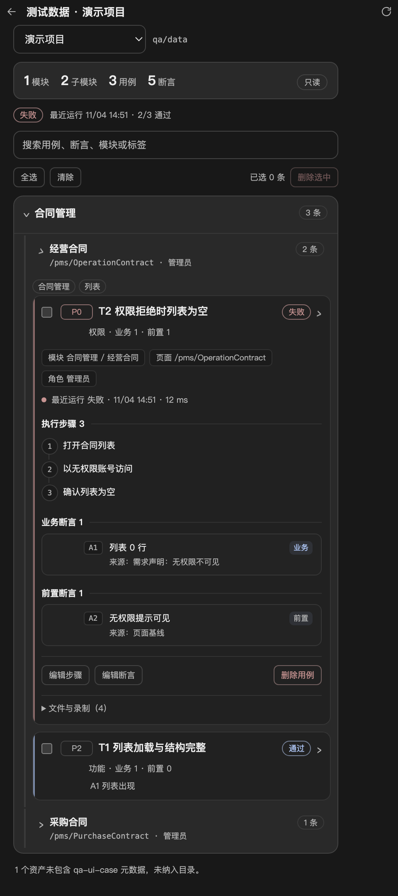

# 项目前置数据与 UI 自动登录接入

沿用现有项目菜单的登记与名称，每个项目增加地址、账号、密码三个字段。主进程通过 `projectService.getProjectData(projectId)` 按需读取四项数据，没有向模型暴露密码的工具。右侧边栏现在提供本机环境编辑，但页面只读取地址、账号和密码是否已配置，密码原文不回填。

## 配置文件

所有项目的登记及四项配置统一保存在当前客户端源码项目的 `config/projects.local.json`：

```text
config/projects.local.json
```

位置相对于客户端源码根目录，不随所选被测工作区变化，也不放入被测工作区的 `qa/data/`。这是开发阶段的可写配置位置，打包发布时需另行调整可写数据目录。

新文件不存在时，第一次读取项目列表或数据会检查旧的 `<userData>/projects.json`，校验后完整迁移登记及配置并保留旧文件。迁移采用 `0600` 权限及同目录排他发布；若新配置已存在（包括空列表），就只使用新配置，不覆盖或合并。新文件损坏或无法读取时明确报错，不回退到旧位置。两处都不存在时沿用空列表，添加项目后生成新文件。

已有登记请先启动客户端完成迁移；未使用过项目菜单时，可在菜单添加工作目录，或参照 `config/projects.example.json` 创建本地配置。示例中的编号、目录和地址都不是实际项目数据。

编辑前完全退出客户端，避免手工保存与应用的添加、重命名操作相互覆盖。使用普通文本编辑器修改目标记录；已有项目保留原 `id` 和 `workspaceDir`。手工新增项目需设置唯一、稳定的编号及真实工作目录绝对路径；不要将已有文件整体替换成示例。要清空列表，保存 `{"projects":[]}`；直接删除本地文件可能再次触发旧配置迁移。

```json
{
  "projects": [
    {
      "id": "保留已有项目编号",
      "name": "订单系统",
      "workspaceDir": "/保留已有真实工作目录",
      "address": "https://example.invalid",
      "account": "",
      "password": ""
    }
  ]
}
```

- `name`：复用项目登记名称；修改后重启会影响现有项目菜单显示，不重命名磁盘目录。与界面重命名约定一致，建议使用 1～40 个字符。
- `address`：被测系统的 HTTP/HTTPS 地址，不是工作目录路径；不能在 URL 中嵌入账号密码。空字符串表示尚未配置。
- `account`、`password`：字符串，默认空。保留原文，包括首尾空格；使用 JSON 的标准转义表示双引号、反斜杠等字符。

旧项目可以手工补充字段；缺失字段读取为空字符串，不自动迁移或重写旧记录。显式 `null`、数字等不视为空值，读取前置数据时报错。配置不完整不影响普通项目打开；是否满足具体测试的登录要求由使用方判断。

## 右侧栏环境编辑接口

右侧边栏通过受限 IPC 使用以下主进程接口：

- `listProjectEnvironments()`：返回 `id`、`name`、`workspaceDir`、`address`、`account`、`passwordConfigured`，不返回密码原文。
- `saveProjectEnvironment(id, input)`：可更新 `name`、`address`、`account`；`password` 缺省表示保持原密码，空字符串表示清除，非空字符串表示替换。
- `deleteProjectEnvironment(id)`：只移除项目登记和环境字段，不删除工作目录、会话或 `qa/data` 测试数据。

添加项目仍复用系统目录选择与 `addProject`，随后在环境表单中补齐字段。地址只接受空字符串或 HTTP/HTTPS 且不能内嵌账号密码；名称沿用 1～40 字校验；账号和密码保留原文。保存和删除使用 `runIdleOperation`，与生成、整理和会话切换互斥。

## 读取与保密边界

`src/main/storage/project-store.js` 的 `readData(projectId)` 和现有主进程项目服务的 `getProjectData(projectId)` 返回：

```json
{
  "name": "订单系统",
  "address": "https://example.invalid",
  "account": "",
  "password": ""
}
```

每次读取从磁盘加载，不缓存密码；只接受已登记编号，不接受任意文件路径，不打开会话、不访问目标地址，也不把读取成功称为身份验证通过。未登记编号、非法字段或地址、损坏 JSON 明确报错；错误不带原始 JSON 及字段值，不自动清空配置。

现有列表、添加和重命名只向页面返回 `id`、`name`、`workspaceDir`。后台保存时保留其他记录及其扩展字段；JSON 格式错误时不覆盖原文件。名称等登记信息的原有校验继续适用。

为支持本期手工编辑，账号密码是**本机明文配置，不是加密凭据库**；页面编辑表单不回填已存密码，只能留空保持、输入新值或显式清除。实际配置及其临时写入文件已被当前仓库的 `.gitignore` 忽略，仓库只提交不含真实数据的 `config/projects.example.json`；不要强制提交实际配置。应用写入时使用 `0600` 文件权限和同目录临时文件原子替换；手工编辑器或同步、备份软件可能改变权限或复制文件，不能据此承诺加密或进程访问隔离。不要将实际内容复制进报告或聊天，不要记录、导出或向模型返回 `getProjectData()` 的完整结果。当前自动登录在后端按需使用凭据并经私有 IPC 交给登录子进程，不把本接口登记为返回密码的模型工具。

2026-11-04 已接入 UI 工作流：qa_ui_project 按地址匹配配置，qa_ui_login 的 auto 分支在后端读取凭据、按需登录并交接临时状态，详见 [内置 UI 测试](ui-testing-runtime.md)。无需在每个阶段人工输入账号密码；验证码、MFA、跨域认证、配置或表单失效仍需处理。没有持久登录态复用、多环境、凭据加密或团队共享。工作区与测试数据目录准备已合并进 qa_ui_project：一次调用完成 qa/data/ui/cases 创建/复用、写入探针和项目匹配，不再单独调用 qa-workspace-prepare。

## 测试数据目录与用例视图（2026-11-04）

右侧栏「测试数据」不再单独列 `qa/data` 文件，而是解析 `qa/data/ui/cases/*.asset.json` 中的 `qa-ui-case/v1` 元数据，按项目 → 模块树 → 用例 → 断言展示；每次打开视图重新读取，回放结束后直接显示最新结果。

- 顶部显示当前项目、模块/子模块/用例/断言数量和数据策略（只读、写入唯一值等），以及最近一次回放状态和通过数；搜索同时匹配用例名、类型、优先级、标签、页面、断言内容和来源。
- 模块按 `caseMeta.modulePath` 还原层级，旧资产缺少该字段时按 `page`/`tags` 兼容归组；一级模块可折叠整棵子树。
- 用例折叠时显示首条业务断言预览；头部两行分别显示优先级/标题/最近状态和类型/“业务 N · 前置 N”，标题可换行完整显示。展开后模块、页面、角色以胶囊显示，执行步骤使用编号时间线，业务与前置断言分节列出编号、内容、来源；最近运行状态、耗时和时间单独成行，资产/脚本/说明/录制时间收进默认折叠的「文件与录制」。
- 展开用例后可点「编辑断言」：调整断言类型、内容和来源，增删断言；保存时同时更新 `.asset.json` 的 `caseMeta` 和 `.md` 中的 `qa-ui-case` 元数据块及「用例与断言」表格。编辑只改说明/资产元数据，**不修改 spec 代码，也不改变最近运行结果**。
- 回放结果取自项目工作区 `qa/ui/runs/*/summary.json`，按脚本名 + 用例名匹配，同一用例取最近一次批次；缺失结果记为未运行。
- 缺少元数据或元数据不合法的资产只提示数量，不纳入目录；本视图不提供原始文件列表和文件删除入口，测试数据清理仍使用原有后端接口。
- 视图本身不执行用例；断言编辑是唯一写入口，保存时校验路径必须位于 `qa/data/ui/cases`、至少一条业务断言、内容和来源非空。单次最多解析 200 个资产、每个不超过 512 KiB，读取最近 50 个批次；超出时页面提示截断。



用例呈现的调研依据与优化说明见 [测试用例呈现调研](test-case-ui-research.md)。

离线检查：`node_modules/.bin/electron tests/ui/test-data-catalog.check.cjs`（临时目录和模拟接口，不读取真实项目数据）。

## 验证

```bash
node --test tests/unit/project-config-location.test.js \
  tests/unit/project-data.test.js tests/unit/project-store.test.js \
  tests/unit/project-service.test.js tests/unit/project-rename.test.js \
  tests/unit/project-rename-ipc.test.js tests/unit/project-open.test.js \
  tests/unit/project-environment.test.js tests/unit/test-data-service.test.js
```

本期使用临时目录、模拟账号密码和现有真实存储/服务/IPC 检查：新记录默认值与文件权限、旧记录兼容、按编号隔离及重读、原文保留、配置持久化、页面返回字段白名单，以及损坏配置的报错与保护。位置迁移检查覆盖启动接线、旧配置完整保留、并发首次迁移、新文件优先及损坏时不覆盖。测试不读取真实配置或会话，不访问业务站点，不请求模型；不替代真实登录或测试执行验收。
