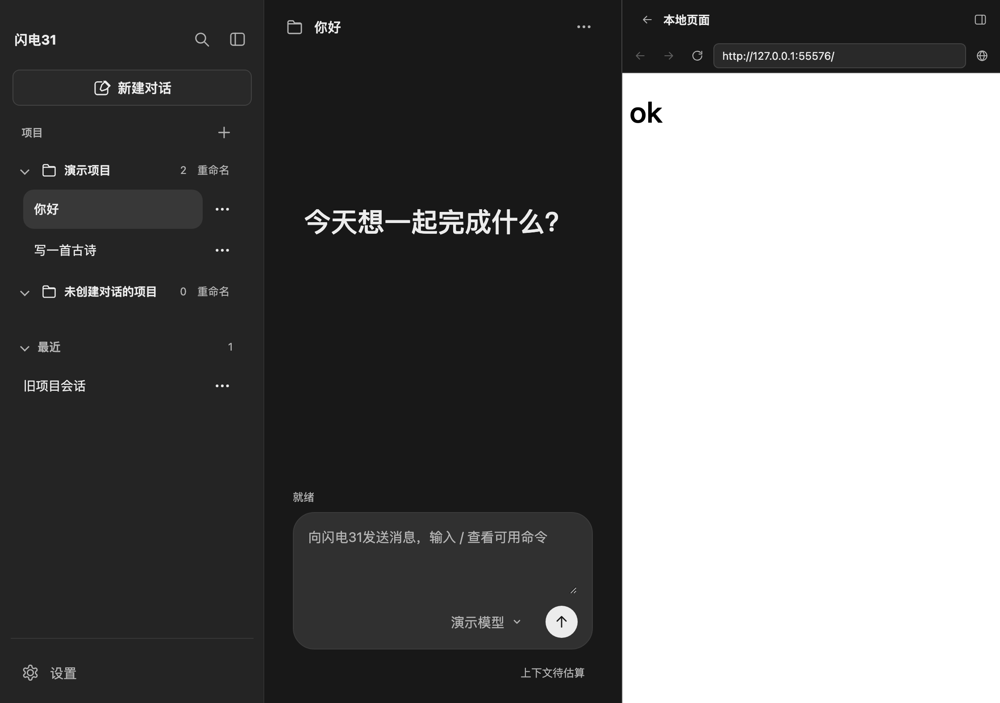
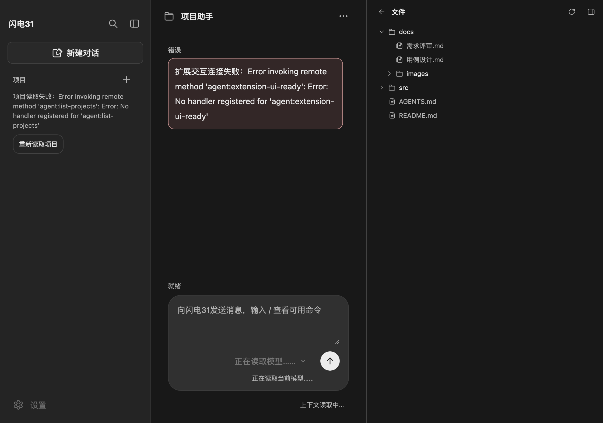
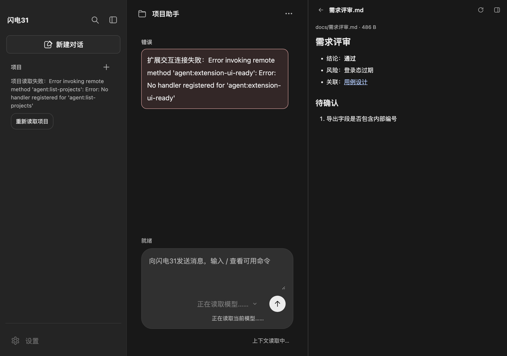
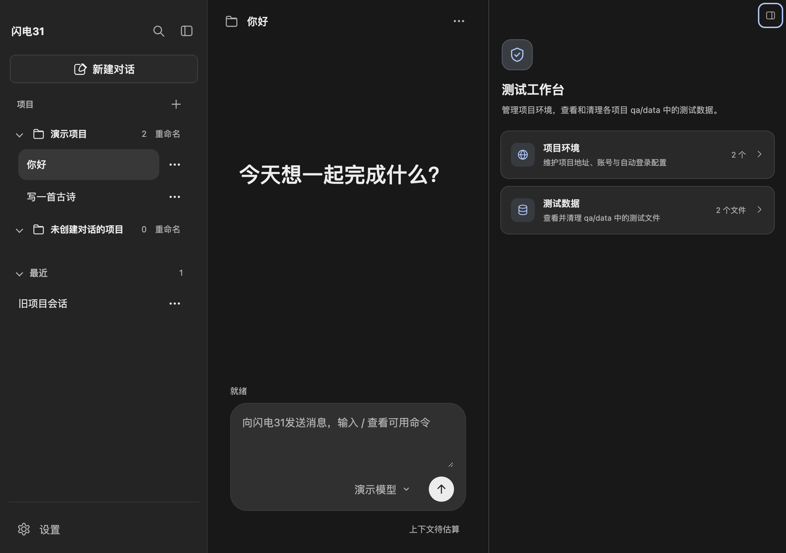
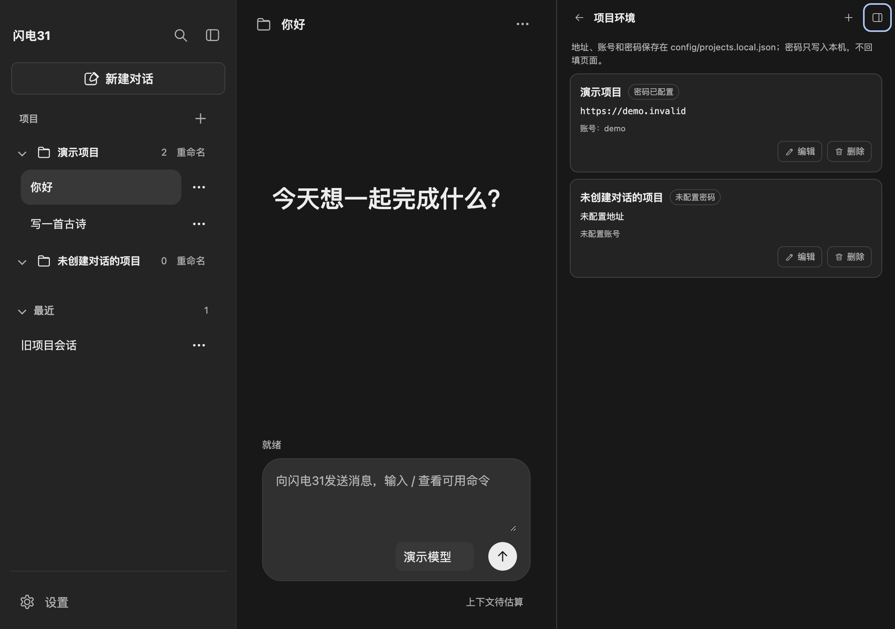
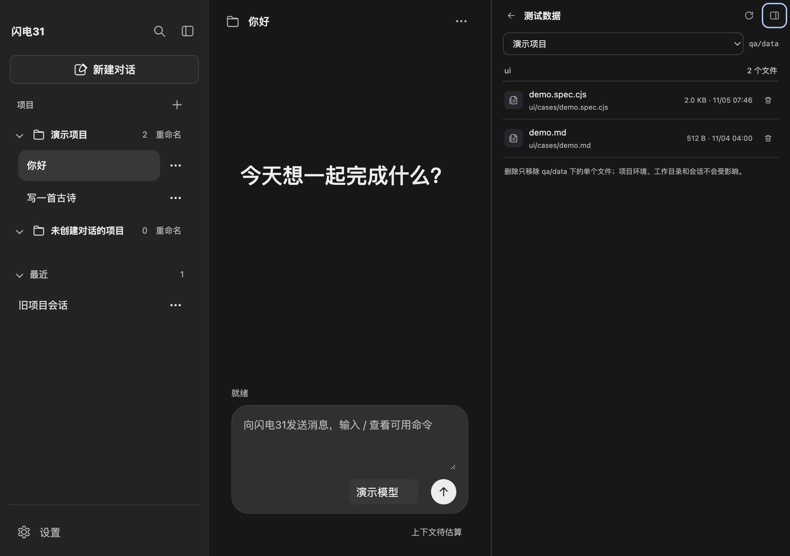
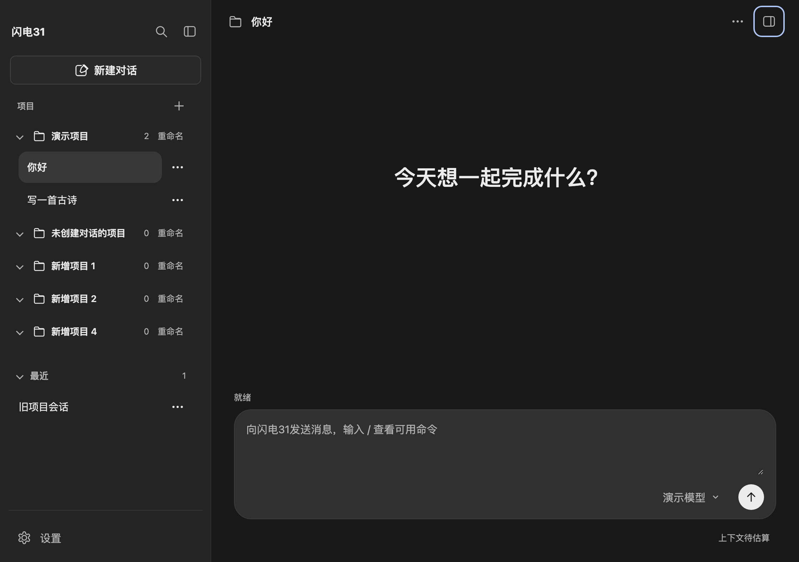
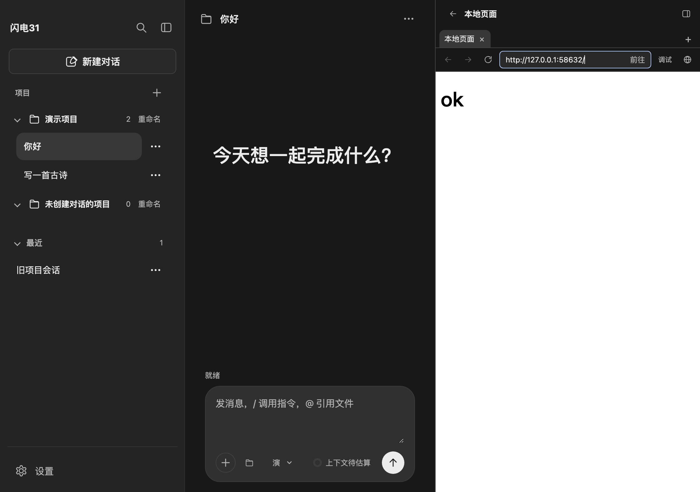

# 右侧边栏

右侧边栏参考 DeepSeek Harness 的 `ui-sidebar-right`：贴右边缘的停靠列、窄屏全屏、header 右上角展开按钮和 DSH 风格的卡片。当前已接入**项目环境**、**测试数据**、**测试报告**、**文件浏览**、**文件预览**与**浏览器**六个工作台功能。

## 外壳

- 会话 header 最右侧（对话操作 `...` 右侧）的镜像面板按钮只在收起时显示；点击打开。展开形状与左侧栏图标一致，方向镜像。
- 首次打开宽度取视口 45%，最小 300px，最大 70%，并给中栏保留 400px。示例：1120 窗口、左栏 296px 时右栏 424px、中栏 400px。
- 打开时若视口窄于 1024px，先临时收起左侧栏；宽屏下左栏被拖得很宽、剩余空间不足 300px 时也会让位。临时收起不写回左栏偏好，重启后恢复。
- 左缘 8px 热区可拖拽改宽；分隔条聚焦后支持 ←/→（Shift 加速）与 Home/End。宽度写入 `localStorage` 的 `agent-client:right-sidebar`，打开状态不持久化。
- 视口窄于 768px 时打开为全屏面板，底层左侧栏与聊天设为 `inert`；关闭后恢复。左栏重新展开导致中栏不足 400px 时，右栏自动收起。
- 中栏窄于 160px 时隐藏 header 入口，避免挤压会话标题。

## 工作台

打开面板先显示工作台：盾牌形状的 QA logo、“测试工作台”标题，以及五张 DSH 风格的功能卡片。

### 项目环境

- 读取 `config/projects.local.json` 中的项目登记与环境字段（`id`、`name`、`workspaceDir`、`address`、`account`、`password`）。
- 列表显示名称、地址、账号和“密码已配置/未配置”；**密码原文不会返回页面**。
- 添加：点击右上角加号，由系统目录窗口选择项目目录；登记后进入环境表单，填写名称、地址、账号和密码。
- 编辑：可修改名称、HTTP/HTTPS 地址、账号；密码留空表示保持原密码，输入新值替换，勾选“清除已存密码”后保存为空。
- 删除：二次确认后只移除项目环境配置，不删除工作目录、会话或 `qa/data` 测试数据。
- 保存和删除经主进程 `runIdleOperation` 串行执行，生成或切换期间会明确拒绝；成功后通知左栏项目与会话分组刷新。
- 地址校验与密码字段规则在主进程完成；页面只提交字段值，不提交任意配置文件路径。

### 测试数据

- 数据目录为当前项目 `workspaceDir/qa/data`。当前登记的“项目管理系统”工作目录是 `/Users/liyingjun/Desktop/SW-QA/18-00work space`，对应 `/Users/liyingjun/Desktop/SW-QA/18-00work space/qa/data`。
- 从 `qa/data/ui/cases/*.asset.json` 读取 `qa-ui-case/v1` 元数据，按 `modulePath` 展示实际项目模块层级（如 `合同管理 / 经营合同`）；同一路径的多个资产合并用例，缺少 `modulePath` 的旧资产按页面归组。
- 顶部项目筛选使用紧凑宽度；显示模块、子模块、用例、断言计数和最近运行结果。
- 进入项目时一级模块展开，子模块和用例默认折叠；搜索匹配模块路径、标签、用例与断言来源，命中时保留祖先分支并展开命中路径。
- 展开用例显示类型、优先级、执行步骤、断言与来源、最近结果及资产/脚本/说明路径。
- 执行步骤来自 `qa-ui-case` 的 `steps`，显示为有序操作列表；详情中可编辑、增删和调整顺序，保存后同步资产与用例说明。步骤是说明元数据，保存不会重写 spec 执行脚本。
- 用例行提供勾选框，可批量选择并删除；单条删除入口在展开后的详情底部。删除会同步从 spec 脚本、资产和说明中移除该 test，最后一条用例删除后对应资产文件也会删除，操作需二次确认。
- 用例内容除步骤/断言编辑外只读，不提供拖拽调整层级。
- 只读取标准化资产，最多 200 个、单资产 512 KiB；不含 `qa-ui-case` 元数据的旧资产单独提示数量，不纳入目录。

### 测试报告

- 工作台第三张卡片进入；读取当前项目 `qa/ui/runs/*/summary.json` 与 `qa/api/runs/*/summary.json`，把 UI 与接口测试结果聚合到同一视图。
- 顶部项目筛选使用紧凑宽度；报告区显示总数、通过/失败/其他批次数量，并可按「全部 / UI / 接口」筛选。
- 报告名称暂按「模块名称 + 完成日期」生成（如 `经营合同 2026-11-04`）；模块取摘要声明的 `modulePath`/`module`，旧批次从 case 资产的 `modulePath` 回看，无法确定时回退到 runId。
- 每份报告显示类型、状态、完成时间、用例数和逐例统计。
- 展开报告时按需读取详情，默认展示结论、通过率、模块/完成时间/耗时、失败与异常清单、报告问题、运行环境、清理/trace 和报告文件路径；全部逐例结果收在默认折叠的「查看全部逐例结果」中，避免长报告难以阅读。
- 展开报告提供「删除报告」，二次确认后删除整个批次目录（摘要、证据、日志），不可恢复；正在执行的批次由主进程拒绝删除。
- 报告内容只读；报告目录、批次编号和最大 50 份/2 MiB 限制由主进程校验，页面只提交项目编号、类型和批次目录名。报告缺失或格式无效时单独计数提示，不把缺失当成零失败通过。
- 公共摘要格式与交付规则见 [测试报告](test-reports.md)。

### 浏览器

- 工作台第五张卡片进入。布局与 DSH 的侧栏浏览器一致：38px 工具栏 + 页面贴边铺满，**没有内层卡片边框、圆角或留白**；地址栏在获得焦点时显示“前往”。
- 工具栏提供后退、前进、刷新/停止、地址栏、“调试”（页面开发者工具）和“在系统浏览器中打开”。系统浏览器只接受当前 `http(s)` 地址，由主进程调用。
- 页面是独立 webContents：Electron 默认菜单的 `Cmd+Opt+I` 只切换**宿主应用窗口**的 DevTools，不会打开页面自己的控制台。页面控制台通过工具栏“调试”或页面内右键“检查元素”打开，是独立窗口。
- 只接受 `http(s)`：裸域名自动补全 `https://`，拒绝 `javascript:`、`file:`、`data:`、`chrome:` 和带账号密码的地址。
- 页面在 `<webview>` 的独立会话分区 `persist:browser-panel` 中加载，不继承应用 preload；主进程在 `will-attach-webview` 中去掉 preload、强制隔离与沙箱，并拒绝非 `http(s)` 地址；webview 的 `window.open` 一律拒绝，非 `http(s)` 跳转被取消。
- 地址栏随导航更新，页面标题显示在侧栏标题；加载失败在页面下方显示错误条（主动停止不算失败）。空状态是居中的开始提示，不画边框。
- 切换右侧栏视图只切换浏览器层可见性，webview 保持挂载；回到浏览器保留当前页面、地址与前进/后退历史。
- 支持多标签（最多 8 个）：标签条可新建、切换和关闭；每个标签页独立保留自己的页面与前进/后退历史，关闭标签页才会销毁对应页面。
- 未声明背景色的页面按白底显示，避免暗色主题下黑字落在深色背景上。



说明：该浏览器使用 Electron 自带的 `<webview>`，与 `pi-web-access` 无关。后者是给模型的 `web_search`/`web_fetch` 工具，只返回文本结果，不提供可渲染页面或导航界面。

### 文件浏览

- 工作台第三张卡片进入，列出当前会话工作目录根，目录在前、文件在后，按名称排序。
- 目录按需展开，展开过的层级缓存在页面内；再次进入工作台不会重新请求已加载的层级，点刷新才重建。
- 点击文件直接进入文件预览；预览返回时回到文件树并保留展开状态。
- 跳过 `node_modules`、`.git`、`sessions`、`.DS_Store`、`.env` 与符号链接；其他隐藏目录（如 `.pi`）仍可浏览。单个目录最多返回 500 项，超出时提示只显示前 500 项。
- 切换会话时清空文件树缓存并回到工作台，避免继续展示上一个项目的目录。
- 只读；路径解析、工作目录边界与条目过滤都在主进程完成，页面只收到名称、相对路径、类型与大小。



### 文件预览

- 入口：Agent 回复里的本地路径链接（Markdown `[文字](路径)`）点击后在右侧栏打开；外部 `http(s)` 链接仍按“文字（地址）”展示，不跳转，也不打开浏览器。
- 右侧栏收起时自动展开；已展开时直接切换到文件视图。导航显示文件名，可返回工作台或重新读取。
- Markdown 文件走与正文相同的清理链路渲染，其他文本按等宽纯文本展示；文档内的本地链接可在同一视图继续跳转。
- 主进程校验：路径必须解析到当前会话工作目录内（含符号链接的真实路径），拒绝越界、`.env` 凭据文件、目录、二进制文件和超过 512 KiB 的文件；页面只收到相对路径、内容和大小。
- 只读，不写文件，不占用生成互斥，回复进行中也可以查看；切换会话时关闭旧工作目录的预览，避免留下上一个项目的文件。



## 结构与内容接入

```html
<aside id="app-right-sidebar" class="right-sidebar">
  <div class="right-sidebar__inner">
    <div class="right-sidebar__chrome">
      <div id="right-sidebar-tabs"></div> <!-- 视图标题、返回、添加/刷新 -->
      <button id="right-sidebar-close">…</button>
    </div>
    <div id="right-sidebar-body"></div> <!-- 工作台、环境、测试数据视图 -->
  </div>
  <div class="right-sidebar__resize"></div>
</aside>
```

内容由 `src/renderer/components/right-sidebar-panel.js` 管理；删除确认使用独立 `#right-sidebar-confirm-dialog`。外壳不注册业务，后续新增视图复用 `#right-sidebar-tabs` 与 `#right-sidebar-body`。

## 验证

```bash
./node_modules/.bin/electron tests/ui/sidebar-layout.check.cjs
./node_modules/.bin/electron tests/ui/test-data-catalog.check.cjs
./node_modules/.bin/electron tests/ui/test-reports.check.cjs
node --test tests/unit/project-environment.test.js tests/unit/test-data-service.test.js tests/unit/test-report-service.test.js tests/unit/file-preview-service.test.js tests/unit/workspace-tree-service.test.js tests/unit/browser-url.test.js
```

侧栏页面检查覆盖工作台卡片、环境列表、编辑保存、测试数据目录、测试报告、删除确认与浏览器/文件视图；测试数据目录检查覆盖 `modulePath` 两级分组与子模块计数、子模块页面/角色/条数、一级模块展开/子模块与用例默认折叠、执行步骤展示与编辑、单条删除与批量勾选删除、搜索保留祖先分支、搜索命中和清空恢复；测试报告检查覆盖 UI/接口聚合、类型筛选、报告详情、逐例错误与证据、清理/trace 信息和无效批次提示。检查使用临时模拟接口，不读取真实配置、会话或测试数据，不请求模型。

单元测试覆盖：环境列表不回传密码、缺省密码保持、显式空密码清除、非法字段拒绝且不改写配置、删除只移除登记；测试数据相对路径、隐藏文件/符号链接跳过、删除单文件、目录穿越/绝对路径/目录/符号链接/缺失文件拒绝；`modulePath` 多级合并、跨页面用例合并与旧资产按页面归组；单条/批量删除用例同步 spec、资产、说明并更新哈希；测试报告聚合排序、UI/接口类型推断、详情规范化、无效类型/路径/符号链接拒绝；文件预览的路径解码、工作目录边界、符号链接逃逸、凭据文件、二进制、超大文件与缺失文件拒绝；文件树的目录优先排序、跳过工程目录与凭据、越界/文件/缺失目录拒绝、500 项截断；浏览器地址的协议白名单、裸域名补全与带凭据地址拒绝。









## 边界

- 真实指针拖拽、真实系统目录选择和真实配置写入未在自动检查中代替人工验收；测试使用临时配置和临时数据目录。
- 项目环境密码是本机明文配置，不是加密凭据库；页面不回填已存密码，也不代表自动登录一定成功。
- 测试数据目录提供执行步骤/断言编辑及单条/批量删除用例；不提供拖拽调整层级或单独删除整个资产。删除用例会同步修改 spec，要求规范内 test 标题与元数据一致。层级由资产 `caseMeta.modulePath` 决定，缺省时按页面兼容显示。
- 测试报告内容只读；允许二次确认后删除整个批次目录（正在执行的批次拒绝删除），不重跑、不改写原始摘要。报告详情依赖批次目录中的 `summary.json`，缺失或损坏时只能提示，不能从其他文件推断通过。
- 文件预览只读单文件，不支持搜索、行号定位、图片/PDF 或二进制；Markdown 内嵌图片仍按文字展示。
- 文件树没有搜索、多选或拖拽，也不显示忽略规则以外的隐藏文件策略；符号链接一律不展示。
- 浏览器不提供下载、书签和地址历史；最多 8 个标签页，切换视图或会话不会销毁当前页面，关闭应用后不保留。
- 标签条在工具栏上方；窄窗下标签标题省略，仍可通过悬停查看完整地址。
- 页面开发者工具由 Electron 创建为独立窗口；本轮自动检查覆盖“调试”按钮与右键菜单入口，受限沙箱中无法确认窗口实际渲染，需要在真实应用窗口复核。
- 全屏按 768px 断点自动选择，未提供手动全屏切换按钮。

## 浏览器多标签



标签条位于工具栏上方，`+` 新建空标签页，标签可切换与关闭；每个标签页持有自己的 `<webview>` 和页面栈，切换不重建。关闭标签页会移除对应 webview，最后一个标签关闭后保留一个新的空标签页。

## 浏览器保活

浏览器层（`right-panel__browser-layer`）常驻在侧栏内容中，切换视图只切换可见性，`<webview>` 不重建；侧栏内容容器与浏览器层都用 `display: contents` 参与原布局。页面检查覆盖「离开再回来复用同一 webview 并保留地址」。

## 输入区入口

输入区工作区 chip 点击时派发 `open-file-browser`：`page-shell` 展开右侧栏并调用 `rightSidebarPanel.openFiles()` 进入文件浏览，复用已有文件树。
