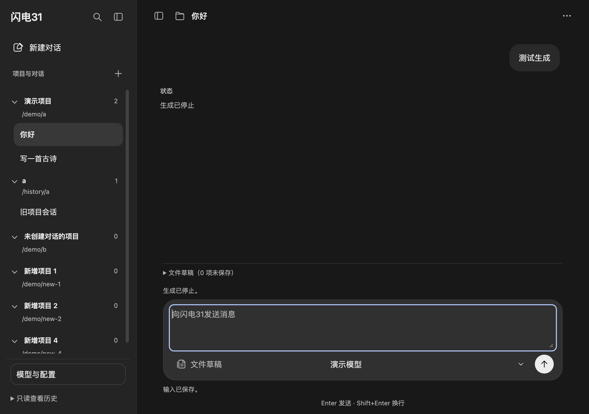
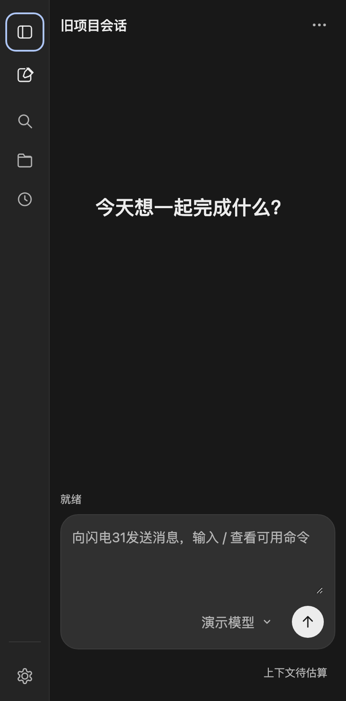

# 侧栏布局

侧栏外壳为原生 DOM/ES Module 实现（`src/renderer/components/sidebar-shell.js` 与 `src/renderer/styles/sidebar-shell.css`），只负责几何、折叠和宽度；项目、最近、搜索、置顶与归档仍由原会话组件维护。

## 布局与交互

- 展开宽度 264–420，默认 280。右侧 6px 热区可拖拽改宽；分隔条聚焦后支持 ←/→（Shift 加速）与 Home/End。拖拽期间关闭宽度过渡，保证跟手。
- 收起后保留 56px 图标轨道：新会话、搜索、项目、最近和底部设置仍可见；点击轨道图标按约定只展开侧栏，不直接执行对应业务。
- 折叠时外层宽度 300ms 收缩，内层冻结在展开宽度并 150ms 淡出；150ms 后换成轨道，轨道内容从 `translateX(49px)` 滑入。`prefers-reduced-motion` 下直接切换，不播动画。
- 视口窄于 760px 时自动收成轨道；手动展开只影响当前窄窗，窗口变宽后回到持久化的展开选择。窄窗口打开项目、会话或恢复成功后回到轨道，失败保留入口。
- 聊天消息、输入区、状态提示与上下文组件共用 `--content-width: min(1440px, 90vw)`，随窗口伸展；侧栏展开时以实际可用宽度为上限，宽屏不再固定为 760px。
- 宽度与展开状态写入 `localStorage` 的 `agent-client:sidebar`，拖拽期间合并 200ms 写入，初始化时读取恢复。窄窗的临时展开不写入持久化状态。页面检查覆盖写入，重载恢复依赖初始化读取，未单独做重载验收。
- 滚动条只是指针可供性：指针进入侧栏才显示，离开 2s 后隐藏；滚动容器使用 `scrollbar-gutter: stable`，滑块出现或消失不改变布局。
- 搜索入口在展开态顶部；收起前先关闭搜索并清除筛选，避免焦点留在不可见输入框。

项目与最近仍共用同一滚动区：项目在上，无项目归属的对话平铺在下方“最近”，点击“最近”只折叠该区域。设置入口固定在底部。项目标题右侧的 `+` 调用原有添加项目入口；取消不改变当前对话。

## 验证

```bash
./node_modules/.bin/electron tests/ui/sidebar-layout.check.cjs
node --test tests/unit/session-list.test.js tests/unit/project-service.test.js
```

侧栏页面检查加载实际渲染代码与临时模拟接口，共 79 项，覆盖项目归属、最近独立折叠、搜索、键盘、输入与文件草稿保留、生成与停止，以及 1523 / 1400 / 900 / 390 四档窗口；新增覆盖宽窗口输入区横向伸展、收起侧栏后聊天列接近窗口宽度、键盘改宽、宽度写入、56px 轨道、轨道图标展开、收起与展开后的焦点归还，以及窄窗打开项目后回到轨道。检查只使用临时数据，不读取真实配置或会话、不请求模型。

真实指针拖拽改宽和系统输入法不在页面模拟范围内，需另行人工验收；模拟检查也不代表真实模型请求或全部系统退出场景。

下图为当前实现：展开态（模拟数据）与 390px 窗口下的 56px 轨道。截图来自离线页面检查，不代表真实模型请求或全部系统退出场景验收。





右侧边栏外壳见 [右侧边栏](right-sidebar.md)。
