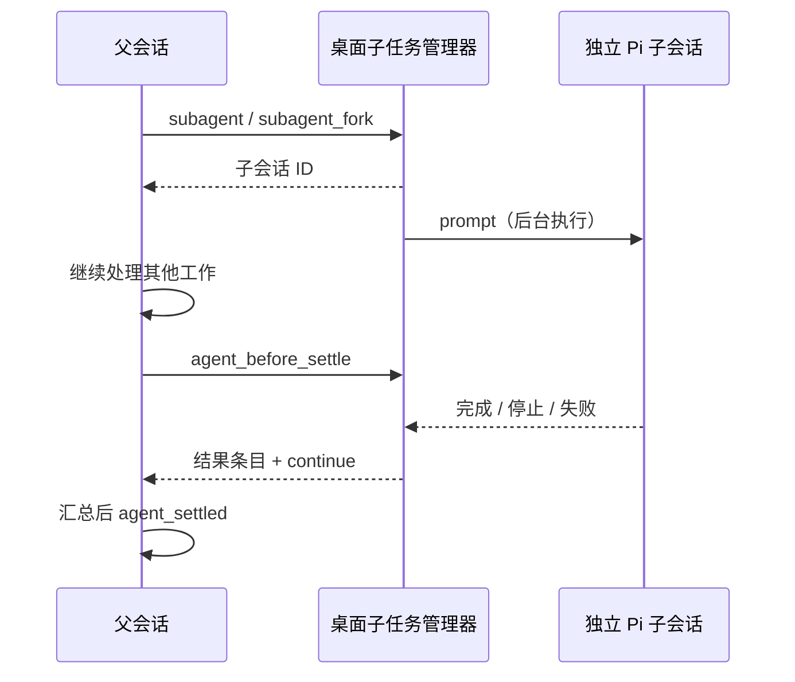

# 子智能体

## 使用

直接向父会话描述需要分工的任务，例如：“安排两个子智能体分别检查接口契约和界面断言，最后汇总；各自只修改负责的文件。”模型根据任务调用工具；输入 `/subagents` 可以查看当前会话的子任务列表和最近输出，不请求模型。

| 工具 | 参数 | 行为 |
| --- | --- | --- |
| `subagent` | `description`, `prompt` | 新上下文启动，立即返回子会话 ID |
| `subagent_fork` | `description`, `prompt` | 继承父当前分支已完成轮次，立即返回 ID |
| `send_message` | `agent_id`, `message` | 父向子插话或续接；子可向直接父级汇报 |
| `list_agents` | 无 | 当前父会话的子任务状态、输出和用量 |
| `interrupt_agent` | `agent_id` | 停止指定子任务，等待清理，保留历史 |

启动之后父级可以继续其他工作。父模型完成当前工作后，应用等待子任务全部收尾，通过 Pi 边界事件回传结果，再让父模型汇总；不需要模型休眠或循环查状态。工具回执显示启动 ID，输入区上方的扩展状态区显示最近 20 个子任务。`/subagents` 查看全部登记任务，最近输出最多保留 12000 字符。

## DSH 参考与 Pi 依据

参考本机 DSH `0.2.2-rc.1` 的 `@deepseek-ai/dsh-subagent` 及其本地 spawn/fork 实现：[上游仓库](https://github.com/deepseek-ai/deepseek-harness/tree/main/packages/subagent)。借鉴独立会话、spawn/fork、立即返回 ID、父子消息、容量控制、持久化目录和父级停止联动。没有引入 DSH 运行时或其远程 Provider 协议。

Pi 官方提供实现所需的底层能力，当前五个子智能体工具由桌面宿主扩展登记，并非 Pi 自带工具：

- [Pi v1.4.0 SDK](https://github.com/earendil-works/pi/blob/v1.4.0/packages/coding-agent/docs/sdk.md)：`createAgentSession`、独立 `ModelRuntime`、`SessionManager` 及命名、可替换的 builtin 扩展。
- [Pi v1.4.0 Extensions](https://github.com/earendil-works/pi/blob/v1.4.0/packages/coding-agent/docs/extensions.md)：`registerTool`、`registerCommand`、`agent_before_settle`、`custom_message` 边界条目、条件 `continue: true`、`sendCustomMessage` 对应的消息投递和字符串数组 widget。
- 已安装包公开导出和声明确认 `SessionManager.open/create/createBranchedSession`、`AgentSession.bindExtensions/prompt/abort/sendCustomMessage` 的签名。没有深层导入 Pi 内部实现或替换原生工具；父子会话统一使用应用配置的系统提示词主体，组装与快照规则见 [Agent 提示词维护](agent-prompts.md)。



`fork` 使用独立 manager 读取父历史并分叉到当前分支最后一个正常结束的 assistant 消息，不改变父 manager、父 ID 或活动分支。当前正在委派的工具调用不复制到子级，避免悬空工具结果；没有已完成轮次时采用空上下文。

## 生命周期与恢复

- 每个父会话最多 8 个活跃子任务，初始化也占名额；只允许一层委派。子级没有内置创建工具，额外拦截同名调用。第三方扩展与进程自身权限不属于隔离边界。
- 子级工作目录与父级相同，启动时使用父当前模型和思考级别。正常续接使用子历史中的模型。每个子级独立执行资源发现、扩展生命周期和 MCP 初始化，保留 Pi 配置语义。扩展、供应商和 MCP 必须能接受多个独立会话。
- 子任务状态写入父 Pi 历史的 `desktop-subagent`、`desktop-subagent-state` 自定义条目；子历史位于父会话目录的 `subagents/<父会话 ID>/`，不混入主侧栏。父子关系与工作目录在恢复时再次校验。
- 已完成或已停止的子级通过 `send_message` 打开原 ID 并发送本次新消息，不重发初始任务。历史缺失或绑定错误则拒绝，不另建同 ID 会话。
- 重启后遗留的“准备中/运行中”显示“执行结果待确认”，不后台重启。续接需要界面确认先核对历史和文件，只发送新消息。没有可用确认界面时拒绝。
- 桌面停止、关闭和扩展 `ctx.abort()` 同时停止父请求与子任务，等清理完成才结束；会话替换先停止子任务。Pi `abort()` 会等待空闲，因此父子停止必须并发，避免父级收尾等待子级造成死锁。
- 正常结束不删除历史；扩展报错、异常结束或资源加载失败作为失败结果回传。停止可能保留此前已完成的文件写入，不承诺回滚。

## 权限与边界

创建和消息工具走现有工具审批门禁：完全权限直接执行；每次确认模式需要批准；只读模式拒绝创建和发送，列表和中断可直接执行。子级使用创建时的权限快照，父级以后切换权限不自动改写既有子任务。子级无交互界面：在每次确认模式下，只读工具可执行，需要审批的工具按拒绝处理；没有借用父级已批准的一次调用来扩大权限。

子任务共享实际工作目录，没有独立 worktree、文件锁或操作系统沙箱。应按文件分工，避免并发改同一文件；扩展本身仍拥有应用进程权限。此版本没有远程 agent、跨父会话通讯、递归委派、单独指定模型/目录或独立子会话聊天页。

子级用量累计其自身新增 assistant 消息的 `totalTokens`，不重复计入 fork 继承的父响应。父页面原有上下文与费用仍是父会话口径，不自动合并为整组费用。父级收到的子结果会正常占用父后续上下文。

内置扩展身份为 `builtin:desktop-subagents`。Pi 官方 `extensions` 设置中的 `-builtin:desktop-subagents` 可禁用，重载后生效；第三方注册重名工具/命令时按 Pi 的 `replaceable` 规则替换整个内置扩展。子级也遵守这项配置。

## 验证

定向 SDK 检查：

```sh
node --require ./tests/helpers/pi-test-isolation.cjs --test tests/unit/subagents.test.js tests/unit/chat-service.test.js tests/unit/pi-session-lifecycle.test.js tests/unit/pi-agent-init.test.js tests/unit/session-prompt.test.js tests/unit/pi-desktop-runtime.test.js tests/unit/pi-native-runtime.test.js tests/unit/permission-gate.test.js
```

使用真实 Pi SDK、临时配置与内存 Provider，覆盖并行、fork 的完整轮次、父级边界汇总、消息回传、恢复同 ID、未知结果确认、目录绑定、权限、容量、停止、扩展失败、重载、禁用与第三方替换。不会请求模型或读取个人真实配置。

页面检查：`node_modules/.bin/electron tests/ui/pi-desktop.check.cjs`。设置 `PI_UI_ARTIFACT_DIR` 保存 1280/390 宽度截图；子任务部分使用明确的历史状态夹具，覆盖真实扩展、IPC、状态恢复、文本安全和布局，不等于真实模型执行。

2026-11-06 定向 SDK/单元检查 32 项通过。页面首轮 26 项断言通过但有测试环境错误；修正模型目录夹具后，复核在窄窗阅读宽度断言处失败，同时 Chromium 临时缓存仍报初始化错误。已将断言前置条件改为等待生产侧栏过渡结束；按有界重试约定停止自动复跑，最终页面脚本及窄窗截图尚未完成复核，不能记为完整页面验收通过。

真实模型的自动任务拆分、长任务效果、具体第三方扩展/MCP 的多会话行为与用户实际并发编辑仍待真实验收，不由离线测试代替。
