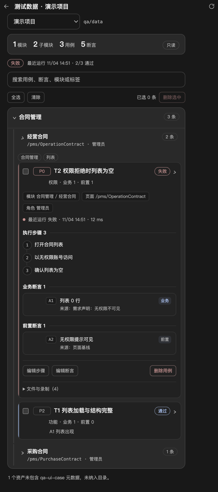

# 测试用例呈现调研与样式优化

调研时间：2026-11-05。上一轮梳理了测试报告的整体能力，这一轮聚焦「测试用例」本身的呈现：高星项目在列表里怎么放标题、状态、优先级和计数，展开后怎么组织步骤、断言、结果和文件。优化严格使用本项目现有字段，没有为样式新增或虚构数据。

> 本文保留为调研记录。当前页面已改为左侧目录、右侧列表，并加入手动用例 CRUD；以[右侧边栏](right-sidebar.md)和实际源码为准。

## 调研对象

星标通过 GitHub API 于 2026-11-05 取数，保留整数；星标只代表社区关注度。

| 项目 | 仓库 | 星标 | 用例呈现侧重点 |
| --- | --- | ---: | --- |
| Playwright HTML reporter | [microsoft/playwright](https://github.com/microsoft/playwright) | 99,309 | 用例行状态、耗时、重试、步骤树、附件与 Trace |
| Allure Report | [allure-framework/allure2](https://github.com/allure-framework/allure2) | 5,580 | 用例详情按步骤、附件、分类、历史组织 |
| ReportPortal | [reportportal/reportportal](https://github.com/reportportal/reportportal) | 2,043 | 用例条目表格、状态/耗时/属性，详情分步骤与日志 |
| TestLink | [TestLinkOpenSourceTRMS/testlink-code](https://github.com/TestLinkOpenSourceTRMS/testlink-code) | 1,625 | 用例管理：步骤、操作/预期、重要级别、前置条件 |
| Kiwi TCMS | [kiwitcms/Kiwi](https://github.com/kiwitcms/Kiwi) | 1,285 | 用例管理：摘要、状态、优先级、分类/标签、步骤与预期 |
| Mochawesome | [adamgruber/mochawesome](https://github.com/adamgruber/mochawesome) | 1,082 | 套件嵌套、用例状态、耗时、错误与上下文 |
| jest-html-reporters | [Hazyzh/jest-html-reporters](https://github.com/Hazyzh/jest-html-reporters) | 542 | 套件卡片、用例行、失败详情与 console 日志 |
| Monocart Reporter | [cenfun/monocart-reporter](https://github.com/cenfun/monocart-reporter) | 327 | 树形网格、列式信息、快速过滤、Worker 时间线 |

## 高位项目的共同做法

1. **标题完整可读**：用例名是主信息，不靠省略号截断；空间不足时换行，而不是把「T1 列表加载与结构完整」压成「T1 列表加载与结…」。
2. **状态和优先级前置**：状态用颜色和短标签，优先级用独立小徽标；两者都不铺满整行背景，避免整页只剩红绿块。
3. **两行式信息层级**：第一行是名称 + 状态，第二行才是类型、标签、断言数、耗时等次级信息。这样折叠状态下也能判断「这条用例是什么、上次结果如何」。
4. **详情分节**：步骤、断言/预期、结果、证据、文件各自成节，而不是连续堆在一起。步骤多用编号序列，断言用独立行，文件/附件后置。
5. **渐进披露**：列表只给摘要，展开后才加载详情；文件路径、原始日志这类低频信息通常再收一层。
6. **搜索和筛选是基本盘**：用例一多，按名称、模块、标签、状态过滤比继续加统计数字更有效。
7. **状态只用于状态**：边框、背景、分隔线保持中性；颜色留给通过、失败、优先级等少量语义，避免视觉噪声。
8. **步骤与预期分离**：用例管理类工具（TestLink、Kiwi）强调「操作 + 可度量的预期结果」，执行类报告（Allure、Playwright）强调「步骤 + 附件 + 历史」，本项目当前只有步骤和断言两组字段，应分别呈现，不混写。

## 本项目实际可用字段

以下字段来自 `qa-ui-case/v1`、报告匹配逻辑与用例标记状态文件，样式只使用这些字段：

| 字段 | 来源 | 当前用途 |
| --- | --- | --- |
| `name` | `caseMeta.cases[].name` | 用例标题 |
| `type` | `cases[].type` | 功能/权限/边界/异常/回归 |
| `priority` | `cases[].priority` | P0/P1/P2 |
| `steps[]` | `cases[].steps` | 执行步骤（字符串数组） |
| `assertions[]` | `cases[].assertions` | `id`、`kind`（业务/前置）、`text`、`source` |
| `page`、`role` | 用例或模块 | 页面、角色 |
| `lastResult` | 运行摘要匹配 | 状态、耗时、完成时间 |
| `workflow`、`markedAt` | `.case-state.json` | 人工流程标记与标记时间 |
| `assetPath`、`specPath`、`documentPath` | 资产 | 资产、脚本、说明路径 |
| `recordedAt` | 资产 | 录制时间 |
| 模块 `path`、`tags`、`policies`、`caseCount` | 目录构建 | 模块层级、标签、数据策略、条数 |

**没有**的字段（因此页面不展示）：用例级标签、前置条件、独立的预期结果字段、附件/截图、负责人/评审状态、完整执行历史。步骤与断言已经能表达「怎么做、验证什么」，但不把它们包装成不存在的「预期结果」或「附件」。

## 本轮样式与布局优化

改动范围：`src/renderer/components/right-sidebar-panel.js`、`src/renderer/styles/right-sidebar-panel.css`；不新增 IPC、不改变 `qa-ui-case/v1` 字段、不改变编辑/删除/搜索行为。

- **顶部摘要**：模块/子模块/用例/断言计数放进卡片，数字放大、标签缩小，数据策略保留为右侧胶囊。
- **用例标题**：取消单行省略，允许换行完整显示；`title` 属性保留完整名称。
- **两行式头部**：第一行优先级 + 名称 + 最近状态 + 展开箭头；第二行类型与「业务 N · 前置 N」计数，与名称对齐。
- **状态色条**：通过/失败用例在卡片左侧显示 2px 色条，未运行保持中性；选中用例用焦点色描边。
- **上下文与结果**：模块/页面/角色改为可换行的小胶囊；最近运行改为状态圆点 + 时间 + 耗时。
- **步骤**：改为编号时间线，去掉每条步骤的独立边框，减少纵向噪声。
- **断言**：业务/前置断言各自成节，标题带分隔线；断言行使用统一容器，编号、内容、来源、类型分层显示。
- **文件**：资产/脚本/说明/录制时间收进默认折叠的「文件与录制」，避免路径抢占正文。
- **兼容**：保留 `.case-card__name`、`.case-card__meta`、`.case-card__status`、`.case-assertion`、`.case-step` 等现有选择器与交互，页面检查可直接覆盖。

效果见下图（离线页面检查截图，展开一条失败用例）：

## 验证与边界

- 离线页面检查：`node_modules/.bin/electron --no-sandbox --disable-gpu tests/ui/test-data-catalog.check.cjs`，28 项通过，覆盖摘要、模块层级、折叠、搜索、步骤/断言编辑、最近状态、单条与批量删除、横向溢出。
- 单元测试：`node --test tests/unit/test-data-service.test.js`，覆盖目录构建、字段归一化、编辑与删除保护。
- 截图使用临时夹具数据，不包含真实业务数据。
- 未做：用例级标签、前置条件、独立预期结果、附件预览、执行历史；这些需要扩展 `qa-ui-case/v1` 或新增主进程接口，不在本轮样式优化内。
- 后续补充：流程标记、按状态筛选和条件复测已实现，见 [用例标记与条件复测](case-marks-retest.md)；用例级标签、附件预览和执行历史仍未做。

## 参考

- [Playwright HTML reporter 文档](https://playwright.dev/docs/test-reporters) / [microsoft/playwright](https://github.com/microsoft/playwright)
- [Allure Report 功能总览](https://allurereport.org/docs/features-overview/) / [allure2](https://github.com/allure-framework/allure2)
- [ReportPortal](https://github.com/reportportal/reportportal)
- [Kiwi TCMS 测试用例指南](https://kiwitcms.readthedocs.io/en/latest/guide/testcase.html) / [Kiwi](https://github.com/kiwitcms/Kiwi)
- [TestLink](https://github.com/TestLinkOpenSourceTRMS/testlink-code)
- [Mochawesome](https://github.com/adamgruber/mochawesome) / [jest-html-reporters](https://github.com/Hazyzh/jest-html-reporters) / [Monocart Reporter](https://github.com/cenfun/monocart-reporter)
