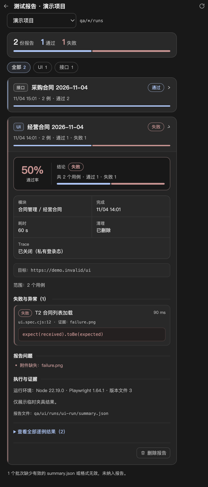

# 测试报告项目调研与能力梳理

调研时间：2026-11-05。目标是找出 GitHub 上使用广、评价高的测试报告方案，拆解它们共同覆盖的「报告能力」，再对照本项目的 `qa-report/v1` 与右侧栏「测试报告」，确定本轮样式与布局优化的重点。

## 调研口径

- 以报告生成、结果聚合或结果交付为主要定位的项目；同时纳入框架内置报告（Playwright HTML）和平台型方案（ReportPortal）作对照。
- 星标通过 GitHub API 于 2026-11-05 取数，保留整数。星标只代表社区关注度，不等于报告质量或适配性。
- 能力判断以各项目 README 与官方文档的功能声明为准，未逐项安装实测；标注「部分」表示需插件、配置或仅覆盖有限场景。

## 项目清单（按星标降序）

| 项目 | 仓库 | 星标 | 形态 | 报告侧定位 |
| --- | --- | ---: | --- | --- |
| Playwright HTML reporter | [microsoft/playwright](https://github.com/microsoft/playwright) | 99,307 | 测试框架内置 | 执行结束生成自包含报告目录，测试列表、重试、附件、Trace 查看 |
| Allure Report | [allure-framework/allure2](https://github.com/allure-framework/allure2) | 5,580 | 静态 HTML 报告 | 多语言统一报告，步骤、分类、历史、时间线、质量门禁 |
| gotestsum | [gotestyourself/gotestsum](https://github.com/gotestyourself/gotestsum) | 2,735 | CLI/JUnit | `go test` 的人类可读汇总、JUnit XML 与 CI 输出，不做图形报告 |
| ReportPortal | [reportportal/reportportal](https://github.com/reportportal/reportportal) | 2,043 | 服务端平台 | 实时上报、仪表盘、历史、失败自动分析、缺陷系统集成 |
| dorny/test-reporter | [dorny/test-reporter](https://github.com/dorny/test-reporter) | 1,185 | CI 注解 | 在 GitHub Actions 中把 JUnit/TRX 结果变成提交注解，不做独立页面 |
| Mochawesome | [adamgruber/mochawesome](https://github.com/adamgruber/mochawesome) | 1,082 | 单文件 HTML | Mocha 报告器，图表、套件嵌套、hooks、代码片段、离线查看 |
| pytest-html | [pytest-dev/pytest-html](https://github.com/pytest-dev/pytest-html) | 779 | HTML 报告 | pytest 结果表、环境信息、附件（extras），可选自包含离线报告 |
| Serenity BDD | [serenity-bdd/serenity-core](https://github.com/serenity-bdd/serenity-core) | 756 | 静态 HTML 报告 | 活文档式报告，需求覆盖、步骤与截图、按功能汇总 |
| jest-html-reporters | [Hazyzh/jest-html-reporters](https://github.com/Hazyzh/jest-html-reporters) | 542 | 单文件 HTML | Jest 汇总、失败详情、console 日志、深色主题 |
| Monocart Reporter | [cenfun/monocart-reporter](https://github.com/cenfun/monocart-reporter) | 327 | 单文件 HTML | Playwright 树形网格、超快筛选、Worker 时间线、覆盖率、趋势图 |
| ExtentReports | [extent-framework/extentreports-java](https://github.com/extent-framework/extentreports-java) | 236 | Java 库 | 经典 HTML 报告库，项目已停止维护，仅作历史对照 |

补充：Allure 的 JS/Python 适配器（[allure-js](https://github.com/allure-framework/allure-js) 282、[allure-python](https://github.com/allure-framework/allure-python) 820）与 TestNG（2,060）星标都不低，但它们是适配器或测试框架，不单独计入报告产品。

## 测试报告的能力分层

把上述项目的功能归并后，测试报告的能力可以拆成五层。这五层也解释了「为什么报告不只是结果表格」。

### 1. 结论层：先回答这次运行能不能信

- 批次状态：通过 / 失败 / 不完整 / 取消，不能用「0 失败」冒充「已通过」。
- 数量与通过率：总数、通过、失败、跳过、其他，以及按用例计算的通过率。
- 时间与耗时：开始、结束、总耗时，失败用例的单项耗时。
- 环境与版本：被测地址、浏览器/运行器版本、执行者、分支或提交。
- 质量门禁：Allure 的 Quality Gate、ReportPortal 的发布判断，把「状态」变成可执行的放行条件。

### 2. 组织层：让人能定位到具体范围

- 项目 → 模块/套件 → 用例 → 步骤的层级；Playwright 的 project、Allure 的 suite/behavior、Mochawesome 的嵌套 suite 都属于这一层。
- 标签、模块、用例编号、参数化数据，用于跨批次聚合和筛选。
- 分类（categories）：按失败原因归类，而不是只按文件路径归类。

### 3. 证据层：失败后能直接复现

- 错误摘要、堆栈、断言差异（expected/actual）。
- 截图、录屏、Trace、console 日志、网络请求；Playwright、Allure、Monocart 都支持附件或 Trace 回看。
- 步骤时间与失败步骤定位，而不只是「第 12 行失败」。
- 原始报告、日志、版本清单的可追溯路径。

### 4. 分析层：跨批次回答「是不是老问题」

- 历史与趋势：同一模块多次运行的通过率曲线（Allure history、Monocart trend）。
- 重试与波动：区分真失败、重试后通过、预期失败、跳过。
- 失败归因：Allure 的分类与稳定性分析，ReportPortal 的自动分析器，Monocart 的自定义字段与可视化。
- 时间线/并发：Allure Timeline、Monocart Worker 时间线，用于发现慢用例和资源争用。
- 性能数据：CPU/内存、步骤耗时、覆盖率。

### 5. 交付层：让报告能被消费

- 筛选、搜索、排序：按状态、类型、模块、关键字快速收敛。
- 导出：JUnit XML、JSON、CSV、质量指标；gotestsum 和 dorny/test-reporter 直接面向 CI。
- 可移植：单文件 HTML（Mochawesome、jest-html-reporters；pytest-html 需 `--self-contained-html`）或自包含目录（Playwright、Allure），离线也能打开。
- 协作：ReportPortal 的实时上报、评论、缺陷集成；Allure 的 Jira 集成。
- 可访问性与主题：深/浅色、键盘焦点、窄屏布局；这部分常被忽略，但直接决定报告是否被日常使用。
- 安全：脱敏、私有登录态、证据访问边界；报告往往含业务数据，不能默认公开。

## 能力对照矩阵

图例：● 内置或官方支持；◐ 部分支持、需配置或覆盖有限；○ 未提供。

| 能力 | Playwright | Allure | ReportPortal | Mochawesome | Monocart | pytest-html | jest-html |
| --- | :---: | :---: | :---: | :---: | :---: | :---: | :---: |
| 批次结论与通过率 | ● | ● | ● | ● | ● | ● | ● |
| 模块/套件层级 | ● | ● | ● | ● | ● | ● | ◐ |
| 步骤/错误/堆栈 | ● | ● | ● | ● | ● | ● | ◐ |
| 断言差异 | ○ | ● | ◐ | ○ | ○ | ○ | ○ |
| 截图/日志/Trace | ● | ● | ● | ● | ● | ● | ◐ |
| 环境与版本 | ◐ | ● | ● | ◐ | ● | ● | ○ |
| 历史与趋势 | ○ | ● | ● | ○ | ● | ○ | ○ |
| 重试/波动 | ● | ● | ● | ◐ | ● | ○ | ○ |
| 失败分类/自动归因 | ○ | ● | ● | ○ | ○ | ○ | ○ |
| 过滤/搜索/排序 | ● | ● | ● | ● | ● | ◐ | ◐ |
| 时间线/并发视图 | ○ | ● | ◐ | ○ | ● | ○ | ○ |
| 导出（JUnit/JSON/CSV） | ○ | ● | ● | ○ | ● | ◐ | ○ |
| 质量门禁 | ○ | ● | ○ | ○ | ○ | ○ | ○ |
| 单文件/离线 | ◐ | ◐ | ○ | ● | ● | ◐ | ● |
| 主题/响应式 | ● | ◐ | ● | ● | ● | ◐ | ● |
| AI 辅助 | ○ | ◐ | ● | ○ | ◐ | ○ | ○ |

矩阵反映的是「通用报告体验」，不表示 Allure 或 ReportPortal 适合本项目的本地只读场景：它们需要采集器、服务端或历史目录，接入成本远高于静态摘要。

## 共性结论

1. **结论先行**：所有方案都把状态、数量、耗时、环境放在首屏；差异只在于有没有通过率和门禁。
2. **逐例可下钻**：卡片/表格先给概览，展开后才加载步骤、错误和证据，长报告不会一次铺开。
3. **证据比文字重要**：截图、Trace、日志和断言差异决定了报告能否替代口头复述。
4. **静态与平台分水岭**：单批次报告解决「这次怎么样」，历史、趋势、归因和协作需要保存多批次数据或服务端。
5. **筛选是刚需**：报告一多，按类型、状态、模块过滤比继续加统计数字更有效。
6. **可移植性和主题影响使用率**：离线可打开、深色可读、窄屏不溢出，往往比多一张图表更有价值。

## 对照本项目 `qa-report/v1`

| 能力 | 当前状态 | 依据 |
| --- | --- | --- |
| 批次结论、数量、通过率 | 已有 | `status`、`counts`、`testCount`；本轮把通过率提到结论区 |
| 模块/范围 | 已有 | `modulePath`、`caseIds`；缺失时回看用例资产 |
| 逐例结果 | 已有 | `tests[]` 的标题、文件、行号、状态、耗时、首个错误 |
| 证据 | 部分 | `attachments[]` 只有名称与类型，页面只展示名称，不能预览 |
| 环境与边界 | 已有 | `targetUrl`、`versions`、`cleanup`、`tracePolicy`、`limits` |
| 历史与趋势 | 暂无 | 报告服务只列出最近 50 份，未保存跨批次对比 |
| 失败分类/归因 | 部分 | 只有 `problems[]` 与逐例状态，没有失败类别 |
| 筛选/搜索 | 部分 | 只有 UI/接口类型筛选，没有状态、关键字、模块筛选 |
| 导出 | 暂无 | 只读展示与删除整批目录 |
| 实时/协作 | 暂无 | 本地只读面板，不接服务端 |
| 安全边界 | 已有 | 固定运行目录、路径校验、大小上限、只读、私有登录态默认关闭 Trace |

因此本项目的短板不在数据结构，而在**呈现层**：结论不够醒目、统计数字和逐例明细混在同一密度里、失败证据缺少视觉分组。本轮先改样式与布局；历史趋势、状态筛选、附件预览需要新增数据或主进程能力，另行评估。

## 本轮样式与布局优化

改动范围：`src/renderer/components/right-sidebar-panel.js`、`src/renderer/styles/right-sidebar-panel.css`，不新增 IPC、不改变 `qa-report/v1` 字段与只读语义。

- **顶部摘要卡**：报告总数、通过、失败、其他改为大号数字 + 小标签，并增加通过/失败/其他占比条；类型筛选改成紧凑胶囊，减少首屏占用。
- **报告卡片**：按状态加左侧色条；标题行保持类型、名称、状态；补充逐例占比条，折叠状态下也能看出通过/失败构成。
- **结论区**：左侧大号通过率 + 右侧结论状态、数量摘要和占比条，替代原来一行文字。
- **事实区**：模块、完成时间、耗时、清理、Trace 改为两列信息栅格，长值换行，不再使用宽度不一的胶囊。
- **逐例与证据**：失败项加状态色条，错误摘要改为等宽字体代码块，文件行号与证据单独一行；章节标题加分隔线。
- **可读性**：统一 10–13px 的字号层级、tabular-nums 对齐时间和数值、保留键盘焦点样式；全部颜色取自现有主题变量，不引入新调色板。

效果见下图（离线页面检查截图，展开一份失败报告）：

## 验证与边界

- 离线页面检查：`node_modules/.bin/electron --no-sandbox --disable-gpu tests/ui/test-reports.check.cjs`，17 项通过，覆盖摘要、筛选、卡片、通过率占比条、展开详情、折叠、删除确认和横向溢出。
- 单元测试：`node --test tests/unit/test-report-service.test.js`，覆盖读取、路径边界、状态归一化与删除保护。
- 截图由页面检查生成，使用临时夹具数据，不含真实业务数据。
- 未做：历史趋势、状态筛选、附件预览、JUnit/JSON 导出、实时协作；这些需要扩展数据模型或新增主进程接口，不在本轮样式优化内。

## 参考

- [Allure Report 功能总览](https://allurereport.org/docs/features-overview/) / [allure2 仓库](https://github.com/allure-framework/allure2)
- [ReportPortal 仓库](https://github.com/reportportal/reportportal)
- [Playwright HTML reporter 文档](https://playwright.dev/docs/test-reporters) / [microsoft/playwright](https://github.com/microsoft/playwright)
- [Mochawesome 仓库](https://github.com/adamgruber/mochawesome)
- [Monocart Reporter 仓库](https://github.com/cenfun/monocart-reporter)
- [pytest-html 仓库](https://github.com/pytest-dev/pytest-html)
- [jest-html-reporters 仓库](https://github.com/Hazyzh/jest-html-reporters)
- [Serenity BDD 仓库](https://github.com/serenity-bdd/serenity-core)
- [gotestsum 仓库](https://github.com/gotestyourself/gotestsum) / [dorny/test-reporter](https://github.com/dorny/test-reporter)
