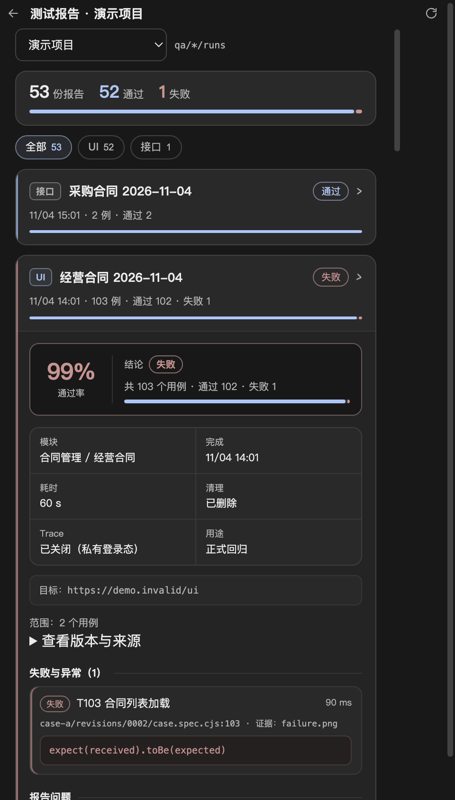

# 测试报告

测试报告是 UI 测试与接口测试共用的结果层：两种执行器写同一份 `qa-report/v1` 摘要，右侧边栏「测试报告」统一聚合展示，Agent 按 `qa-test-report` 技能交付结论。报告内容只读，不重跑、不修改脚本、不改写原始结果；可从右侧栏二次确认删除整份批次目录。

UI 的本轮功能汇总另存 `qa/ui/rounds/<roundId>/<revision>/summary.json` 和 `summary.md`，由 qa_ui_coverage 在核对来源、候选版本与业务预期引用后生成，使用 `qa-ui-coverage/v1`，不混入 `qa-report/v1` 执行批次。主流程先留档范围、持续更新，最后冻结准确版本；报告技能读取该版本交付概览、完整清单和缺项。仅探索/仅候选可直接交付这份汇总，旧回归和 API 不强制补建。结构、生成率算法、历史复用及缺数据处理统一见 [本轮清单规程](../resources/testing/ui/skills/qa-ui-basic/references/coverage.md)。本轮状态不替代执行状态，右侧报告面板未增加本轮汇总入口。

本轮清单接入的验证与已知边界见 [功能清单验收记录](ui-coverage-acceptance.md)。

## 存放位置

| 类型 | 批次目录 | `kind` |
| --- | --- | --- |
| UI | `qa/ui/runs/<runId>/summary.json` | `ui` |
| 接口 | `qa/api/runs/<runId>/summary.json` | `api` |

UI 批次由 `resources/testing/ui/run.cjs` 写入；接口测试后续由对应执行器写入同结构文件。UI 只读取新版 `browser-use-playwright` 报告，旧 UI 摘要不推断、不转换；接口旧摘要仍可读取。

## 公共字段

```json
{
  "schema": "qa-report/v1",
  "kind": "ui",
  "workflow": "browser-use-playwright",
  "purpose": "regression",
  "workspace": "/absolute/project/workspace",
  "runId": "批次编号",
  "status": "failed",
  "startedAt": "2026-11-04T06:00:00.000Z",
  "finishedAt": "2026-11-04T06:01:00.000Z",
  "targetUrl": "https://example.test/path",
  "project": { "id": "pms", "name": "项目管理系统" },
  "modulePath": ["合同管理", "经营合同"],
  "caseIds": ["case-a"],
  "revisions": { "case-a": "0002" },
  "sourceTaskIds": { "case-a": "task-a" },
  "caseModules": { "case-a": ["合同管理", "经营合同"] },
  "testCount": 1,
  "counts": { "failed": 1 },
  "cleanup": "deleted",
  "tracePolicy": "disabled-for-private-auth",
  "problems": [],
  "tests": [
    {
      "title": "业务动作 + 预期结果",
      "file": "相对路径",
      "line": 12,
      "status": "failed",
      "durationMs": 800,
      "errors": [{ "message": "断言错误摘要" }],
      "attachments": [{ "name": "failure.png", "contentType": "image/png" }]
    }
  ],
  "versions": { "node": "22.19.0", "playwright": "1.64.1", "files": [] },
  "limits": "报告边界说明"
}
```

执行器写入 `schema`、`kind`、`runId`、`status`、`startedAt`、`finishedAt`、`testCount`、`counts`、`tests`。新版 UI 另须声明 `workflow: "browser-use-playwright"`、`purpose: "validate" | "regression"`、项目编号、真实工作区、非重复 `caseIds`，以及与 caseIds 准确对应的四位字符串 `revisions` 和 `sourceTaskIds`；服务核对项目、工作区与批次目录归属后才展示。

`modulePath`（或字符串 `module`）可选，报告名称优先使用它，其次采用执行时冻结的 `caseModules`，仍无法确定时回退到 runId；不再回看旧 case 资产。接口测试可用 `tests[]` 表达接口场景，`file` 写脚本或场景相对路径。修复批次的 validate 摘要可带 `parentRunId`（该正式版本真实失败的 regression 批次）和 `patchSummary`（补丁说明）；列表显示“修复”标记，详情展示修复来源与补丁说明。隔离写批次另记录 `dataStrategy: "isolated-write"`、`dataCleanup: "in-test" | "residual"`、`writeAuthorization{kind,reference}`，声明残留时另有 `residualAuthorization{kind,reference}`；详情展示数据策略、写授权与残留授权来源。删除 UI 报告时，仍被任一修复任务引用为父批次的报告不能删除。

## 状态与通过条件

- 批次状态只使用 `passed`、`failed`、`incomplete`、`cancelled`。
- 逐例状态保留 `passed`、`failed`、`timedOut`、`skipped`、`flaky`、`expected-failure`、`cancelled`、`interrupted`、`not-run`、`unknown`。
- 只有同时满足以下条件才是 `passed`：至少一条测试；所选脚本/场景都有结果；全部实际 `passed`；退出码为 0；无原生报告缺失、证据缺失、版本变化或清理失败。
- 缺少报告、统计为空或无法确认时为 `incomplete`，测试数记为未知，不能当成零用例通过。
- 取消不冒充断言失败；断言失败不能直接推定产品缺陷，根因不明写未知。

## 右侧栏

工作台第三张卡片「测试报告」进入：

- 读取当前项目 `qa/ui/runs` 与 `qa/api/runs`，按完成时间倒序聚合；顶部摘要卡显示报告总数、通过/失败/其他批次数量及占比条，项目筛选使用紧凑宽度。
- 报告名称暂为「模块名称 + 完成日期」（如 `经营合同 2026-11-04`），同一天多次运行由卡片时间区分。
- 支持「全部 / UI / 接口」胶囊筛选；完整扫描、排序及类型筛选后每页 50 份，删除后重新读取全量统计并收敛页码。顶部统计始终为全部有效报告，不随当前页变化。每张卡片显示类型、状态、完成时间、用例数、逐例统计和通过/失败占比条。
- 展开后才读取详情；显示通过率、结论、模块/完成/耗时/清理等事实、新 UI 的候选验证/正式回归用途，以及可折叠的准确版本与来源 task。逐例结果默认折叠，每页 50 条，可返回第一页；失败总数和前 5 条摘要取自整批结果，不受当前逐例页影响。
- 失败项使用状态色条和等宽错误代码块，文件行号与证据名单独展示；通过/失败/其他比例同时出现在批次摘要、卡片和详情结论区。
- 主进程从项目解析固定路径，单份摘要限制 2 MiB，逐层拒绝符号链接，跳过隐藏目录及无效摘要。附件只返回名称与类型。列表接口为 `listTestReports(projectId, { page, kind })`，详情为 `getTestReport(projectId, kind, id, { page })`；均返回 pagination。页面核对项目和请求身份，迟到结果不覆盖当前视图。
- 报告内容只读；展开后提供「删除报告」，二次确认后删除整个批次目录，不可恢复。UI 删除通过主进程 idle 互斥和共享工作区锁，重新核对 summary/task 归属，拒绝 prepared/running、遗留锁、损坏版本索引及仍被任一 revision 的 validationRunId/validatedRunId 引用的运行；保留来源 tasks 和其他资产。接口旧批次允许无 task，但损坏或链接 task 及 running 批次拒绝删除。报告正文仍可能含业务数据。

## 本轮验证（2026-11-09）

报告服务、IPC、项目服务及共享只读工作流的 23 项定向测试通过，退出 0。覆盖 205 批完整排序筛选分页、103 条结果分页及全批失败摘要、UI 新契约与 API 兼容、归属/链接/大小拒绝、共享锁、验证引用及删除保留任务。共享工作流使用离线模型协议夹具和受控本地 Chromium，无真实模型请求。

独立 Electron 报告页面 18 项断言通过，退出 0，覆盖列表与逐例翻页、用途/版本/来源、迟到请求、删除确认和统计刷新、焦点及无横向溢出。首次页面检查因夹具错误触发焦点刷新而超时，修正触发方式与失败退出码后完成一次恢复验证；Chromium 缓存日志仍未解决，详见 [异常记录 E、G](browser-use-readonly-workflow.md)。



## Agent 交付

Agent 在 UI 或接口批次结束后加载 `qa-test-report`，按以下顺序交付：

1. 结论与统计：批次状态、通过/失败/跳过、是否满足通过条件。
2. 范围：项目、地址、角色、caseId/接口场景、runId。
3. 失败与异常：逐例状态、失败步骤、原始错误摘要、证据位置。
4. 清理与限制：私有登录态、测试数据或外部副作用的清理状态；未知和失败必须披露。
5. 证据与版本：summary/summary.md/manifest、原生结果、Node/Playwright 版本和清单覆盖范围。
6. 未覆盖：未执行场景、被测部署版本未知和依赖闭包边界。

## 调研与能力对照

测试报告常见能力分层、GitHub 高星项目对照与本轮布局优化说明见 [测试报告项目调研与能力梳理](test-report-research.md)。

## 安全

- 不写入账号、密码、token、cookie、私有登录态或完整敏感响应。
- 报告、截图和错误信息可能含业务数据；只把可公开的必要片段写进结论。
- 页面和模型都不能直接指定任意报告路径；报告服务从项目工作区解析固定目录并校验边界。
