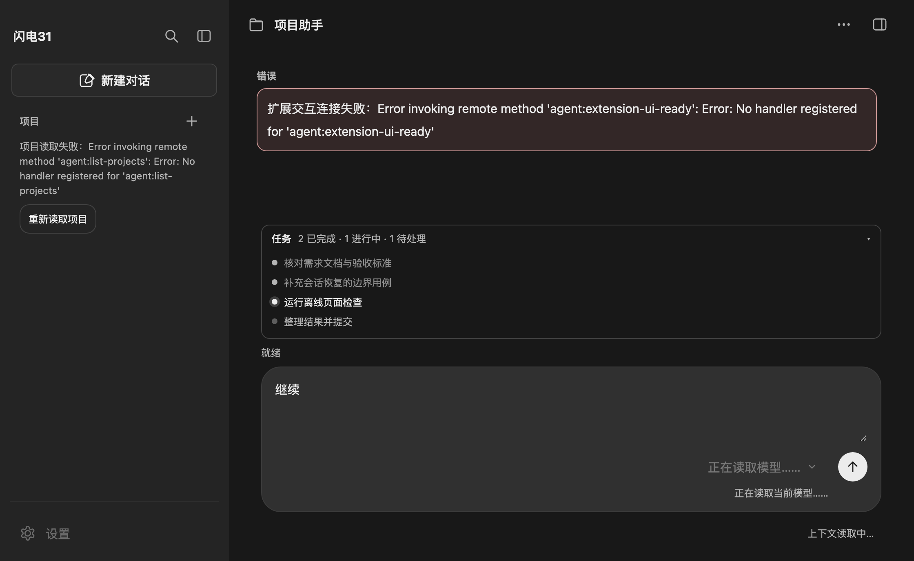

# 任务清单：todo_write 与任务栏

模型在多步工作中维护一份可见的任务列表：每次调用 `todo_write` 整表替换，页面在输入框上方显示当前清单和进度。清单不写入会话之外的存储，切换会话时按历史重建，新对话清空。



图中为离线渲染的演示数据，不是真实模型输出。

## 工具

`src/main/tools/todo-write.mjs` 通过公开的 `defineTool` 定义，随 `createAgentSession({ customTools })` 追加注册：

- 参数为 `{ todos: [{ content, status }] }`，`status` 只接受 `pending`、`in_progress`、`completed`。
- 每次提交完整列表，空数组表示清空。
- 内容为空或重复时返回明确错误，不写入清单。
- 成功结果是各状态计数文本，`details.todos` 保存去除首尾空白后的清单，供页面读取。
- `customTools` 只追加，不替换 Pi 原生工具；`tools`、`excludeTools` 与 `defaultTools` 的既有语义不变。

## 数据链路

| 环节 | 行为 |
| --- | --- |
| 主进程投影 | `output-event-adapter` 只从结果 `details.todos` 取 `content` 与 `status`，不把 `details` 或 `structuredContent` 整体送到页面 |
| 实时 | `tool_execution_end` 的结果携带 `todos`，页面收到后更新任务栏 |
| 历史 | 工具结果消息保存 `details`，重新打开会话时按顺序取最后一条有效清单 |
| 页面 | `createTodoDock` 渲染在输入框上方；有清单才显示，默认折叠；进度按状态汇总，零计数不显示 |

任务栏与消息流共用同一次会话读取，不新增 IPC 通道，也不额外请求模型。清空、失败调用和没有 `todos` 的工具结果不改变当前清单。

## 交互

- 点击标题行展开或收起；展开状态不持久化，切换会话后恢复折叠。
- 状态点区分待处理、进行中、已完成；面板列出任务顺序与进度，不提供就地编辑，修改仍由模型通过下一次 `todo_write` 完成。
- 清单较长时列表内部滚动，不挤占输入框。

## 验证

```sh
node --test tests/unit/todo-write.test.js tests/unit/todo-projection.test.js
node_modules/.bin/electron tests/ui/output-trace.check.cjs
```

- 单元检查覆盖计数、空列表、空内容/重复拒绝、参数 schema 与历史投影取最后一条。
- 页面检查覆盖：实时流程没有 `todo_write` 时任务栏隐藏；历史中的清单重建进度与条目；默认折叠与展开后的 `aria-expanded`。
- 以上为离线自动检查，未使用真实模型验证自然语言触发 `todo_write` 的频率或效果。
