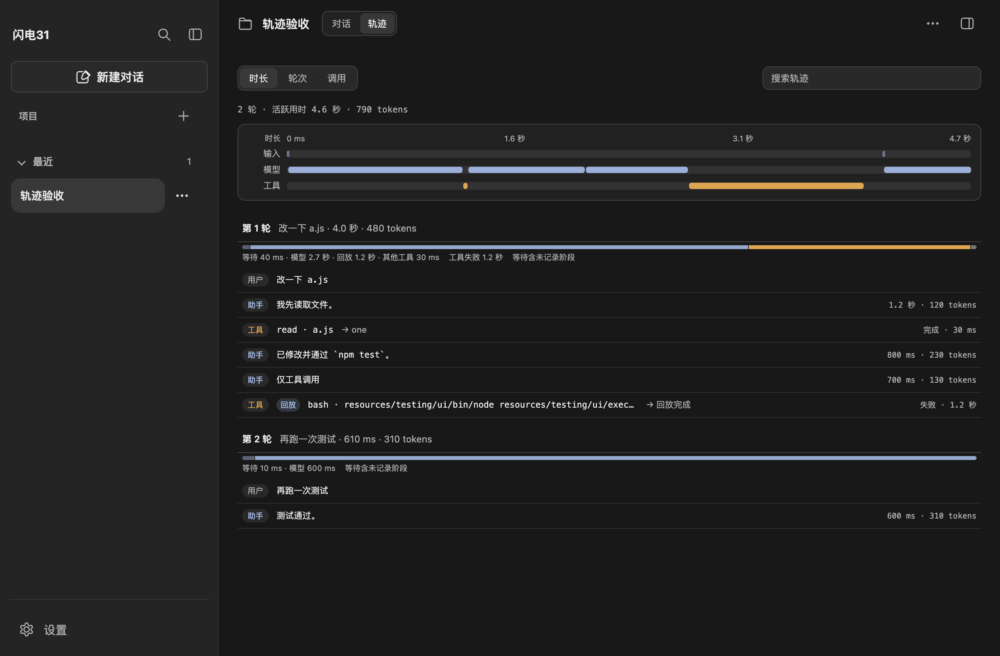
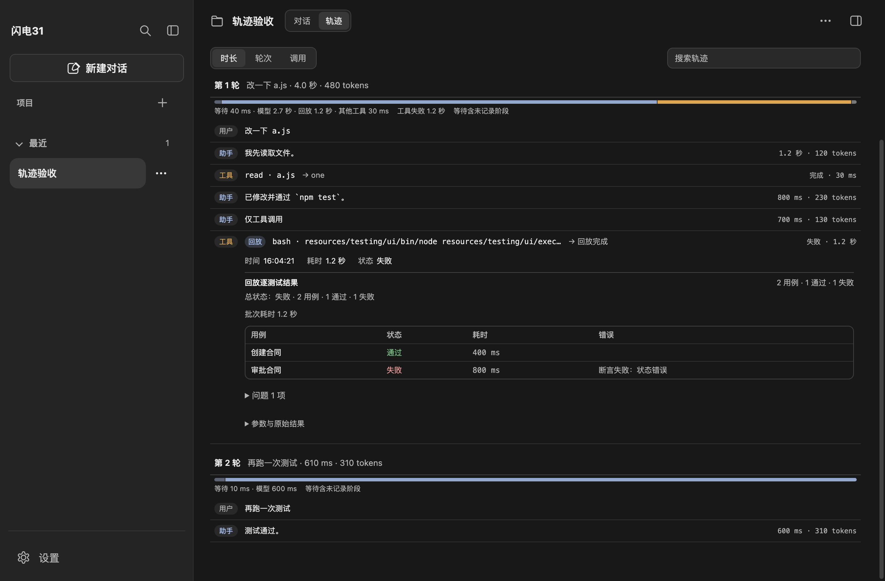
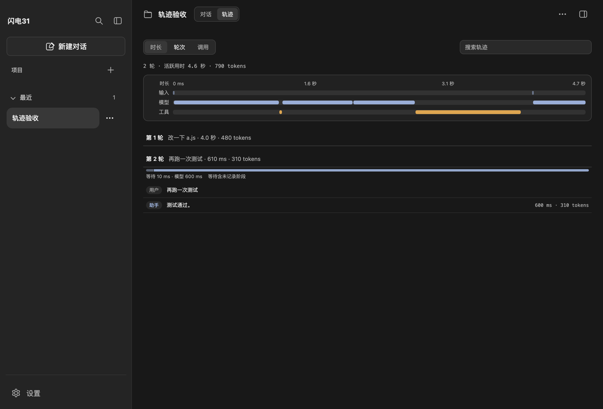
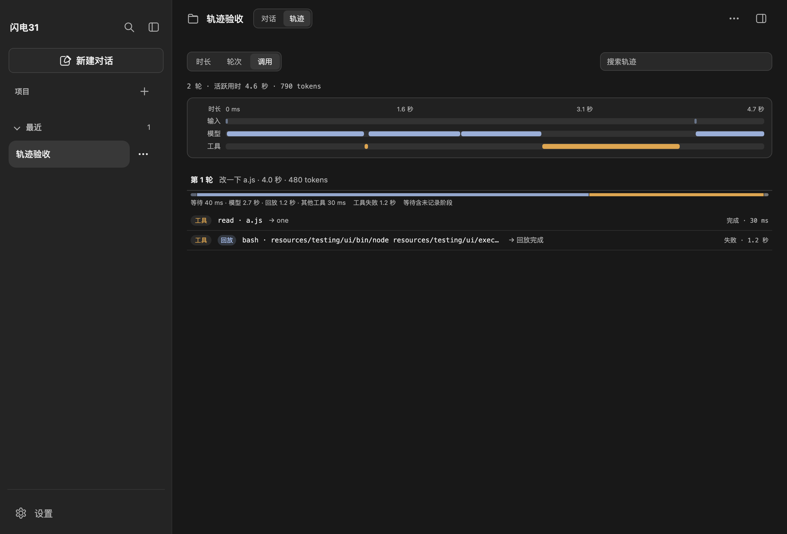

# 运行轨迹

对话头部的「对话 / 轨迹」切换进入运行轨迹。轨迹按用户消息分轮，显示时长概览、用户/助手/工具记录、耗时与 token，支持搜索和展开详情。只读取 Pi 历史与实时输出事件，不请求模型、不重新执行工具、不改动 Pi 历史。



## 数据来源

- **历史**：`toHistory(..., { includeTrace: true })` 在保留消息的同时带上 Pi 的时间戳（`ts` 毫秒或 `timestamp` ISO，统一转为毫秒）和 `durationMs`。打开会话、切换会话或新建对话后重建轨迹。
- **实时**：发送时开始一轮，接收 `message_end`（助手正文/思考/用量）、`tool_execution_start/end`（运行中与结果）、`steer_delivered`（插话）、`auto_retry_*`、`compaction_*` 和 `agent_settled`。
- 没有时间戳的旧历史仍显示记录与时长，但隐藏时间轴并明确提示。

## 功能

- **时长概览**：输入/等待、模型、工具三行，按真实开始时间在会话时间轴上画条；悬停显示记录名称、开始时刻与耗时。时间轴刻度为相对会话首条记录的时间。
- **每轮耗时构成**：在轮次标题下用堆叠条展示等待、模型、回放、其他工具、重试、整理；同时标出工具失败耗时。实时请求能区分重试和整理；历史只能从消息间隔推算等待，队列、审批和重试可能混在等待里，界面会标注「等待含未记录阶段」。
- **三种视图**：
  - 时长：全部记录按时间顺序展示，带轮次分隔。
  - 轮次：按用户消息分组，可折叠每一轮。
  - 调用：只列工具调用，适合核对命令与结果。
- **记录详情**：展开工具记录查看参数、结果、状态、耗时与技能标记；展开助手记录查看正文、思考过程、模型与 token；用户与状态记录也可展开原文。
- **回放逐测试统计**：回放命令的工具结果里带有 `summaryFile` 时，展开记录会按需读取同一批次 `summary.json`，列出每个测试的耗时、状态和错误，并显示批次通过/失败数。路径由主进程校验，只允许当前工作区 `qa/ui/runs` 或 `qa/api/runs` 下的 `summary.json`。即使工具展示文本被 4000 字截断，适配器也会从完整结果中保留 `summaryFile`，不影响统计。
- **定位与滚动**：点击时长概览里的条或轨道空白处，会自动切回时长视图、清除搜索、滚动到对应记录并展开高亮；输入/等待条对应该轮首条记录，模型/工具条对应具体记录；点击轨道空白处定位横坐标最近的记录。轨迹停在底部时实时跟随最新记录，上翻后暂停并出现「回到最新」按钮；轮次视图默认展开最新一轮，旧轮收起。
- **搜索**：按用户文本、工具名、参数、结果与思考内容过滤；搜索在页面内完成，不请求主进程。
- **实时**：工具开始时显示「运行中」，结束后补结果与耗时；停止或收尾时仍未结束的工具标记「结果未确认」。助手记录在响应结束后出现。







## 与 DSH 轨迹对比

对照对象为本机 DSH `0.2.1-rc.5` 的 `dsh-client-ui-trajectory` 源码、包内 README 与界面截图；未逐项运行 DSH 交互。DSH 的轨迹是对话视图环中的独立标签页，基于会话事件投影、虚拟化记录表和交互式时间概览。本项目 P1 的目标是复用同一信息结构，不照搬 React 组件。

| 能力 | DSH | 本项目 | 结论 |
| --- | --- | --- | --- |
| 入口 | 对话视图环的「轨迹」标签 | 对话头部「对话/轨迹」切换 | 等价 |
| 时间概览 | 输入/模型/工具，按真实时间投影；TTFT 与解码分段；悬停详情、拖选过滤、滚轮缩放、右键清除/平移 | 输入/模型/工具三行，按 `ts`/耗时画条；每轮另加等待/模型/回放/其他工具/重试/整理的堆叠构成；悬停提示；点击条或轨道空白处定位记录；无 TTFT 分段、拖选与缩放 | 部分实现 |
| 耗时构成 | 时间条与检查器提供分段时间；不区分 QA 回放 | 每轮堆叠条与图例；实时区分重试/整理，历史标注未记录阶段；回放与工具失败单列 | 项目增量 |
| 记录表 | 按轮次/步骤组织，用户、助手、工具、嵌套子工具、压缩记录；虚拟化与分页 | 按用户消息分轮，用户、助手、工具、状态记录；无分页/虚拟化 | 部分实现 |
| 时长/轮次/调用 | 顶部切换记录组织方式 | 三种视图切换 | 等价意图 |
| 记录检查器 | 选中记录打开侧栏检查器，显示 token、耗时、输入/输出、图片与附件 | 行内展开：参数、结果、正文、思考、usage、父子调用；回放记录额外列出逐测试耗时/错误 | 部分实现（回放统计为 QA 业务增量） |
| 搜索 | 过滤可见记录 | 按文本/参数/结果/思考过滤全部已载入记录 | 实现，范围更大 |
| 实时 | 开始即出现记录；流式中跟随尾部；不虚构耗时 | 工具开始即出现；助手在 `message_end` 出现；未结束工具标未确认 | 部分实现 |
| 历史 | 会话事件投影，分页加载更早记录；图片、附件、压缩区段 | Pi 消息历史，带 `ts` 与耗时；最多 500 条；无图片/附件 | 部分实现 |
| 嵌套工具 | 父子树与折叠 | 平铺记录，父调用 id 出现在详情 | 差异 |
| 压缩/重试 | 独立区段与轮次内编号 | 作为状态记录 | 近似 |
| 尾部跟随 | 初始与流式更新停留尾部；上翻暂停，回到尾部恢复 | 打开与底部更新跟随最新；上翻暂停并显示「回到最新」；旧轮次收起 | 等价 |
| 回放逐测试统计 | 无 QA 回放业务概念 | 读 `summary.json` 展示逐测试耗时/状态/错误 | 项目增量 |
| 时间轴交互 | 拖选、缩放、平移、跟随尾部 | 点击条定位记录；无拖选、缩放、平移 | 部分实现 |
| 附件与图片 | 记录检查器展示图片和附件摘要 | 不展示 | 未实现 |

### 判断

- **已实现正确的信息结构**：同样的「对话/轨迹」入口、时长/轮次/调用三种视角、输入/模型/工具时间概览、按轮次的用户/助手/工具记录、搜索、耗时与 token、实时工具状态、历史时间戳。
- **没有照搬 DSH 的交互重件**：时间轴的拖选/缩放/平移、TTFT 与解码分段、虚拟化分页、图片/附件检查器、嵌套工具树。已补的是点击时间条定位记录和尾部跟随/回到最新。这些是 DSH 轨迹中体量最大、最依赖其事件投影和 React 运行时的部分。
- **数据口径不同**：DSH 使用会话事件投影；本项目使用 Pi 消息与实时 SDK 事件。两者都能还原每轮开始/结束和工具耗时，但本项目没有 Pi 之外的会话事件，压缩/重试只能作为状态记录。
- **实时细节差异**：助手记录在 `message_end` 才出现，没有 DSH 的「生成中」占位和 TTFT；工具记录有开始/结束两阶段。旧历史缺少 `ts`/`timestamp` 时不画时间轴。
- **回放统计是本项目增量**：DSH 轨迹不包含 QA 用例回放业务；本项目从回放命令输出的 `summaryFile` 读取 `summary.json`，只展示逐测试总耗时/状态/错误，不解析 Playwright trace，因此回放内部的等待/动作拆分仍未实现。

## 实现入口

| 位置 | 职责 |
| --- | --- |
| `src/renderer/components/trajectory-model.js` | 历史/实时投影为请求与记录，计算等待/模型/工具/重试/整理构成 |
| `src/renderer/components/trajectory-view.js` | 时长概览、三种视图、搜索、详情、回放统计与定位滚动 |
| `src/main/services/replay-stats-service.js` | 校验并读取 `qa/{ui,api}/runs/**/summary.json` |
| `src/main/ipc/agent-ipc.js`、`src/preload/preload.js` | 回放统计只读接口 |
| `src/renderer/renderer.js` | 对话/轨迹切换、发送与输出事件接入 |
| `src/main/adapters/output-event-adapter.js` | 保留助手/工具消息的时间戳，并从完整工具结果提取回放 `summaryFile` |
| `src/main/adapters/message-adapter.js` | 追踪历史时保留用户与状态记录的 `ts` |
| `src/renderer/index.html`、`styles/trajectory.css` | 标签页、轨迹视图与样式 |

## 验证

```sh
node --test tests/unit/trajectory-model.test.js tests/unit/message-adapter.test.js tests/unit/replay-stats-service.test.js
node_modules/.bin/electron tests/ui/trajectory.check.cjs
```

页面检查覆盖：对话/轨迹切换、隐藏输入区、时长概览三行与时间轴、每轮耗时构成、轮次/调用视图、搜索、工具详情、回放逐测试统计、点击时长条/轨道定位、跟随/回到最新、实时请求进入轨迹、切回对话，以及 680/375 窄窗无页面级横向溢出。全量单元回归 792 项通过。截图由该检查生成。

边界：手机窄屏未单独验收；真实模型下的长会话、图片附件和旧历史时间戳缺失尚未人工验收；自动检查使用模拟历史与事件，不请求模型。
