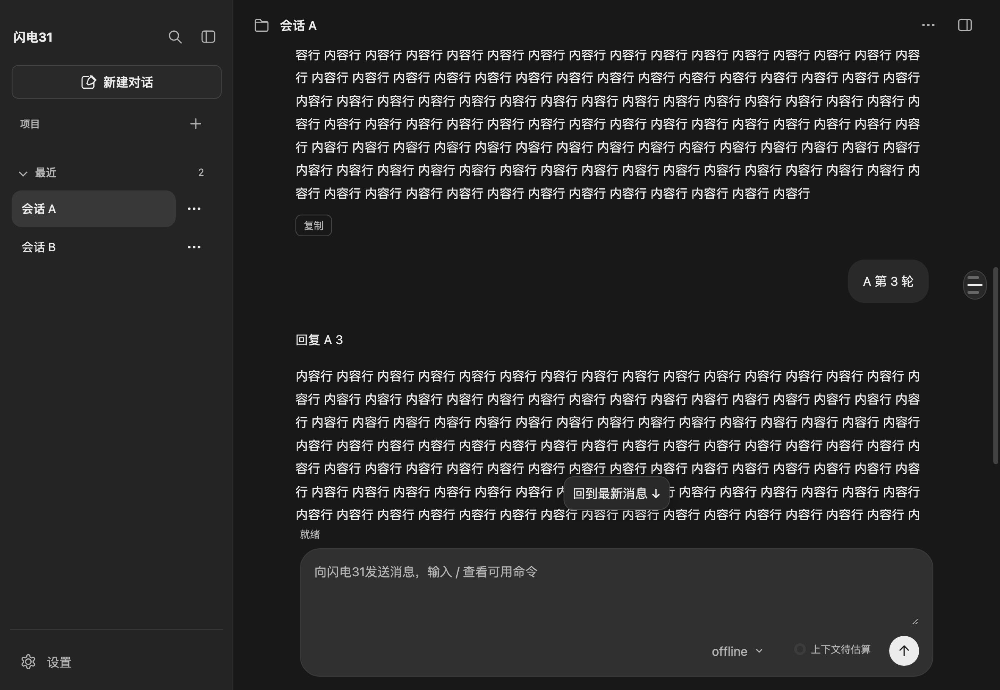

# 轮次导航与阅读位置

2026-11-04：消息区轮次导航轨与按会话的阅读位置恢复。

## 使用

- 消息区右缘的轮次导航轨按用户消息生成标记，**≥2 轮**时出现；悬停显示「第 N 轮：首行」，点击跳转到该轮开头。
- 滚动时高亮当前轮：已在底部时跟随最新一轮，上翻时按视口顶部所在的轮次高亮。
- 切换会话（含项目切换、未发送恢复、新建对话）时按会话保存滚动偏移与是否跟随最新；切回时恢复，不再强制回到最新。
- 窄于 640px 隐藏导航轨；「回到最新消息」按钮保持原行为。

## 实现

- `src/renderer/components/turn-rail.js`：只读取已有用户消息节点，不参与历史渲染或发送；`refresh()` 在历史渲染和新增用户消息后重建标记。
- `src/renderer/components/message-scroll.js`：新增 `restore()` 与 `isFollowing()`；位置越界时夹到有效范围。
- `src/renderer/renderer.js`：`readingPositions` 按会话保存 `{ top, following }`；`showHistory(history, sessionId)` 渲染后恢复，`openUnsentSession` 显式传入新会话编号；历史布局稳定后再校正一帧。

## 验证

- `tests/ui/turn-rail.check.cjs`：历史渲染生成 3 个标记、底部跟随最后一轮、点击首条标记回到顶部、滚到 600px 后切到另一会话再切回恢复位置。
- 回归：`output-trace`、`send-queue`、`file-reference`、`context-usage-page`、`sidebar-layout` 均通过。

## 边界

- 阅读位置只存在页面内存，关闭应用后不恢复；只恢复滚动偏移，不恢复选区、草稿或未发送内容。
- Markdown 排版在渲染后仍有异步变化时，恢复位置可能有几像素偏差，下一帧会再校正一次。
- 轮次以用户消息为界；没有用户消息的历史不显示导航轨。
